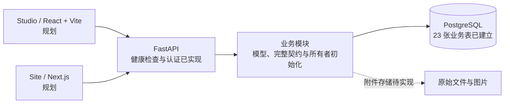
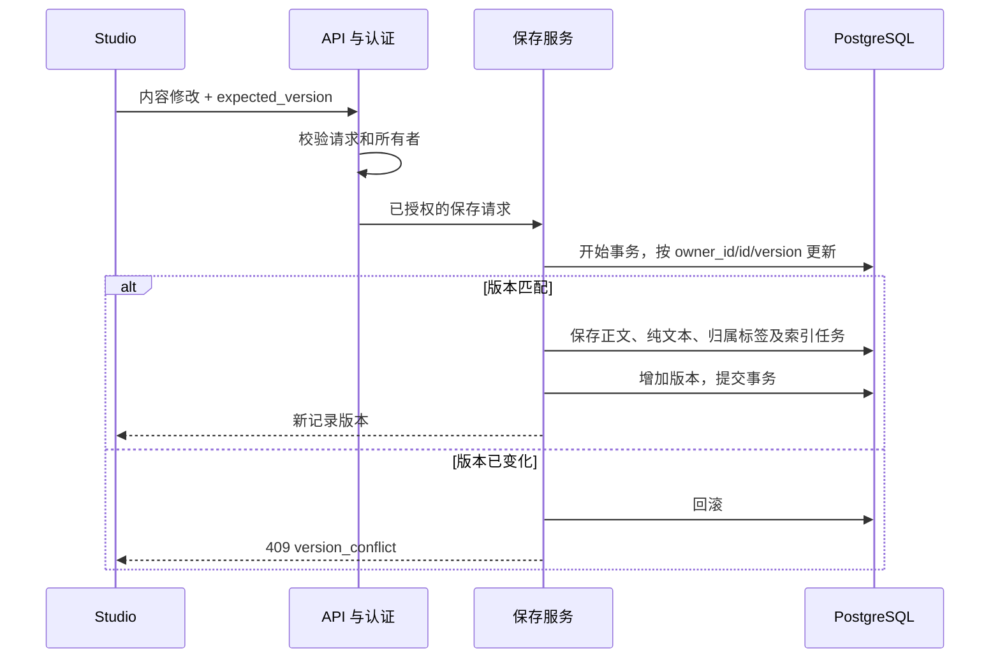
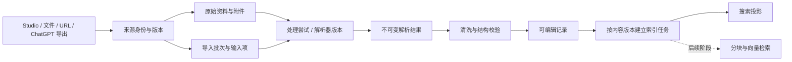

# 系统设计

灵脑由私人 Studio、公开 Site 和共用后端组成。当前已实现数据库与后端基础，前端仍为静态原型；下图同时标出已实现和规划部分。



## 技术选择

| 部分 | 技术 | 选择理由 |
| --- | --- | --- |
| Studio | React + Vite | 私人工作台以交互、编辑和客户端状态为主 |
| Site | Next.js | 后续承接公开阅读、路由与 SEO |
| API | FastAPI + Pydantic | 请求校验、依赖注入与 OpenAPI |
| 配置 | pydantic-settings | 环境变量解析、类型校验及生产边界 |
| 持久化 | PostgreSQL + SQLAlchemy 2.x + psycopg 3 | 统一事务、约束、类型化模型与 PostgreSQL 能力 |
| 密码哈希 | pwdlib[argon2] / Argon2id | 使用成熟实现生成与验证哈希 |
| 迁移 | Alembic | 显式版本化升级，不在应用启动时自动建表 |
| 开发工具 | uv、Ruff、mypy、pytest | 锁定依赖、格式检查、类型检查与自动化测试 |
| 部署 | Docker / Compose | 后续复用部署配置，当前本地直接运行 |

## 代码组织

```text
backend/
├── app/
│   ├── main.py                 # 应用工厂与资源生命周期
│   ├── core/config.py          # 开发、生产配置校验
│   ├── api/                    # 公共依赖、健康检查、错误格式与完整业务契约
│   ├── db/                     # 共享 Base、模型注册、连接和事务
│   └── modules/
│       ├── accounts/           # 账号与会话
│       ├── content/            # 记录、正文、关联、来源引用、索引任务
│       ├── organization/       # 空间、分类、标签
│       ├── attachments/        # 文件元数据与记录附件关系
│       └── ingestion/          # 来源版本、导入批次、处理尝试与解析结果
├── migrations/                 # Alembic 版本
├── scripts/                    # 所有者初始化、契约导出、空库迁移验证
└── tests/
```

模块按业务领域划分，共享一个 Declarative Base。跨模块外键通过表名关联，app/db/models.py 统一注册，避免循环导入。新增 router、service、schemas 等文件随功能引入，不提前铺空目录。

所有者初始化由 scripts/init_owner.py 交互入口、accounts/schemas.py 输入校验及 accounts/service.py 事务用例组成。哈希计算在事务外进行，事务内锁定 users 表并检查空表，再插入账号；提交成功后返回不含密码哈希的结果。登录、刷新、当前用户与退出接口已实现，认证事务在 accounts/auth_service.py，HTTP 适配在 accounts/router.py，JWT 和限流在 accounts/security.py。

## 请求与事务

应用工厂读取配置；lifespan 创建 Engine 和 Session 工厂，关闭应用时释放连接池。导入模块不创建数据库连接。

请求依赖只创建和关闭 Session，不隐式提交。业务用例显式管理事务：成功提交，异常回滚。当前使用同步 psycopg 3，同步数据库路由放在线程池执行，不直接阻塞 async 事件循环。

记录保存的目标流程如下，业务路由和服务尚未实现：



- owner_id 来源于有效会话，不接受客户端指定。数据库复合外键是关联防错，不能替代查询和接口权限检查。
- 正文、plain_text、version、updated_at 和对应索引任务同事务保存，数据库不会自动维护这些业务字段。
- JSONB 更新赋予新值；当前未配置嵌套 JSON 原地修改追踪。
- 版本号只用于并发控制，不提供编辑历史恢复。
- 外部文件写入不能与 PostgreSQL 共用事务，使用上传状态、失败重试和孤儿清理协调。

请求与响应见 [API 契约](API.md)，字段、外键和索引见 [数据库设计](DATABASE-DESIGN.md)。

## 内容采集

主动记录和外部导入遵循统一来源契约，保留所有者、输入类型、幂等标识、原始时间、载荷引用和权限。Studio 输入可以同步保存；普通编辑不重新跑外部解析。



| 数据 | 职责 |
| --- | --- |
| Source / SourceVersion | 来源身份、输入版本、原始时间和校验摘要 |
| RawAsset / Attachment | 文件、JSON 或网页快照及其内部存储引用 |
| ImportJob / ImportItem | 批次与单项状态，允许部分成功 |
| IngestionRun | 每次尝试的解析器、版本、配置、阶段、错误与租约 |
| NormalizedDocument | 某次处理生成的规范结果，与用户正文分开 |
| Content / ContentBody | 用户可修改的笔记，以 Tiptap JSON 为正文权威格式 |
| ContentSource / IndexJob | 原文引用及可重建的搜索投影任务 |

原始资料和解析结果不随用户编辑改写。重新导入创建输入版本，重新处理创建新尝试；已有笔记先产生候选结果，经用户确认并校验当前版本后应用，不静默覆盖。

幂等请求复用结果，部分失败保留原件与成功项。接收文件与解析完成分别反馈；URL 不能一概用作全局唯一键，外部身份规则按适配器确定。适配顺序为 Markdown/附件、URL、ChatGPT、DOCX/PDF；解析器在接入前验证许可与资源消耗。

索引任务按内容版本领取，租约 token、到期时间与状态同时更新。完成前复查 token、到期时间和内容版本，旧结果不能覆盖新版。删除记录后旧任务不能重新暴露内容，引用归零的文件才允许回收。

采集执行器验收应覆盖：输入重试与中断不重复生成、解析升级保留旧版本、重新导入识别变化、部分失败和缺失附件有反馈、编辑与重解析并发冲突、删除后的索引和引用清理。

Site 发布阶段须分别保存私人编辑内容与上次成功发布的公开版本。普通自动保存只更新私人记录；所有者预览并执行「更新发布」后才替换公开版本。公开查询从已发布版本读取，不能直接返回当前编辑正文。公开版本及其附件范围的持久化结构在 Site 阶段设计。

V1.0 Release 提供人工思考主题与成员关系。主题引用现有记录，支持多主题归属和按时间回看，默认私有。对应模块、表与接口尚未实现，不将普通关联图作为主题对象替代。中英文界面、响应式阅读和基础编辑由正式前端承接，用户原文不自动翻译。

## 认证与会话

业务接口使用 JWT Bearer Access Token，Web 端仅在内存持有。随机 Refresh Token 保存到 HttpOnly Cookie，服务端保存哈希及会话状态，刷新时原子轮换。JWT 包含会话标识，业务请求验证 JWT 并检查会话有效性，以支持退出即时失效和改密码撤销全部会话。

刷新使用 Cookie，Access Token 过期不影响刷新操作。登录、刷新及 Cookie 退出校验请求来源，Cookie 的 Secure、SameSite 和作用路径按 API 规格配置。前端通过单次刷新协调和跨标签页同步避免并发重用刷新令牌。未来 App 使用系统安全存储。Access Token 默认 15 分钟，刷新空闲期 7 天，单次会话最长 30 天；通过环境配置调整。

当前已实现所有者登录、HS256 JWT 签发与严格校验、刷新轮换和会话撤销；密码修改和管理员重置仍待实现。生产必须提供稳定随机签名密钥，开发默认使用进程临时密钥。持久化采用 sessions 管理会话与撤销，refresh_tokens 保存历史摘要和前序关系；字段、约束、轮换事务及迁移规则见 [数据库认证设计](DATABASE-DESIGN.md#20-双令牌认证设计)。该结构已通过 9c3d8a1f6b20 迁移建立，四个认证接口已接入。限流采用有容量上限的单进程内存计数，当前单 worker 运行，扩为多实例前使用共享计数。

## 安全与部署边界

私人数据默认不公开。Site 仅通过专用公开响应读取明确发布的字段，不能复用后台完整数据对象。撤回必须清理公开列表、搜索、缓存、关系和附件访问。

网页抓取检查协议、解析 IP 和每次重定向，禁止访问内网与元数据服务；限制超时、响应大小和递归附件。导入 HTML 清洗后转换。保留布局的 HTML 文件通过独立隔离容器展示，正文只保存附件引用和展示配置。具体隔离方式、脚本及外部资源权限在实现前确定，嵌入不能访问应用凭据或私人数据。保留原件不等于禁止用户永久删除。

开发和测试共用本地 luma_dev，数据库用例回滚写入；生产使用独立库，先在本机正式使用，再迁云。APP_ENV 只分 development、production，生产不读取本地 dotenv。生产账号实际权限由数据库配置，不能只依赖账号名称检查。

部署与迁移是显式步骤，健康检查只检测进程和数据库连接。当前无生产库、生产 Compose 或自动发布流水线；具体操作见 [开发指南](../development/DEVELOPMENT.md)。

## 待确定

- 记录请求及文件上限。
- 是否增加 RLS、生产 PostgreSQL 版本、连接池规模、附件存储、备份恢复与中文检索性能目标；本机已在 PostgreSQL 16.14 验证。
- 采集 worker 的进程组织、解析库版本和复杂文件转换约束。
- 未来连接器的游标、外部删除标记与授权撤回；未来 RAG、Memory、Agent 不提前创建整套物理表。

工程参考：[FastAPI 官方模板](https://github.com/fastapi/full-stack-fastapi-template) 的配置、Session 依赖、迁移与契约生成；[FastAPI Best Practices](https://github.com/zhanymkanov/fastapi-best-practices#project-structure) 的领域模块划分。保留本项目的 SQLAlchemy 模型和组合事务，不直接复制模板的业务及测试数据清理方式。
