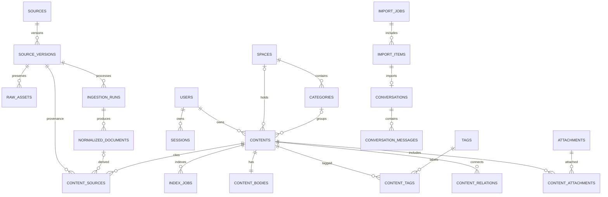
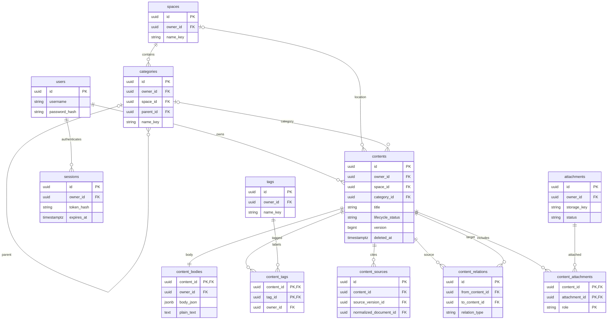
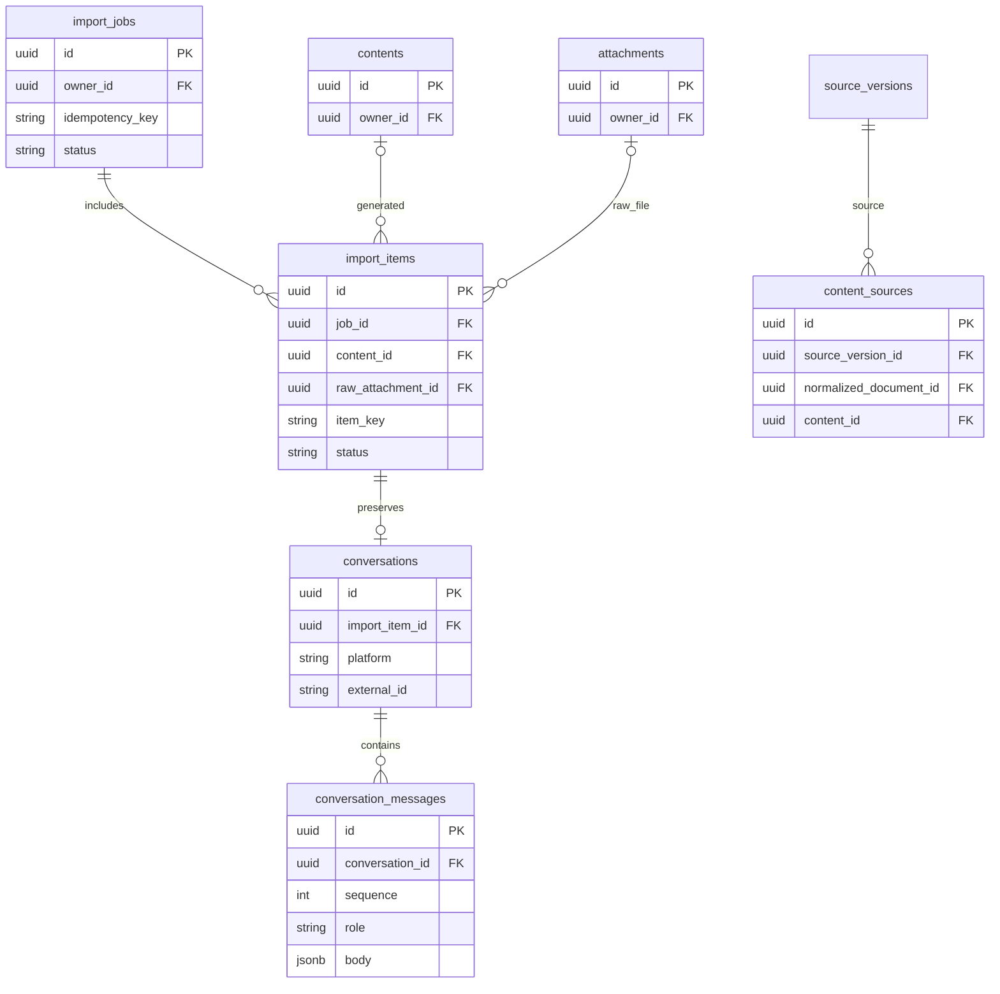
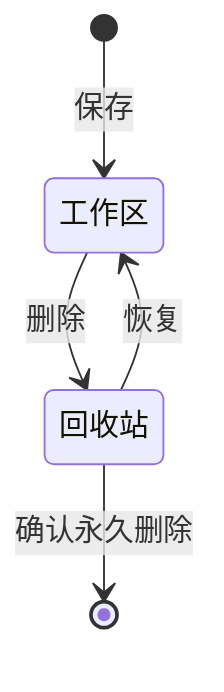
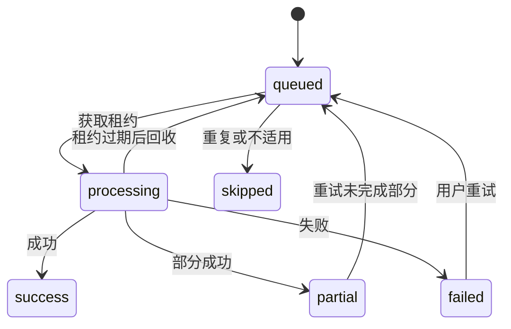
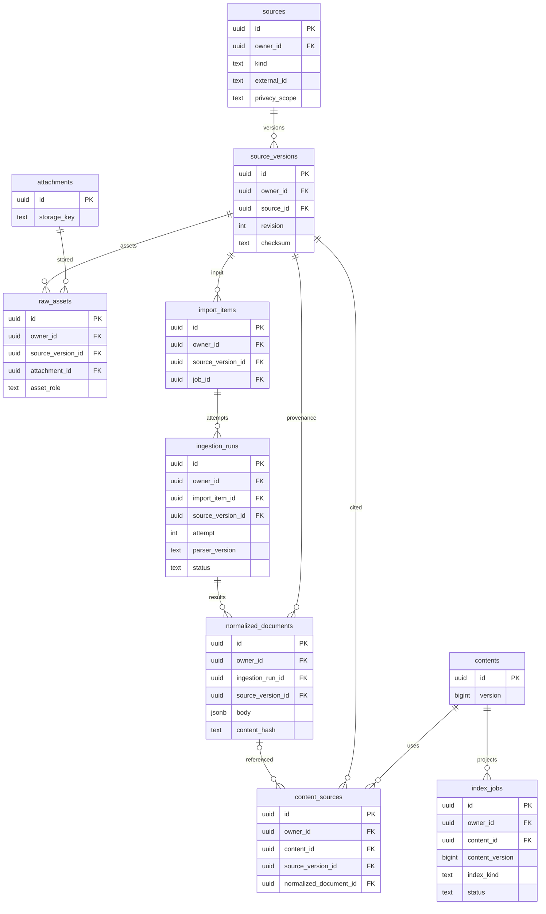
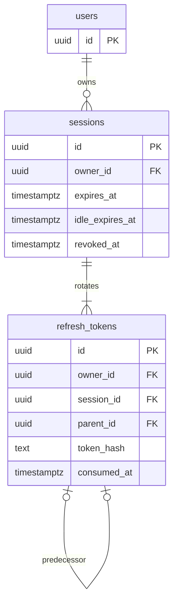

# 首阶段数据库设计

更新于 2026-11-27。依据 [PRD 的记录与组织规则](../product/PRD.md#记录与组织)。22 张业务表已通过 SQLAlchemy 模型与 Alembic 迁移在本地 PostgreSQL 16.14 的 luma_dev 中建立。

> 本文按 [系统架构](ARCHITECTURE.md) 的统一采集模型维护。模型实现见 backend/app/modules/*/models.py，由 backend/app/db/models.py 统一注册；迁移见 backend/migrations/versions/；运行命令见 [开发指南](../development/DEVELOPMENT.md)。表结构通过验证不代表业务 API、导入执行器和搜索功能已经实现。

> 第 1–19 节记录当前已建结构，第 20 节定义下一次认证迁移的目标结构。当前仍为 22 张业务表，认证目标结构尚未迁移。

> 产品已取消学习状态和学习中心。现有 `learning_state` 字段暂保留，后续迁移统一清理。

> 产品已取消归档。现有 lifecycle_status 及 archived 检查值暂时保留，本表结构描述不代表仍提供归档功能；后续业务不开放归档入口，是否清理字段在迁移时评估。

## 1. 范围与技术

采用 PostgreSQL、SQLAlchemy 2.x、psycopg 3、Alembic。首阶段单所有者，保留 owner_id。正文使用 Tiptap JSON，Markdown 导入导出。取消收集箱，不接 AI。编辑历史恢复待定。

首批闭环覆盖登录、创建、保存、列表、编辑、目录标签、搜索、回收站。来源、原件与处理版本纳入采集基础，适配器按 Markdown、附件、URL、ChatGPT、DOCX/PDF 顺序实现。V1.0 Release 需增加人工脉络主题与成员关系的物理设计和迁移，当前 22 张表尚未覆盖该能力。Site 发布版本、自动建议、Memory 和 Agent 按对应阶段设计。

## 2. 关系

关联表的 from_content_id、to_content_id 都指向 CONTENTS。owner_id 约束在所有业务归属关系上执行，图中省略重复连线。

## 3. 通用约定

- 表与字段用 snake_case。实体主键使用 UUID，由服务端生成；原型旧 ID 通过迁移映射保留引用关系。创建重试使用客户端 request_id 作为幂等标识，与服务端生成的记录主键分开。
- 时间采用 timestamptz，数据库连接时区设置为 UTC，界面按用户时区显示。
- 可变主实体包含 created_at、updated_at，默认数据库当前时间；updated_at 由写事务明确更新。六张采集基础表按追加记录保存，仅含 created_at，详见第 19 节。
- 所有业务实体 owner_id 必填。每个可被关联实体提供 UNIQUE(owner_id, id)，跨表引用用包含 owner_id 的复合外键，防止跨所有者关联。
- 可选关系使用 NULL，空字符串不表达无归属。名称去除首尾空白，业务校验非空；同名规则通过 name_key 的规范化策略统一。
- 有限状态使用 text 加 CHECK，避免首阶段为枚举变更引入额外复杂度。长度与文件上限由接口契约统一校验，精确值待确认。

## 4. 核心表数据字典

下列字段未标可空则必填。UUID 主实体包含上一节的时间字段，连接表按说明设置。

| 表 | 核心字段及类型 | 约束与职责 |
| --- | --- | --- |
| users（用户表） | id uuid PK、username text、password_hash text、display_name text、disabled_at timestamptz 可空 | lower(username) 唯一，密码仅保存安全哈希。单所有者由初始化流程控制，未来账号扩展不修改内容归属模型。 |
| sessions（登录会话表） | id uuid PK、owner_id uuid、token_hash text、expires_at timestamptz、revoked_at timestamptz 可空 | token_hash 唯一；随机会话令牌只保存哈希。登录有效性与过期策略由认证设计确定。 |
| spaces（知识空间表） | id uuid PK、owner_id uuid、name text、name_key text、description text 默认空、sort_order integer 默认 0 | UNIQUE(owner_id,name_key)。 |
| categories（目录分类表） | id uuid PK、owner_id uuid、space_id uuid、parent_id uuid 可空、name text、name_key text、sort_order integer 默认 0 | 父分类必须同所有者同空间，使用复合外键。根分类与同父分类分别建立唯一索引。禁止自引用，移动事务检查循环。 |
| contents（记录主表） | id uuid PK、owner_id uuid、create_request_id uuid、create_request_hash text、title text 默认空、content_type text 可空、space_id uuid 可空、category_id uuid 可空、learning_state text 可空、lifecycle_status text 默认 active、version bigint 默认 1、deleted_at timestamptz 可空 | lifecycle_status 仅 active/archived，version 大于 0；内容类型使用稳定代码校验；learning_state 为已取消能力的遗留字段。category_id 有值时 space_id 必填，且复合外键保证分类属于该空间。 |
| content_bodies（记录正文表） | content_id uuid PK、owner_id uuid、body_json jsonb、plain_text text、schema_version integer 默认 1、updated_at timestamptz | 与内容一对一，删除内容时级联删除。JSON 顶层为 object 且 type=doc；节点白名单、非空正文和导出支持情况在服务端校验。plain_text 从 JSON 同步生成。 |
| tags（标签表） | id uuid PK、owner_id uuid、name text、name_key text | UNIQUE(owner_id,name_key)，规范化避免重复标签。 |
| content_tags（记录与标签关联表） | owner_id uuid、content_id uuid、tag_id uuid、created_at timestamptz | PK(content_id,tag_id)，两端同所有者。连接行随任意一端永久删除而级联删除。 |
| content_relations（记录关系表） | id uuid PK、owner_id uuid、from_content_id uuid、to_content_id uuid、relation_type text、note text 默认空 | 禁止自关联，关系类型 CHECK。related_to 对称关系将较小 UUID 作为 from，唯一约束阻止反向重复。其他有向关系保留方向。 |
| content_sources（记录来源引用表） | id uuid PK、owner_id uuid、content_id uuid、source_version_id uuid、normalized_document_id uuid 可空 | 引用原始来源版本与可选解析结果；原始元数据保存在 sources/source_versions。 |

分类外键目标增加 UNIQUE(owner_id,space_id,id)，父分类外键 (owner_id,space_id,parent_id) 引用该键。内容的 (owner_id,space_id,category_id) 同样引用它。使用默认 MATCH SIMPLE 允许无分类；CHECK 保证有分类时空间非空。跨行的循环、内容正文存在性通过受控事务保证，不用跨表 CHECK。

## 5. 导入与附件表

| 表 | 字段 | 约束与职责 |
| --- | --- | --- |
| import_jobs（导入批次表） | id、owner_id、kind、status、idempotency_key、created_at、updated_at | UNIQUE(owner_id,idempotency_key)。记录请求批次，不把接收成功视为正文解析成功。 |
| import_items（导入单项表） | id、owner_id、job_id、source_version_id、item_key、status、error_code 可空、error_detail 可空、content_id 可空、source_hash 可空、raw_attachment_id 可空 | UNIQUE(job_id,item_key)。状态 queued/processing/success/partial/failed/skipped。处理次数与租约由 ingestion_runs 管理。 |
| conversations（原始对话表） | id、owner_id、import_item_id、source_version_id、platform、external_id 可空、title、occurred_at 可空 | import_item_id 唯一，一个导入项保留一个会话原文。相同平台 ID 的再次导入通过内容哈希和批次策略提示，避免误丢新增消息。 |
| conversation_messages（原始对话消息表） | id、owner_id、conversation_id、sequence integer、external_message_id 可空、parent_external_id 可空、role text、body jsonb、occurred_at 可空 | UNIQUE(conversation_id,sequence)，sequence 非负。保留角色、顺序、时间与分支信息；原始 JSON 附件支持重建分支。不可编辑的原文与可编辑笔记分别保存。 |
| attachments（附件元数据表） | id、owner_id、storage_key text、original_name text、mime_type text、byte_size bigint、sha256 text 可空、status text | storage_key 唯一，byte_size 非负。status 为 pending/ready/failed。二进制保存到持久存储，具体存储方案待确认。 |
| content_attachments（记录与附件关联表） | owner_id、content_id、attachment_id、role text | PK(content_id,attachment_id,role)，复合外键校验归属。允许正文附件与原始资料角色。 |

除上述类型特例，ID/外键均为 uuid，状态和标识为 text，时间为 timestamptz。本节可变主实体含创建更新时间；第 19 节采集追加表仅含创建时间。导入项最终提交原文、来源和内容的事务需防止重试创建重复记录，业务写入前锁定导入项并检查状态。失败信息不得包含令牌或密码。

## 6. 查询与索引

| 场景 | 索引与访问方式（注明候选项） |
| --- | --- |
| 全部记录 | contents(owner_id,updated_at DESC,id DESC) WHERE deleted_at IS NULL，游标分页使用时间与 ID |
| 回收站 | contents(owner_id,deleted_at DESC,id DESC) WHERE deleted_at IS NOT NULL |
| 目录浏览 | contents(owner_id,space_id,category_id,updated_at DESC,id DESC) WHERE deleted_at IS NULL |
| 分类树 | 已有根/同父名称唯一索引覆盖 owner_id、space_id 及 parent_id 的前缀查询；按 sort_order、id 的专用索引为候选，尚未建立 |
| 标签筛选 | 已有 content_tags(owner_id,tag_id) 与 (owner_id,content_id)；PK(content_id,tag_id) 支持按记录查标签。三列覆盖索引尚未建立 |
| 反向关联 | content_relations(owner_id,to_content_id)，正向唯一索引覆盖 from 前缀 |
| 来源与附件 | content_sources(owner_id,content_id)，content_attachments(owner_id,attachment_id) |
| 导入处理 | ingestion_runs(status,lease_until)，import_items(owner_id,job_id)，content_sources(owner_id,source_version_id) |
| 会话消息 | UNIQUE(conversation_id,sequence) 支持有序读取，额外检查复合外键索引前缀覆盖 |
| 会话失效 | UNIQUE(owner_id,id) 覆盖所有者前缀；expires_at 清理索引为候选，尚未建立 |

逐项检查外键的引用侧索引，复合索引已覆盖时避免重复创建。JSONB 正文首阶段不默认建立整列 GIN 索引。用代表性数据的 EXPLAIN ANALYZE 验证列表与搜索，测试数据与目标响应指标待接口设计给出。

中文搜索的候选实现是在 title 与 plain_text 上使用参数化 ILIKE 子串查询，必须应用 owner 与 deleted_at 过滤。转义用户输入中的通配符，避免把文本输入当任意模式。先验证数据量与响应时间；pg_trgm 对中文短词的效果、中文分词扩展及专用搜索服务作为评估项，不能用英语全文检索配置假定已满足中文搜索。

## 7. 事务与并发

- 新建记录时，Content、ContentBody、来源及用户明确选择的标签同事务提交，失败整体回滚。
- 保存携带 expected_version，原子更新条件包含 owner_id、id、version 和 deleted_at IS NULL，同时 version 加一。未命中区分无权访问、已删除和版本冲突，不可见、已删除或不存在的记录返回 404；仅对当前用户有权访问的版本冲突返回 409，并保留客户端修改。
- 更新正文与 plain_text、替换标签、调整位置均在同一事务；正文单独更新也必须递增 contents.version。SQLAlchemy ORM 版本检测不覆盖所有批量 SQL，批量操作必须显式带版本条件。
- 单次事务短小，外部文件处理和网络调用放在事务之外。重试只针对可重试错误，唯一性和乐观锁仍在数据库检查。
- 分类移动事务检查同空间父节点、环路和目标唯一性；并发移动按空间加事务级锁，重新读取树后校验。
- 删除非空空间/分类默认阻止，用户先迁移或处理内容与子级。清空位置属于独立整理操作，同事务递增受影响记录版本；不能把确认删除解释为自动清空归属或级联删除正文。

## 8. 删除、恢复与文件一致性

软删除设置 `deleted_at` 并更新版本。回收站单独查询已删除记录，普通搜索、关联预览和附件入口均过滤这些记录。接入 Site 后，已发布记录移入回收站时须同时撤回发布。从回收站恢复只恢复私人访问。所有者须重新发布才能再次公开。

恢复时保留仍有效的位置；位置已清除则保留无归属。永久删除内容级联清理正文、标签连接、来源与关系，保留其他内容。用户账号删除使用 RESTRICT，不提供隐式批量删库。空间、分类外键使用 RESTRICT，确认内容和子级已由用户另行处理后再删除。

导入批次和项仍在历史中时，content_id 由清理事务先置空；不级联删除整个批次。会话原文删除范围必须随导入删除流程明确确认。附件连接随内容清理，原始导入附件可能仍被导入项引用，只有无引用的附件才能回收。

文件上传先写入 pending 元数据与临时存储，完成校验后转 ready。文件系统与数据库无法共用事务，通过状态、重试和孤儿清理保证最终一致。附件读取经后端鉴权，storage_key 不直接变成公开 URL。

## 9. 权限与运行

业务查询显式限制 owner_id；写入通过复合外键再次防错。数据库应用账号仅具有业务读写权限，迁移账号管理 DDL，数据库不直接暴露公网。首阶段是否增加 RLS 待评审，不依赖未实现策略保护数据。

密码使用成熟哈希库，会话令牌和连接密码不写日志。连接池容量按 API 实例数乘每实例上限统一计算，保留迁移与运维余量，具体值由部署资源确定。阻塞驱动不得直接放入异步事件循环执行，当前使用同步 Session，应用生命周期与请求依赖已实现；业务用例的事务仍需在对应服务中落实。

## 10. 迁移、备份与验证

使用 Alembic，先建立账号、来源、附件存储元数据，再建立输入批次、处理版本、规范结果及内容引用，随后添加标签与关联。依赖环通过分步添加外键处理。启动不依赖 ORM 自动 create_all 代替迁移。每次迁移评审升级过程、失败回滚与数据兼容性，已发布迁移不修改。删列或不可逆数据变化先备份，恢复策略可以采用前向修复或恢复备份。

原型 localStorage 数据先导出，保留原文和旧 ID 映射。inbox/organized 映射 active，archived 与 deleted_at 保留。Markdown 解析为 Tiptap JSON 前验证结构，转换失败单项反馈，不静默丢失。不自动导入用户浏览器凭据。

生产数据库用 pg_dump 等工具备份，同时保存附件、清单及校验和；备份窗口冻结附件删除并保留数据库快照期间可能引用的文件，保证数据与文件可配对恢复。备份加密、异机保存与定期恢复演练的频率、保留期及恢复目标待确认。数据库卷存活不等同于备份。

实施前验证清单：

- 空库升级、重复部署、已有数据升级与恢复演练。
- 无归属记录正常保存与搜索，分类跨空间或跨所有者引用被拒绝。
- 两个客户端同时保存只有一个版本成功，失败客户端修改可找回。
- 重复标签与关系、目录环路和导入重试不会产生脏数据。
- 正文、标签任一步失败都回滚；软删除记录不泄漏，恢复与永久删除符合规则。
- 中文短词、长文本、排序分页和回收站过滤有代表性数据验证。

双令牌认证目标结构、轮换事务和迁移规则见第 20 节。当前 sessions 字段字典与已建模型保持一致。

## 11. 待评审决定

UUID、会话表、名称唯一性、复合外键、检查约束与索引已落实到迁移。迁移使用同步 psycopg 3；请求 Session 生命周期已实现；密码与认证会话策略、附件存储、数据库备份目标、中文搜索性能指标仍需确定。编辑历史仍待定；人工脉络纳入 V1.0 Release，其表结构尚待设计。Site 发布版本和 AI 对象在对应阶段设计。

## 参考

- [PostgreSQL 约束](https://www.postgresql.org/docs/current/ddl-constraints.html)
- [SQLAlchemy 版本检测及批量操作限制](https://docs.sqlalchemy.org/en/20/orm/versioning.html)
- [PostgreSQL SQL 备份](https://www.postgresql.org/docs/current/backup-dump.html)

## 12. 详细 ER 图

拆为核心内容与导入原文两张图。图中展示关键字段，完整字段见第 13 节。复合归属外键和删除策略见第 14 节。

## 13. 字段级字典

字段备注已写入数据库 COMMENT，只保留简短含义。关联、约束及操作规则见第 4–10、14–16 节。

以下为字段定义。必填字段不可为 NULL；未注明默认值表示插入时必须提供。所有带 id 的表使用 uuid 主键，服务端生成，无数据库隐式默认。业务表 owner_id 必填，连接表也执行所有者校验。users 无 owner_id。

除 content_bodies、content_tags、content_attachments 外，所有表包含 created_at 和 updated_at，类型 timestamptz、必填、默认 CURRENT_TIMESTAMP。content_bodies 仅含 updated_at，content_tags 仅含 created_at，默认同上；content_attachments 无时间字段。updated_at 后续修改由业务事务维护。

### users｜用户表

| 字段 | 类型 | 可空 | 默认值 | 备注 |
| --- | --- | --- | --- | --- |
| id | uuid PK | 否 | 服务端生成 | 用户ID |
| username | text | 否 | 无 | 登录账号 |
| password_hash | text | 否 | 无 | 密码哈希 |
| display_name | text | 否 | 无 | 显示名称 |
| disabled_at | timestamptz | 是 | 无 | 停用时间 |

### sessions｜登录会话表

| 字段 | 类型 | 可空 | 默认值 | 备注 |
| --- | --- | --- | --- | --- |
| id | uuid PK | 否 | 服务端生成 | 会话ID |
| owner_id | uuid FK | 否 | 无 | 所有者ID |
| token_hash | text | 否 | 无 | 会话令牌哈希 |
| expires_at | timestamptz | 否 | 无 | 过期时间 |
| revoked_at | timestamptz | 是 | 无 | 撤销时间 |

### spaces｜知识空间表

| 字段 | 类型 | 可空 | 默认值 | 备注 |
| --- | --- | --- | --- | --- |
| id | uuid PK | 否 | 服务端生成 | 空间ID |
| owner_id | uuid FK | 否 | 无 | 所有者ID |
| name | text | 否 | 无 | 名称 |
| name_key | text | 否 | 无 | 规范化名称 |
| description | text | 否 | 空字符串 | 简介 |
| sort_order | integer | 否 | 0 | 排序值 |

### categories｜目录分类表

| 字段 | 类型 | 可空 | 默认值 | 备注 |
| --- | --- | --- | --- | --- |
| id | uuid PK | 否 | 服务端生成 | 分类ID |
| owner_id | uuid FK | 否 | 无 | 所有者ID |
| space_id | uuid | 否 | 无 | 空间ID |
| parent_id | uuid | 是 | 无 | 上级分类ID |
| name | text | 否 | 无 | 名称 |
| name_key | text | 否 | 无 | 规范化名称 |
| sort_order | integer | 否 | 0 | 排序值 |

### contents｜记录主表

| 字段 | 类型 | 可空 | 默认值 | 备注 |
| --- | --- | --- | --- | --- |
| id | uuid PK | 否 | 服务端生成 | 记录ID |
| owner_id | uuid FK | 否 | 无 | 所有者ID |
| create_request_id | uuid | 否 | 无 | 新建请求ID |
| create_request_hash | text | 否 | 无 | 新建请求摘要 |
| title | text | 否 | 空字符串 | 标题 |
| content_type | text | 是 | 无 | 内容类型 |
| space_id | uuid | 是 | 无 | 空间ID |
| category_id | uuid | 是 | 无 | 分类ID |
| learning_state | text | 是 | 无 | 学习状态 |
| lifecycle_status | text | 否 | active | 生命周期状态 |
| version | bigint | 否 | 1 | 并发版本号 |
| deleted_at | timestamptz | 是 | 无 | 删除时间 |

### content_bodies｜记录正文表

| 字段 | 类型 | 可空 | 默认值 | 备注 |
| --- | --- | --- | --- | --- |
| owner_id | uuid FK | 否 | 无 | 所有者ID |
| content_id | uuid | 否 | 无 | 记录ID |
| body_json | jsonb | 否 | 无 | 结构化正文 |
| plain_text | text | 否 | 无 | 正文纯文本 |
| schema_version | integer | 否 | 1 | 正文结构版本 |
| updated_at | timestamptz | 否 | CURRENT_TIMESTAMP | 更新时间 |

### tags｜标签表

| 字段 | 类型 | 可空 | 默认值 | 备注 |
| --- | --- | --- | --- | --- |
| id | uuid PK | 否 | 服务端生成 | 标签ID |
| owner_id | uuid FK | 否 | 无 | 所有者ID |
| name | text | 否 | 无 | 名称 |
| name_key | text | 否 | 无 | 规范化名称 |

### content_tags｜记录与标签关联表

| 字段 | 类型 | 可空 | 默认值 | 备注 |
| --- | --- | --- | --- | --- |
| owner_id | uuid FK | 否 | 无 | 所有者ID |
| content_id | uuid | 否 | 无 | 记录ID |
| tag_id | uuid | 否 | 无 | 标签ID |
| created_at | timestamptz | 否 | CURRENT_TIMESTAMP | 创建时间 |

### content_relations｜记录关系表

| 字段 | 类型 | 可空 | 默认值 | 备注 |
| --- | --- | --- | --- | --- |
| id | uuid PK | 否 | 服务端生成 | 关系ID |
| owner_id | uuid FK | 否 | 无 | 所有者ID |
| from_content_id | uuid | 否 | 无 | 关系起点记录 |
| to_content_id | uuid | 否 | 无 | 关系终点记录 |
| relation_type | text | 否 | 无 | 关系类型 |
| note | text | 否 | 空字符串 | 关系说明 |

### content_sources｜记录来源引用表

| 字段 | 类型 | 可空 | 默认值 | 备注 |
| --- | --- | --- | --- | --- |
| id | uuid PK | 否 | 服务端生成 | 来源引用ID |
| owner_id | uuid FK | 否 | 无 | 所有者ID |
| content_id | uuid FK | 否 | 无 | 记录ID |
| source_version_id | uuid FK | 否 | 无 | 来源版本ID |
| normalized_document_id | uuid FK | 是 | 无 | 解析结果ID |
| created_at | timestamptz | 否 | CURRENT_TIMESTAMP | 创建时间 |
| updated_at | timestamptz | 否 | CURRENT_TIMESTAMP | 更新时间 |

### import_jobs｜导入批次表

| 字段 | 类型 | 可空 | 默认值 | 备注 |
| --- | --- | --- | --- | --- |
| id | uuid PK | 否 | 服务端生成 | 导入批次ID |
| owner_id | uuid FK | 否 | 无 | 所有者ID |
| kind | text | 否 | 无 | 导入类型 |
| status | text | 否 | queued | 批次状态 |
| idempotency_key | text | 否 | 无 | 幂等标识 |

### import_items｜导入单项表

| 字段 | 类型 | 可空 | 默认值 | 备注 |
| --- | --- | --- | --- | --- |
| id | uuid PK | 否 | 服务端生成 | 导入项ID |
| owner_id | uuid FK | 否 | 无 | 所有者ID |
| job_id | uuid | 否 | 无 | 导入批次ID |
| source_version_id | uuid FK | 否 | 无 | 来源版本ID |
| item_key | text | 否 | 无 | 批次内项目标识 |
| status | text | 否 | queued | 导入状态 |
| error_code | text | 是 | 无 | 错误代码 |
| error_detail | text | 是 | 无 | 错误说明 |
| content_id | uuid | 是 | 无 | 记录ID |
| source_hash | text | 是 | 无 | 来源内容摘要 |
| raw_attachment_id | uuid | 是 | 无 | 原文件附件ID |

### conversations｜原始对话表

| 字段 | 类型 | 可空 | 默认值 | 备注 |
| --- | --- | --- | --- | --- |
| id | uuid PK | 否 | 服务端生成 | 对话ID |
| owner_id | uuid FK | 否 | 无 | 所有者ID |
| import_item_id | uuid | 否 | 无 | 导入项ID |
| source_version_id | uuid FK | 否 | 无 | 来源版本ID |
| platform | text | 否 | 无 | 来源平台 |
| external_id | text | 是 | 无 | 外部ID |
| title | text | 否 | 无 | 标题 |
| occurred_at | timestamptz | 是 | 无 | 原始发生时间 |

### conversation_messages｜原始对话消息表

| 字段 | 类型 | 可空 | 默认值 | 备注 |
| --- | --- | --- | --- | --- |
| id | uuid PK | 否 | 服务端生成 | 消息ID |
| owner_id | uuid FK | 否 | 无 | 所有者ID |
| conversation_id | uuid | 否 | 无 | 原始对话ID |
| sequence | integer | 否 | 无 | 消息顺序 |
| external_message_id | text | 是 | 无 | 平台消息ID |
| parent_external_id | text | 是 | 无 | 平台上级消息ID |
| role | text | 否 | 无 | 消息角色 |
| body | jsonb | 否 | 无 | 原始消息内容 |
| occurred_at | timestamptz | 是 | 无 | 原始发生时间 |

### attachments｜附件元数据表

| 字段 | 类型 | 可空 | 默认值 | 备注 |
| --- | --- | --- | --- | --- |
| id | uuid PK | 否 | 服务端生成 | 附件ID |
| owner_id | uuid FK | 否 | 无 | 所有者ID |
| storage_key | text | 否 | 无 | 文件存储键 |
| original_name | text | 否 | 无 | 原始文件名 |
| mime_type | text | 否 | 无 | 文件媒体类型 |
| byte_size | bigint | 否 | 无 | 文件字节数 |
| sha256 | text | 是 | 无 | 文件校验摘要 |
| status | text | 否 | pending | 文件状态 |

### content_attachments｜记录与附件关联表

| 字段 | 类型 | 可空 | 默认值 | 备注 |
| --- | --- | --- | --- | --- |
| owner_id | uuid FK | 否 | 无 | 所有者ID |
| content_id | uuid | 否 | 无 | 记录ID |
| attachment_id | uuid | 否 | 无 | 附件ID |
| role | text | 否 | 无 | 附件用途 |

## 14. 约束与删除策略

命名采用 pk_表、fk_表_关系、uq_表_用途、ck_表_用途、ix_表_用途。SQLAlchemy MetaData 使用统一命名模板。此处为迁移命名基线。

| 约束 | 规则 | 删除行为 |
| --- | --- | --- |
| fk_业务表_owner | owner_id 引用 users.id | RESTRICT |
| fk_categories_space / parent | 同所有者，父节点同空间 | RESTRICT，树移动和删除先显式处理引用 |
| fk_contents_space / category | 分类非空则空间非空，分类必须属于该空间 | RESTRICT，非空位置阻止直接删除。用户先显式迁移或处理记录及子分类，归属修改递增记录版本，位置清空后再允许删除 |
| fk_content_bodies_content | 同所有者一对一 | CASCADE，事务保证每条内容同时有正文 |
| fk_content_tags_content / tag | 两端同所有者，PK(content_id,tag_id) | CASCADE |
| fk_content_relations_from / to | 两端同所有者，禁止自己关联 | CASCADE，保留另一端内容 |
| fk_content_sources_content | 同所有者 | CASCADE |
| fk_import_items_job | 同所有者 | RESTRICT，删除批次走独立清理事务 |
| fk_import_items_content / raw_attachment | 可空，同所有者 | RESTRICT，清理前显式置空引用 |
| fk_content_sources_source_version / normalized | 同所有者；解析结果须属于同来源版本 | RESTRICT，删除来源前检查内容引用 |
| fk_conversations_import_item | 一项最多一个原始会话 | RESTRICT，确认清理范围后显式删除 |
| fk_conversation_messages_conversation | 同所有者，有序消息 | CASCADE |
| fk_content_attachments_content / attachment | 同所有者，PK(content_id,attachment_id,role) | CASCADE |

UNIQUE(owner_id,id) 支持同所有者复合外键。users 的 username 以 lower(username) 唯一索引实现；spaces、tags 使用 UNIQUE(owner_id,name_key)。categories 根节点用 UNIQUE(owner_id,space_id,name_key) WHERE parent_id IS NULL，非根节点用 UNIQUE(owner_id,space_id,parent_id,name_key) WHERE parent_id IS NOT NULL。

content_relations 唯一键为 (owner_id,from_content_id,to_content_id,relation_type)。related_to 关系以 UUID 固定大小排序，并增加 CHECK 保证规范方向。name_key 的 Unicode 规范化和大小写处理由接口统一实现，具体用户可见重名策略仍待评审。

CHECK 覆盖 version/schema_version 大于零、byte_size/sequence/attempt_count 非负、分类与空间非空关系、JSONB 顶层结构和受控状态。ContentType 使用稳定值 knowledge/experience/memory_note/thought。现有学习状态检查值为遗留结构，后续迁移清理。消息 role 保留平台原值，未知角色不伪装成 user；正文 JSON 需版本化解析。

## 15. 状态流转

`deleted_at` 为空表示记录在工作区，有值表示记录在回收站。删除和恢复均保留原 `lifecycle_status` 字段值。更新归属不影响记录的删除状态。

导入项状态为上图，批次状态由各项聚合。重试 partial 项复用 content_id，只补齐缺失结果，租约领取采用原子条件更新。重试边界和可重试错误码在导入接口细化。

## 16. 接口与事务设计基线

V1.0 业务接口已统一定义在 [API 契约](API.md)，请求、响应与权限以该规格为准；下表保留已有数据库的事务职责。业务路由尚未实现，契约中的预览、备份恢复、主题与发布资源还需在对应阶段落实持久化设计。

| 操作 | 接口草案 | 单次事务与冲突处理 |
| --- | --- | --- |
| 登录 | POST /api/auth/sessions | 验证密码后写入会话哈希；限流参数待定 |
| 新建 | POST /api/contents | 写 Content、Body、来源和明确选定的标签；客户端提供 UUID request_id；以 UNIQUE(owner_id,create_request_id) 去重，首次生成服务端记录 ID，重复请求对照 create_request_hash 返回同一结果，载荷不同返回 409 |
| 查看列表/原文 | GET /api/contents、GET /api/contents/{id} | 所有者与删除过滤，列表只取摘要元数据，详情返回 version |
| 保存 | PATCH /api/contents/{id} | expected_version 条件更新，正文、投影、归属、标签同事务，返回新 version |
| 搜索 | GET /api/contents?q=... | 按所有者执行参数化查询，只返回工作区内的记录 |
| 移入回收站 | DELETE /api/contents/{id} | 设置 deleted_at、更新 version；重复删除返回现有结果，不重复执行副作用 |
| 从回收站恢复 | POST /api/contents/{id}/restore | 带版本检查，校验位置有效性，同事务清空无效位置并恢复 |
| 永久删除 | DELETE /api/trash/{id} | 校验内容已在回收站与版本，清理引用，后续异步回收无引用文件 |

冲突返回 409，响应包含当前版本，客户端保留尚未保存文本并提供重新加载/比较入口。版本号用于并发控制，与待定的编辑历史功能分别管理。PATCH 约定字段缺省表示不修改，null 表示清空可选字段，空标签数组表示清除全部标签。

## 17. 设计核验结果与实施门槛

字段、约束、默认值与备注已落实到模型和迁移。修改结构时同步核对第 13、14、19 节、模型及迁移；不能只改文档或以设计审查代替运行验证。

数据库实际约束、删除级联和版本条件更新已通过集成测试；Mermaid 渲染、真实多连接并发、中文搜索和备份恢复仍待验证。迁移使用 PostgreSQL 16.14 与同步 psycopg 3；请求 Session 生命周期已实现；认证会话与业务服务尚未实现。

## 18. 实现约束与后续范围

### 约束依据

| 边界 | 采用规则 |
| --- | --- |
| 主键生成与幂等冲突 | 服务端生成 id，客户端 create_request_id 单独去重。请求摘要创建后保持不变，记录后续编辑不影响重试判断。 |
| related 与领域模型代码不一致 | 统一 related_to。原型 related 在迁移时映射。其余方向性代码在接口中统一。 |
| 上传 pending 阶段无法提供完整哈希 | sha256 允许为空，ready 状态必须非空，CHECK(status <> 'ready' OR sha256 IS NOT NULL)。 |
| 租约超时的旧处理进程可能提交 | ingestion_runs 增加 lease_token，领取时生成新值；完成写入必须核对状态、token 与有效期。失效处理进程不得提交。 |
| PostgreSQL 时间描述不精确 | timestamptz 表达时刻，连接时区统一 UTC，界面负责显示时区。 |
| 首批表范围不明确 | 22 张表均已建成；下表区分职责，不表示业务功能已经交付。 |

### 已建表的功能分组

| 组 | 表 | 交付 |
| --- | --- | --- |
| A 基础记录 | users、sessions、spaces、categories、contents、content_bodies、tags、content_tags、content_sources | 登录、保存、目录标签、搜索、回收站 |
| B 人工关系 | content_relations | 原文链接和基础关系 |
| C 导入与文件 | attachments、content_attachments、import_jobs、import_items、conversations、conversation_messages | 文件导入、AI 对话原文和附件 |

采集基础组已建立 sources/source_versions/raw_assets/ingestion_runs/normalized_documents/index_jobs；content_sources 使用来源版本引用，不再通过 import_item_id 作为唯一来源路径。contents 新建请求摘要只覆盖创建载荷，导入内容由导入项自己的幂等规则处理。历史数据迁移可为每条记录生成固定 create_request_id；清空工作区恢复时保留映射。

### 结构约束与业务写入责任

- contents 已有 UNIQUE(owner_id,create_request_id)。幂等创建遇唯一冲突须回滚失败事务，再读取同请求结果并验证摘要，不能在已失败事务内继续查询。
- JSON 检查使用 COALESCE(body_json ->> 'type', '') = 'doc'，同时检查 jsonb_typeof(body_json) = 'object'。避免缺少 type 时 CHECK 结果为 NULL 而通过。
- 正文一对一外键只能保证最多一份，不能单独保证每条记录必有正文；创建事务和写入口测试需保证这一点。
- categories 除父分类复合外键，还需独立 (owner_id,space_id) 外键指向 spaces。parent_id 为空时复合父外键不会检查空间有效性。
- 查询索引按执行计划核验。记录主键作为 content_bodies.content_id 已覆盖内容关联查询，避免重复索引。复合外键索引与主键是否重复按最左列前缀判断。
- processing 租约与 token 必须同时设置；结束状态清空租约和 token。恢复任务重新领取后，旧处理进程因 token 变化无法写入。
- 目录删除与归属写入按同一空间锁协议串行协调，锁后重新校验目录。无位置写入不需要空间锁。批量锁按稳定空间 ID 顺序取得。
- 账号未授权和不存在统一返回不可访问结果；仅对有权查看的记录返回版本冲突详情。

### 尚未证明的部分

数据库结构已运行验证；约束与迁移测试结果见文末。真实多连接死锁、接口请求重试、中文检索性能和备份恢复完整性尚未验证。附件存储、认证会话及性能指标仍待确定。

人工思考脉络需独立主题与成员关系，不能用标签或普通 content_relations 代替。成员引用稳定记录 ID，支持一条记录加入多个主题；删除主题只清理成员关系。主题、成员、时间线所需字段、索引与迁移尚未实现。完整备份须覆盖这两类对象。Site 另需保存上次成功发布版本，自动保存不能覆盖该版本。

## 19. 采集基础字段字典

以下为物理字段定义。每表均有 id uuid 主键、owner_id uuid 外键、created_at timestamptz，分别备注为主键ID、所有者ID、创建时间。

### sources｜来源身份表

| 字段 | 类型 | 可空 | 默认值 | 备注 |
| --- | --- | --- | --- | --- |
| kind | text | 否 | 无 | 来源类型 |
| platform | text | 是 | 无 | 来源平台 |
| external_id | text | 是 | 无 | 外部ID |
| external_url | text | 是 | 无 | 来源链接 |
| privacy_scope | text | 否 | 无 | 使用权限 |

### source_versions｜来源版本表

| 字段 | 类型 | 可空 | 默认值 | 备注 |
| --- | --- | --- | --- | --- |
| source_id | uuid FK | 否 | 无 | 来源ID |
| revision | integer | 否 | 无 | 来源版本号 |
| checksum | text | 否 | 无 | 原文摘要 |
| original_created_at | timestamptz | 是 | 无 | 原始创建时间 |
| original_updated_at | timestamptz | 是 | 无 | 原始更新时间 |
| captured_at | timestamptz | 否 | 无 | 采集时间 |
| metadata | jsonb | 否 | 无 | 来源元数据 |

### raw_assets｜原始资料表

| 字段 | 类型 | 可空 | 默认值 | 备注 |
| --- | --- | --- | --- | --- |
| source_version_id | uuid FK | 否 | 无 | 来源版本ID |
| attachment_id | uuid FK | 否 | 无 | 存储附件ID |
| asset_role | text | 否 | 无 | 资料角色 |
| metadata | jsonb | 否 | 无 | 资料元数据 |

### ingestion_runs｜采集处理记录表

| 字段 | 类型 | 可空 | 默认值 | 备注 |
| --- | --- | --- | --- | --- |
| import_item_id | uuid FK | 否 | 无 | 导入项ID |
| source_version_id | uuid FK | 否 | 无 | 来源版本ID |
| attempt | integer | 否 | 无 | 尝试序号 |
| parser_name | text | 否 | 无 | 解析器名称 |
| parser_version | text | 否 | 无 | 解析器版本 |
| config_hash | text | 否 | 无 | 配置摘要 |
| stage | text | 否 | 无 | 处理阶段 |
| status | text | 否 | 无 | 执行状态 |
| lease_token | uuid | 是 | 无 | 租约标识 |
| lease_until | timestamptz | 是 | 无 | 租约到期时间 |
| error_code | text | 是 | 无 | 错误代码 |
| error_detail | text | 是 | 无 | 错误说明 |
| started_at | timestamptz | 是 | 无 | 开始时间 |
| finished_at | timestamptz | 是 | 无 | 结束时间 |

### normalized_documents｜规范解析结果表

| 字段 | 类型 | 可空 | 默认值 | 备注 |
| --- | --- | --- | --- | --- |
| ingestion_run_id | uuid FK | 否 | 无 | 处理记录ID |
| source_version_id | uuid FK | 否 | 无 | 来源版本ID |
| canonical_format | text | 否 | 无 | 规范格式 |
| schema_version | integer | 否 | 无 | 结构版本 |
| body | jsonb | 否 | 无 | 规范内容 |
| plain_text | text | 否 | 无 | 解析纯文本 |
| content_hash | text | 否 | 无 | 解析内容摘要 |
| warnings | jsonb | 否 | 无 | 解析警告 |

### index_jobs｜索引任务表

| 字段 | 类型 | 可空 | 默认值 | 备注 |
| --- | --- | --- | --- | --- |
| content_id | uuid FK | 否 | 无 | 记录ID |
| content_version | bigint | 否 | 无 | 记录版本 |
| index_kind | text | 否 | 无 | 索引类型 |
| processor_version | text | 否 | 无 | 处理器版本 |
| status | text | 否 | 无 | 任务状态 |
| attempt_count | integer | 否 | 无 | 尝试次数 |
| lease_token | uuid | 是 | 无 | 租约标识 |
| lease_until | timestamptz | 是 | 无 | 租约到期时间 |
| error_detail | text | 是 | 无 | 错误说明 |

### 采集约束与生命周期

来源版本 UNIQUE(source_id,revision)，revision > 0；处理记录 UNIQUE(import_item_id,attempt)，attempt > 0；索引任务 UNIQUE(content_id,content_version,index_kind,processor_version)，content_version > 0，attempt_count >= 0。

content_sources 使用两个部分唯一索引：未指定解析结果时 UNIQUE(content_id,source_version_id) WHERE normalized_document_id IS NULL；指定结果时 UNIQUE(content_id,source_version_id,normalized_document_id) WHERE normalized_document_id IS NOT NULL。

每个新实体提供 UNIQUE(owner_id,id)。source_versions 提供 UNIQUE(owner_id,source_id,id)，import_items 提供 UNIQUE(owner_id,source_version_id,id)，ingestion_runs 提供 UNIQUE(owner_id,source_version_id,id)，normalized_documents 提供 UNIQUE(owner_id,source_version_id,id)。处理记录引用导入项、解析结果引用处理记录、内容来源引用解析结果时，均包含 owner_id 与 source_version_id，从数据库约束来源链一致性。

sources.privacy_scope 暂定 private，具体 AI 权限列或策略在 AI 阶段设计。source_versions.metadata、raw_assets.metadata 默认空 JSON 对象，normalized_documents.warnings 默认空 JSON 数组。revision、attempt、schema_version 由处理服务显式提供。索引任务 attempt_count 默认 0，status 默认 queued。所有新增实体 id 由服务端生成，created_at 默认 CURRENT_TIMESTAMP；其他字段未写默认值则由创建请求提供，可空字段使用 NULL。

新增表状态范围：ingestion_runs.status 为 queued/processing/success/partial/failed/needs_review/cancelled；stage 为 normalize/clean/materialize/index_dispatch。index_jobs.status 为 queued/processing/success/failed/cancelled，index_kind 首阶段为 search。原始来源与解析结果不可变，处理尝试重跑建立新 run。

### 索引与清理

- source_versions(source_id,revision) 唯一索引覆盖版本查询；raw_assets(owner_id,source_version_id) 与 raw_assets(owner_id,attachment_id) 支持引用检查。
- ingestion_runs(owner_id,import_item_id,attempt)、ingestion_runs(owner_id,source_version_id)、normalized_documents(owner_id,ingestion_run_id)、normalized_documents(owner_id,source_version_id) 支持来源链访问。
- index_jobs(status,lease_until) 支持任务领取，index_jobs(owner_id,content_id) 支持内容清理；已建索引与复合唯一键提供相应前缀；实际吞吐仍需执行计划验证。
- 来源、版本、原件、解析结果之间采用 RESTRICT，清理先检查引用再由专门事务按依赖逆序执行。永久删除某条笔记只清理其 content_sources 和 index_jobs，不删除仍被引用的来源或其他笔记。
- 删除原始来源需要列出影响并确认；与笔记彻底断开引用后，才能删除解析结果、处理记录和原件元数据。附件物理文件在引用归零后异步回收。
- 原始资料不自动随外部删除消失。对外部同步使用 tombstone 的具体字段留到连接器阶段。

### 任务与事务

保存 Content/Body、同步 plain_text、插入对应版本 index_jobs 同事务。任务领取原子写入 token 与到期时间，成功提交前复查 token 与内容版本。旧版本索引任务标记 cancelled；删除笔记后所有未执行任务取消，物理删除级联移除任务。

ingestion_runs 作为处理租约权威。import_items 的旧 lease_token/lease_until 与 attempt_count 从字段字典移除，项状态由尝试和结果聚合，避免双重租约。部分成功需要人工审阅时，保留规范结果和原件，重试新建 run。已存在 Content 的重解析结果通过当前版本校验后由用户确认应用。

### 核验状态

本地环境：PostgreSQL 16.14，SQLAlchemy 2.x，psycopg 3 同步连接。luma_dev 当前迁移版本为 782568a18b39（初始表结构 5f5c23f07202，随后补充任务查询索引）。

- 13 项数据库结构集成测试通过：表及字段备注、所有者与空间边界、创建幂等、正文格式、版本条件更新、软删除还原与物理删除级联、关系去重、索引任务租约和幂等、事务回滚、采集来源链一致性。
- 空开发库已完成 downgrade base → upgrade head；alembic check 无差异。测试事务全部回滚，不保留业务数据。
- 当前测试验证数据库约束和 SQL 操作；未实现保存服务、任务执行器、API 权限过滤。version、updated_at 和正文/纯文本/索引同事务写入需要由后续服务层落实。
- 此前基础阶段完成 36 项测试，结果保留作阶段记录；自动化测试按用户要求继续在 luma_dev 中回滚执行，不维护独立测试库。生产库后续独立建立，先本机使用再迁云。
- 尚未验证真实多连接并发、中文检索性能、备份恢复与 Mermaid 渲染。生产数据库版本、认证会话策略、附件存储和性能目标后续确定。

## 20. 双令牌认证设计

本节定义下一次认证迁移的目标结构。迁移将调整 sessions 并新增 refresh_tokens，完成后业务表数量为 23。第 13 节仍记录当前已建字段，迁移实施时统一更新现有字典、模型、ER 图和核验结果。

### 20.1 会话与刷新令牌的关系

一次登录创建一个 sessions 行及一个初始 refresh_tokens 行。同一会话的全部刷新令牌组成一条轮换链，sessions.id 同时作为 JWT 的 sid 和撤销整个链的会话标识。每次新登录创建独立会话，退出只撤销当前会话，修改密码和停用账号撤销该用户全部会话。

Access Token 由服务端签名，数据库不保存 JWT 原文。刷新令牌使用密码学安全随机数生成至少 32 字节随机值，编码后交给客户端，数据库只保存 SHA-256 摘要。随机原值不写数据库、日志、备份或错误响应。刷新令牌的随机性提供防猜测能力，密码仍使用专用密码哈希算法。

### 20.2 sessions｜登录会话表

| 字段 | 类型 | 可空 | 默认值 | 备注 |
| --- | --- | --- | --- | --- |
| id | uuid PK | 否 | 服务端生成 | 会话ID |
| owner_id | uuid FK | 否 | 无 | 所有者ID |
| created_at | timestamptz | 否 | CURRENT_TIMESTAMP | 登录时间 |
| updated_at | timestamptz | 否 | CURRENT_TIMESTAMP | 更新时间 |
| expires_at | timestamptz | 否 | 无 | 绝对到期时间 |
| idle_expires_at | timestamptz | 否 | 无 | 刷新空闲到期时间 |
| last_refreshed_at | timestamptz | 否 | 无 | 最近刷新时间 |
| revoked_at | timestamptz | 是 | 无 | 撤销时间 |
| revoked_reason | text | 是 | 无 | 撤销原因 |

- 保留主键、UNIQUE(owner_id,id) 和 owner_id → users.id 的 RESTRICT 外键。
- expires_at 登录时确定，此后不延长。idle_expires_at 在成功刷新后延长，最大不超过 expires_at。last_refreshed_at 初始等于 created_at，业务接口读取不延长空闲期限。
- CHECK 保证 expires_at > created_at、last_refreshed_at >= created_at，以及 last_refreshed_at < idle_expires_at <= expires_at。
- revoked_at 与 revoked_reason 同时为空或同时有值，非空撤销时间不得早于 created_at。原因使用稳定代码 logout、password_changed、refresh_reuse、account_disabled、admin、legacy_upgrade。
- 当前的 token_hash 字段及其唯一约束在迁移中移除，令牌摘要统一由 refresh_tokens 管理。

### 20.3 refresh_tokens｜刷新令牌表

| 字段 | 类型 | 可空 | 默认值 | 备注 |
| --- | --- | --- | --- | --- |
| id | uuid PK | 否 | 服务端生成 | 刷新令牌ID |
| owner_id | uuid | 否 | 无 | 所有者ID |
| session_id | uuid | 否 | 无 | 会话ID |
| parent_id | uuid | 是 | 无 | 前一令牌ID |
| token_hash | text | 否 | 无 | 令牌哈希 |
| created_at | timestamptz | 否 | CURRENT_TIMESTAMP | 签发时间 |
| expires_at | timestamptz | 否 | 无 | 令牌到期时间 |
| consumed_at | timestamptz | 是 | 无 | 使用时间 |

- token_hash 全局唯一，CHECK 限定为 64 位小写十六进制 SHA-256 摘要。
- (owner_id,session_id) 通过复合外键引用 sessions(owner_id,id)，删除已结束会话时级联清理其刷新记录。
- 提供 UNIQUE(owner_id,id) 和 UNIQUE(owner_id,session_id,id)。parent_id 通过 (owner_id,session_id,parent_id) 引用同表的对应复合键，保证前一令牌属于同一会话和用户。该自引用外键采用 NO ACTION，允许清理整个会话时在语句结束校验。
- parent_id 创建后不可修改。CHECK 禁止 parent_id=id，UNIQUE(parent_id) 保证一个前序最多生成一个后继。仅初始令牌的 parent_id 为空。
- CHECK 保证 expires_at > created_at，consumed_at 为空或不早于 created_at。服务层在锁定会话后保证令牌到期时间不超过会话绝对到期时间。
- consumed_at 只从空变为本次使用时间，旧行保留，不用覆盖旧摘要的方式完成轮换。
- 会话撤销统一记录在 sessions，不在每个令牌行重复维护撤销状态。

### 20.4 索引

| 索引或约束 | 用途 |
| --- | --- |
| sessions UNIQUE(owner_id,id) | 所有者范围查询及复合外键目标，沿用现有约束 |
| sessions(expires_at) | 绝对到期后的分批清理 |
| sessions(idle_expires_at) WHERE revoked_at IS NULL | 查找空闲到期的会话 |
| refresh_tokens UNIQUE(token_hash) | 根据客户端令牌摘要定位历史或当前令牌 |
| refresh_tokens UNIQUE(owner_id,session_id,id) | 约束同会话轮换链及同用户归属 |
| refresh_tokens(session_id,id) | 会话级清理及 CASCADE 的引用侧查询 |
| refresh_tokens UNIQUE(parent_id) | 限制每个令牌只有一个后继，并覆盖前序外键的查询 |
| refresh_tokens UNIQUE(session_id) WHERE parent_id IS NULL | 每个会话只有一个初始令牌 |
| refresh_tokens UNIQUE(session_id) WHERE consumed_at IS NULL | 每个会话至多一个尚未使用的令牌 |

索引随下一次迁移创建，查询计划在实现时核验。不在部分索引条件中使用随时间变化的 now()。刷新查到 token_hash 后锁定会话并复查状态，不能仅凭命中未使用令牌的索引认定可刷新。

### 20.5 登录与轮换事务

1. 登录先验证账号及密码，计算密码哈希校验不占用行锁。事务内锁定用户并复查账号状态及密码哈希是否仍为本次验证的版本，随后创建会话和初始刷新令牌。创建时间、最近刷新时间使用同一个服务端时刻。
2. 刷新先计算传入随机值的摘要并定位所属用户与会话，再按用户 → 会话 → 令牌的顺序加行锁，持锁后复查全部归属。账号停用、会话撤销、绝对到期或空闲到期均拒绝刷新。
3. 持锁后获取数据库当前时刻，避免等待锁期间已经到期却仍按旧时间通过校验。对已使用的旧令牌发起刷新，撤销其整个会话链，原因记录 refresh_reuse。
4. 对有效且未使用的令牌，先设置 consumed_at，再插入 parent_id 指向旧行的新令牌。更新会话的 last_refreshed_at、idle_expires_at 和 updated_at，全部变更在同一事务内提交。部分唯一索引确保不会出现两个有效后继。
5. 新刷新令牌到期时间为 min(会话绝对到期时间, 本次时刻 + 刷新空闲有效期)，新 idle_expires_at 使用同一值。JWT 的 exp 不超过 Access Token 有效期及当前会话有效截止时间。
6. JWT 使用已加载的签名密钥生成，事务中不调用外部服务。签发失败或提交失败整体回滚，提交成功后才返回 Access Token 并设置新 Cookie。数据库提交与 HTTP 响应无法原子完成，响应丢失时不得自动重复使用旧令牌，按重用检测处理并要求重新登录。
7. 检测重用时必须先提交撤销事务，再返回 401。不能通过抛异常把撤销变更一并回滚。已过期或已撤销会话直接返回 401，不签发后继。

认证写事务统一采用用户 → 会话 → 令牌的加锁顺序，同用户的多个会话按 id 排序锁定。密码校验在事务外完成，事务内复查必要状态，控制持锁时间。并发重复刷新只允许一次轮换；后到请求发现旧令牌已使用时撤销会话，前端须协调同标签页和跨标签页刷新。

### 20.6 业务鉴权与撤销

JWT 校验签名、算法白名单、iss、aud、exp 及 sub/sid。按 sub 与 sid 读取未撤销会话，并检查用户未停用、绝对及空闲期限有效。Access Token 即使尚未到 exp，也不能在会话撤销后通过下一次业务鉴权。首阶段不缓存会话有效性。

退出使用 Bearer 或 Refresh Cookie 定位当前会话并写入 revoked_at/revoked_reason。修改密码在同一事务内更新密码哈希并撤销该用户全部会话。已经通过鉴权且正在执行的请求允许完成；这里的即时失效指撤销提交后的新鉴权请求。

### 20.7 清理与迁移

- 仅在会话已绝对到期后分批物理删除会话及其令牌历史，保留未绝对到期会话的历史令牌用于重用检测。会话失效依靠查询条件即时判断，不等待清理任务。
- 应用层的个人内容备份不包含会话、刷新令牌或签名密钥。数据库运维备份仍按生产备份策略保护。
- 升级时先增加会话新字段并创建 refresh_tokens，补齐旧行时间。旧会话统一标记 legacy_upgrade 并要求重新登录，保留 users 和全部个人业务数据。
- 校验旧行、新约束及新旧服务部署顺序后移除 sessions.token_hash。模型注册、字段备注、字典及 ER 同一变更同步，不改写已执行的初始迁移。
- 降级不得保留新令牌为有效旧会话。需要降级时先撤销全部会话，再按旧结构生成不可用于真实登录的随机占位摘要并重建约束，用户重新登录。降级不会恢复已撤销凭据。

### 20.8 验证要求

- 旧结构升级后账号及笔记保留，旧会话失效，新字段非空、时间约束和中文 COMMENT 正确。
- 同用户不同会话互不混用，跨用户、跨会话的 parent_id 被外键拒绝，重复摘要和同会话两个未使用令牌被唯一约束拒绝。
- 两个真实数据库连接同时刷新同一令牌，只能产生一个后继。后到请求触发的撤销持久化提交，新后继和旧 JWT 均无法继续通过鉴权。
- 新令牌插入或 JWT 签发失败时，旧令牌使用标记和会话时间整体回滚。
- 退出撤销当前会话，改密码撤销所有会话，停用用户后新请求被拒绝。
- 绝对及空闲到期、Cookie 与服务端期限一致，清理任务保留未到绝对期限的旧令牌历史。

Access Token 有效期、刷新空闲期与会话绝对期限使用配置参数，具体数值在认证实现前确定。
