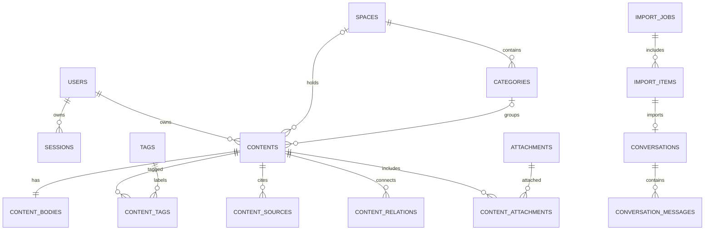
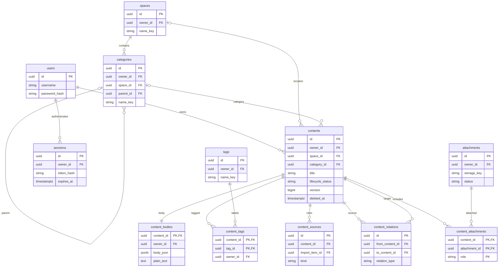
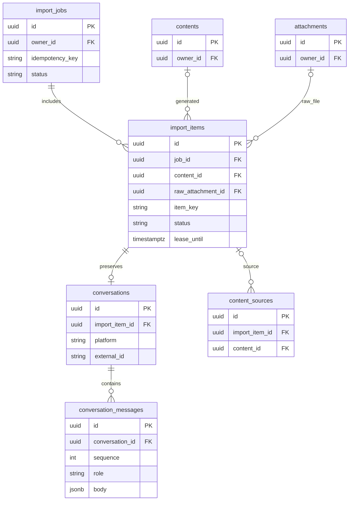
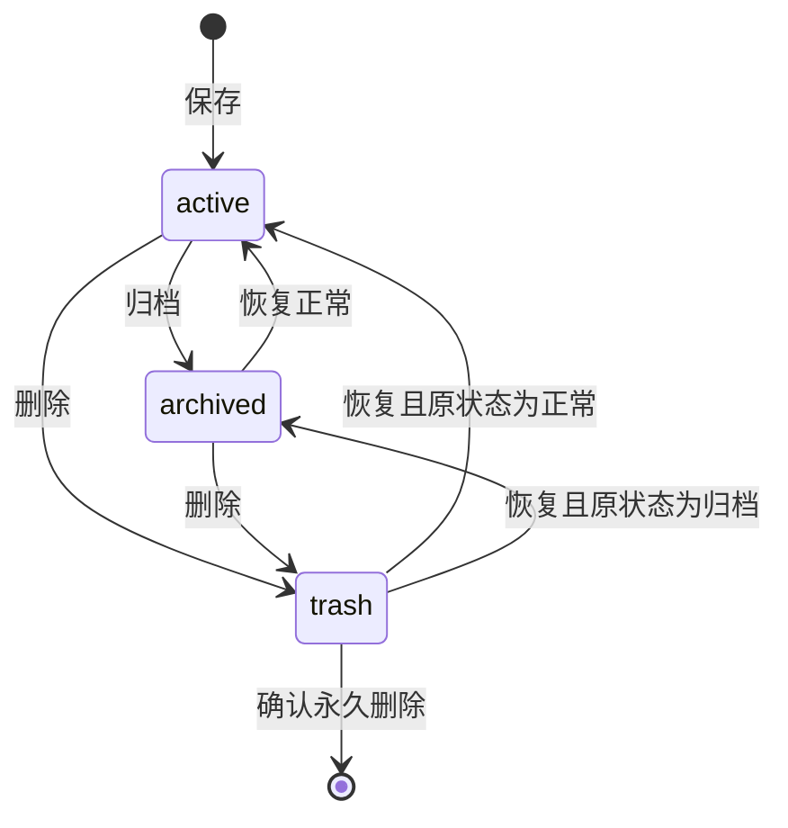
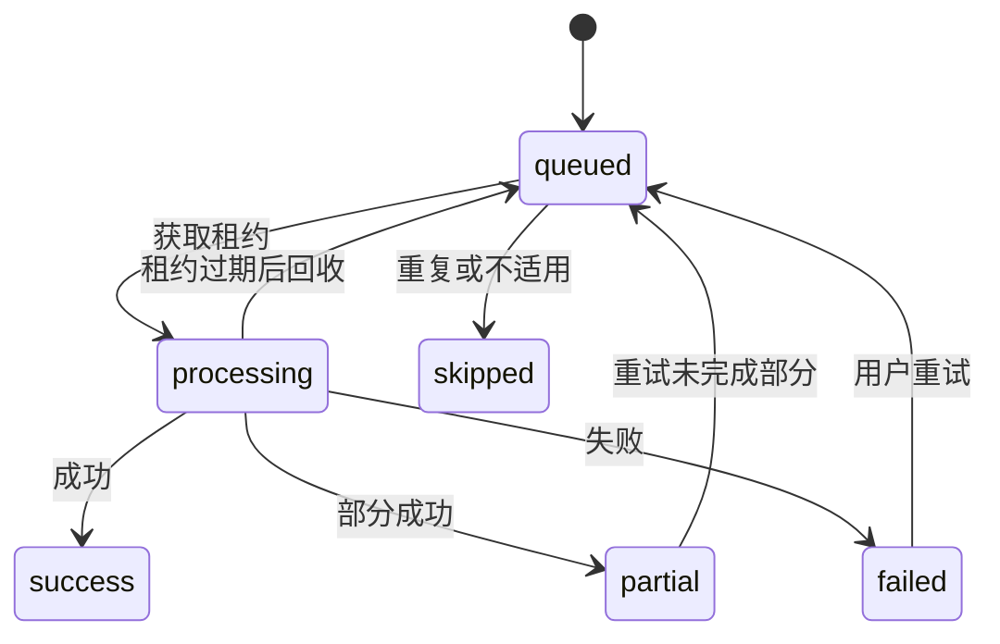

# 首阶段数据库设计

2026-11-25 · 评审稿。依据 [核心领域模型](../product/CORE-DOMAIN-MODEL.md) 与 [PRD](../product/PRD.md)。本稿给出物理设计建议，具体字段和约束在迁移实现前复核。

## 1. 范围与技术

已确认 PostgreSQL、SQLAlchemy 2.x、psycopg 3、Alembic。首阶段单所有者，保留 owner_id。正文使用 Tiptap JSON，Markdown 导入导出。取消收集箱，不接 AI。编辑历史恢复待定。

首批闭环覆盖登录、创建、保存、列表、编辑、目录标签、搜索、归档、回收站。导入及附件作为同阶段后续迁移组，先保留数据设计。Site 发布、自动建议、Memory、Agent、独立脉络及版本表留待对应阶段。

## 2. 关系

关联表的 from_content_id、to_content_id 都指向 CONTENTS。owner_id 约束在所有业务归属关系上执行，图中省略重复连线。

## 3. 通用约定

- 表与字段用 snake_case。实体主键建议 UUID，由服务端生成；原型旧 ID 通过迁移映射保留引用关系。
- 时间采用 timestamptz，数据库按 UTC 保存，界面按用户时区显示。
- 主实体包含 created_at、updated_at，默认数据库当前时间；updated_at 由写事务明确更新。
- 所有业务实体 owner_id 必填。每个可被关联实体提供 UNIQUE(owner_id, id)，跨表引用用包含 owner_id 的复合外键，防止跨所有者关联。
- 可选关系使用 NULL，空字符串不表达无归属。名称去除首尾空白，业务校验非空；同名规则通过 name_key 的规范化策略统一。
- 有限状态建议 text 加 CHECK，避免首阶段为枚举变更引入额外复杂度。长度与文件上限由接口契约统一校验，精确值待确认。

## 4. 核心表数据字典

下列字段未标可空则必填。UUID 主实体包含上一节的时间字段，连接表按说明设置。

| 表 | 核心字段及类型 | 约束与职责 |
| --- | --- | --- |
| users | id uuid PK、username text、password_hash text、display_name text、disabled_at timestamptz 可空 | lower(username) 唯一，密码仅保存安全哈希。单所有者由初始化流程控制，未来账号扩展不修改内容归属模型。 |
| sessions | id uuid PK、owner_id uuid、token_hash text、expires_at timestamptz、revoked_at timestamptz 可空 | token_hash 唯一；随机会话令牌只保存哈希。登录有效性与过期策略由认证设计确定。 |
| spaces | id uuid PK、owner_id uuid、name text、name_key text、description text 默认空、sort_order integer 默认 0 | UNIQUE(owner_id,name_key)。 |
| categories | id uuid PK、owner_id uuid、space_id uuid、parent_id uuid 可空、name text、name_key text、sort_order integer 默认 0 | 父分类必须同所有者同空间，使用复合外键。根分类与同父分类分别建立唯一索引。禁止自引用，移动事务检查循环。 |
| contents | id uuid PK、owner_id uuid、title text 默认空、content_type text 可空、space_id uuid 可空、category_id uuid 可空、learning_state text 可空、lifecycle_status text 默认 active、version bigint 默认 1、deleted_at timestamptz 可空 | lifecycle_status 仅 active/archived，version 大于 0；内容类型和学习状态用领域模型中的稳定代码校验。category_id 有值时 space_id 必填，且复合外键保证分类属于该空间。 |
| content_bodies | content_id uuid PK、owner_id uuid、body_json jsonb、plain_text text、schema_version integer 默认 1、updated_at timestamptz | 与内容一对一，删除内容时级联删除。JSON 顶层为 object 且 type=doc；节点白名单、非空正文和导出支持情况在服务端校验。plain_text 从 JSON 同步生成。 |
| tags | id uuid PK、owner_id uuid、name text、name_key text | UNIQUE(owner_id,name_key)，规范化避免重复标签。 |
| content_tags | owner_id uuid、content_id uuid、tag_id uuid、created_at timestamptz | PK(content_id,tag_id)，两端同所有者。连接行随任意一端永久删除而级联删除。 |
| content_relations | id uuid PK、owner_id uuid、from_content_id uuid、to_content_id uuid、relation_type text、note text 默认空 | 禁止自关联，关系类型 CHECK。related 对称关系将较小 UUID 作为 from，唯一约束阻止反向重复。其他有向关系保留方向。 |
| content_sources | id uuid PK、owner_id uuid、content_id uuid、kind text、title text、url text 可空、platform text 可空、external_id text 可空、occurred_at timestamptz 可空、imported_at timestamptz 可空、import_item_id uuid 可空 | 保留来源信息，来源种类由服务端白名单控制。来源 URL 不作为所有记录的唯一键。 |

分类外键目标增加 UNIQUE(owner_id,space_id,id)，父分类外键 (owner_id,space_id,parent_id) 引用该键。内容的 (owner_id,space_id,category_id) 同样引用它。使用默认 MATCH SIMPLE 允许无分类；CHECK 保证有分类时空间非空。跨行的循环、内容正文存在性通过受控事务保证，不用跨表 CHECK。

## 5. 导入与附件表

| 表 | 字段 | 约束与职责 |
| --- | --- | --- |
| import_jobs | id、owner_id、kind、status、idempotency_key、created_at、updated_at | UNIQUE(owner_id,idempotency_key)。记录请求批次，不把接收成功视为正文解析成功。 |
| import_items | id、owner_id、job_id、item_key、status、error_code 可空、error_detail 可空、content_id 可空、source_hash 可空、raw_attachment_id 可空、attempt_count 默认 0、lease_until 可空 | UNIQUE(job_id,item_key)。状态 queued/processing/success/partial/failed/skipped。记录重试次数及处理中租约，进程中断后可回收任务。 |
| conversations | id、owner_id、import_item_id、platform、external_id 可空、title、occurred_at 可空 | import_item_id 唯一，一个导入项保留一个会话原文。相同平台 ID 的再次导入通过内容哈希和批次策略提示，避免误丢新增消息。 |
| conversation_messages | id、owner_id、conversation_id、sequence integer、external_message_id 可空、parent_external_id 可空、role text、body jsonb、occurred_at 可空 | UNIQUE(conversation_id,sequence)，sequence 非负。保留角色、顺序、时间与分支信息；原始 JSON 附件支持重建分支。不可编辑的原文与可编辑笔记分别保存。 |
| attachments | id、owner_id、storage_key text、original_name text、mime_type text、byte_size bigint、sha256 text、status text | storage_key 唯一，byte_size 非负。status 为 pending/ready/failed。二进制保存到持久存储，具体存储方案待确认。 |
| content_attachments | owner_id、content_id、attachment_id、role text | PK(content_id,attachment_id,role)，复合外键校验归属。允许正文附件与原始资料角色。 |

除上述类型特例，ID/外键均为 uuid，状态和标识为 text，时间为 timestamptz。主实体含创建更新时间。导入项最终提交原文、来源和内容的事务需防止重试创建重复记录，业务写入前锁定导入项并检查状态。失败信息不得包含令牌或密码。

## 6. 查询与索引

| 场景 | 建议索引或访问方式 |
| --- | --- |
| 全部记录 | contents(owner_id,updated_at DESC,id DESC) WHERE deleted_at IS NULL，游标分页使用时间与 ID |
| 回收站 | contents(owner_id,deleted_at DESC,id DESC) WHERE deleted_at IS NOT NULL |
| 目录浏览 | contents(owner_id,space_id,category_id,updated_at DESC,id DESC) WHERE deleted_at IS NULL |
| 分类树 | categories(owner_id,space_id,parent_id,sort_order,id) |
| 标签筛选 | content_tags(owner_id,tag_id,content_id)，PK 支持按记录查询标签 |
| 反向关联 | content_relations(owner_id,to_content_id)，正向唯一索引覆盖 from 前缀 |
| 来源与附件 | content_sources(owner_id,content_id)，content_attachments(owner_id,attachment_id) |
| 导入处理 | import_items(status,lease_until)，import_items(owner_id,job_id)，content_sources(owner_id,import_item_id) |
| 会话消息 | UNIQUE(conversation_id,sequence) 支持有序读取，额外检查复合外键索引前缀覆盖 |
| 会话失效 | sessions(owner_id)，sessions(expires_at) 支持清理 |

逐项检查外键的引用侧索引，复合索引已覆盖时避免重复创建。JSONB 正文首阶段不默认建立整列 GIN 索引。用代表性数据的 EXPLAIN ANALYZE 验证列表与搜索，测试数据与目标响应指标待接口设计给出。

首阶段中文搜索建议在 title 与 plain_text 上使用参数化 ILIKE 子串查询，必须应用 owner 与 deleted_at 过滤。转义用户输入中的通配符，避免把文本输入当任意模式。先验证数据量与响应时间；pg_trgm 对中文短词的效果、中文分词扩展及专用搜索服务作为评估项，不能用英语全文检索配置假定已满足中文搜索。

## 7. 事务与并发

- 新建记录时，Content、ContentBody、来源及用户明确选择的标签同事务提交，失败整体回滚。
- 保存携带 expected_version，原子更新条件包含 owner_id、id、version 和 deleted_at IS NULL，同时 version 加一。未命中区分无权访问、已删除和版本冲突，接口建议返回 409 冲突并保留客户端修改。
- 更新正文与 plain_text、替换标签、调整位置均在同一事务；正文单独更新也必须递增 contents.version。SQLAlchemy ORM 版本检测不覆盖所有批量 SQL，批量操作必须显式带版本条件。
- 单次事务短小，外部文件处理和网络调用放在事务之外。重试只针对可重试错误，唯一性和乐观锁仍在数据库检查。
- 分类移动事务检查同空间父节点、环路和目标唯一性；并发移动按空间加事务级锁，重新读取树后校验。
- 删除空间/分类前，将受影响内容的位置置空并递增版本，按层级清理目录。默认不级联删除正文，删除范围必须经用户确认。

## 8. 删除、恢复与文件一致性

软删除只设置 deleted_at 并更新版本；归档状态保留以便恢复。回收站查询独立过滤。删除后的内容不得通过普通搜索、关联预览或附件入口读取。

恢复时保留仍有效的位置；位置已清除则保留无归属。永久删除内容级联清理正文、标签连接、来源与关系，保留其他内容。用户账号删除使用 RESTRICT，不提供隐式批量删库。空间、分类外键使用 RESTRICT，先完成上述位置处理再删除。

导入批次和项仍在历史中时，content_id 由清理事务先置空；不级联删除整个批次。会话原文删除范围必须随导入删除流程明确确认。附件连接随内容清理，原始导入附件可能仍被导入项引用，只有无引用的附件才能回收。

文件上传先写入 pending 元数据与临时存储，完成校验后转 ready。文件系统与数据库无法共用事务，通过状态、重试和孤儿清理保证最终一致。附件读取经后端鉴权，storage_key 不直接变成公开 URL。

## 9. 权限与运行

业务查询显式限制 owner_id；写入通过复合外键再次防错。数据库应用账号仅具有业务读写权限，迁移账号管理 DDL，数据库不直接暴露公网。首阶段是否增加 RLS 待评审，不依赖未实现策略保护数据。

密码使用成熟哈希库，会话令牌和连接密码不写日志。连接池容量按 API 实例数乘每实例上限统一计算，保留迁移与运维余量，具体值由部署资源确定。阻塞驱动不得直接放入异步事件循环执行，同步/异步 Session 模式待后端工程设计确认。

## 10. 迁移、备份与验证

使用 Alembic，先迁移账号/目录/内容/正文，再迁移标签与关联，再添加导入和附件。启动不依赖 ORM 自动 create_all 代替迁移。每次迁移评审升级过程、失败回滚与数据兼容性，已发布迁移不修改。删列或不可逆数据变化先备份，恢复策略可以采用前向修复或恢复备份。

原型 localStorage 数据先导出，保留原文和旧 ID 映射。inbox/organized 映射 active，archived 与 deleted_at 保留。Markdown 解析为 Tiptap JSON 前验证结构，转换失败单项反馈，不静默丢失。不自动导入用户浏览器凭据。

生产数据库用 pg_dump 等工具备份，同时保存附件、清单及校验和；备份窗口冻结附件删除并保留数据库快照期间可能引用的文件，保证数据与文件可配对恢复。备份加密、异机保存与定期恢复演练的频率、保留期及恢复目标待确认。数据库卷存活不等同于备份。

实施前验证清单：

- 空库升级、重复部署、已有数据升级与恢复演练。
- 无归属记录正常保存与搜索，分类跨空间或跨所有者引用被拒绝。
- 两个客户端同时保存只有一个版本成功，失败客户端修改可找回。
- 重复标签与关系、目录环路和导入重试不会产生脏数据。
- 正文、标签任一步失败都回滚；软删除记录不泄漏，恢复与永久删除符合规则。
- 中文短词、长文本、排序分页和回收站过滤有代表性数据验证。

## 11. 待评审决定

本稿新增的 UUID、会话表、名称唯一性、索引组合、ILike 首阶段搜索和导入租约均为设计建议。PostgreSQL 版本、同步或异步访问、密码与会话策略、附件存储、数据库备份目标、中文搜索性能指标仍需确定。编辑历史、Site 发布和 AI 对象另阶段设计。本稿未执行建表。

## 参考

- [PostgreSQL 约束](https://www.postgresql.org/docs/current/ddl-constraints.html)
- [SQLAlchemy 版本检测及批量操作限制](https://docs.sqlalchemy.org/en/20/orm/versioning.html)
- [PostgreSQL SQL 备份](https://www.postgresql.org/docs/current/backup-dump.html)

## 12. 详细 ER 图

拆为核心内容与导入原文两张图。图中展示关键字段，完整字段见第 13 节。复合归属外键和删除策略见第 14 节。

## 13. 字段级字典

以下是评审建议值。必填字段不可为 NULL；未注明默认值表示插入时必须提供。所有带 id 的表使用 uuid 主键，服务端生成，无数据库隐式默认。业务表 owner_id 必填，连接表也执行所有者校验。users 无 owner_id。

除 content_bodies、content_tags、content_attachments 外，所有表包含 created_at 和 updated_at，类型 timestamptz、必填、默认 CURRENT_TIMESTAMP。content_bodies 仅含 updated_at，content_tags 仅含 created_at，默认同上；content_attachments 无时间字段。updated_at 后续修改由业务事务维护。

### users

| 字段 | 类型 | 可空 | 默认 |
| --- | --- | --- | --- |
| id | uuid PK | 否 | 服务端生成 |
| username | text | 否 | 无 |
| password_hash | text | 否 | 无 |
| display_name | text | 否 | 无 |
| disabled_at | timestamptz | 是 | 无 |

### sessions

| 字段 | 类型 | 可空 | 默认 |
| --- | --- | --- | --- |
| id | uuid PK | 否 | 服务端生成 |
| owner_id | uuid FK | 否 | 无 |
| token_hash | text | 否 | 无 |
| expires_at | timestamptz | 否 | 无 |
| revoked_at | timestamptz | 是 | 无 |

### spaces

| 字段 | 类型 | 可空 | 默认 |
| --- | --- | --- | --- |
| id | uuid PK | 否 | 服务端生成 |
| owner_id | uuid FK | 否 | 无 |
| name | text | 否 | 无 |
| name_key | text | 否 | 无 |
| description | text | 否 | 空字符串 |
| sort_order | integer | 否 | 0 |

### categories

| 字段 | 类型 | 可空 | 默认 |
| --- | --- | --- | --- |
| id | uuid PK | 否 | 服务端生成 |
| owner_id | uuid FK | 否 | 无 |
| space_id | uuid | 否 | 无 |
| parent_id | uuid | 是 | 无 |
| name | text | 否 | 无 |
| name_key | text | 否 | 无 |
| sort_order | integer | 否 | 0 |

### contents

| 字段 | 类型 | 可空 | 默认 |
| --- | --- | --- | --- |
| id | uuid PK | 否 | 服务端生成 |
| owner_id | uuid FK | 否 | 无 |
| title | text | 否 | 空字符串 |
| content_type | text | 是 | 无 |
| space_id | uuid | 是 | 无 |
| category_id | uuid | 是 | 无 |
| learning_state | text | 是 | 无 |
| lifecycle_status | text | 否 | active |
| version | bigint | 否 | 1 |
| deleted_at | timestamptz | 是 | 无 |

### content_bodies

| 字段 | 类型 | 可空 | 默认 |
| --- | --- | --- | --- |
| owner_id | uuid FK | 否 | 无 |
| content_id | uuid | 否 | 无 |
| body_json | jsonb | 否 | 无 |
| plain_text | text | 否 | 无 |
| schema_version | integer | 否 | 1 |
| updated_at | timestamptz | 否 | CURRENT_TIMESTAMP |

### tags

| 字段 | 类型 | 可空 | 默认 |
| --- | --- | --- | --- |
| id | uuid PK | 否 | 服务端生成 |
| owner_id | uuid FK | 否 | 无 |
| name | text | 否 | 无 |
| name_key | text | 否 | 无 |

### content_tags

| 字段 | 类型 | 可空 | 默认 |
| --- | --- | --- | --- |
| owner_id | uuid FK | 否 | 无 |
| content_id | uuid | 否 | 无 |
| tag_id | uuid | 否 | 无 |
| created_at | timestamptz | 否 | CURRENT_TIMESTAMP |

### content_relations

| 字段 | 类型 | 可空 | 默认 |
| --- | --- | --- | --- |
| id | uuid PK | 否 | 服务端生成 |
| owner_id | uuid FK | 否 | 无 |
| from_content_id | uuid | 否 | 无 |
| to_content_id | uuid | 否 | 无 |
| relation_type | text | 否 | 无 |
| note | text | 否 | 空字符串 |

### content_sources

| 字段 | 类型 | 可空 | 默认 |
| --- | --- | --- | --- |
| id | uuid PK | 否 | 服务端生成 |
| owner_id | uuid FK | 否 | 无 |
| content_id | uuid | 否 | 无 |
| kind | text | 否 | 无 |
| title | text | 否 | 无 |
| url | text | 是 | 无 |
| platform | text | 是 | 无 |
| external_id | text | 是 | 无 |
| occurred_at | timestamptz | 是 | 无 |
| imported_at | timestamptz | 是 | 无 |
| import_item_id | uuid | 是 | 无 |

### import_jobs

| 字段 | 类型 | 可空 | 默认 |
| --- | --- | --- | --- |
| id | uuid PK | 否 | 服务端生成 |
| owner_id | uuid FK | 否 | 无 |
| kind | text | 否 | 无 |
| status | text | 否 | queued |
| idempotency_key | text | 否 | 无 |

### import_items

| 字段 | 类型 | 可空 | 默认 |
| --- | --- | --- | --- |
| id | uuid PK | 否 | 服务端生成 |
| owner_id | uuid FK | 否 | 无 |
| job_id | uuid | 否 | 无 |
| item_key | text | 否 | 无 |
| status | text | 否 | queued |
| error_code | text | 是 | 无 |
| error_detail | text | 是 | 无 |
| content_id | uuid | 是 | 无 |
| source_hash | text | 是 | 无 |
| raw_attachment_id | uuid | 是 | 无 |
| attempt_count | integer | 否 | 0 |
| lease_until | timestamptz | 是 | 无 |

### conversations

| 字段 | 类型 | 可空 | 默认 |
| --- | --- | --- | --- |
| id | uuid PK | 否 | 服务端生成 |
| owner_id | uuid FK | 否 | 无 |
| import_item_id | uuid | 否 | 无 |
| platform | text | 否 | 无 |
| external_id | text | 是 | 无 |
| title | text | 否 | 无 |
| occurred_at | timestamptz | 是 | 无 |

### conversation_messages

| 字段 | 类型 | 可空 | 默认 |
| --- | --- | --- | --- |
| id | uuid PK | 否 | 服务端生成 |
| owner_id | uuid FK | 否 | 无 |
| conversation_id | uuid | 否 | 无 |
| sequence | integer | 否 | 无 |
| external_message_id | text | 是 | 无 |
| parent_external_id | text | 是 | 无 |
| role | text | 否 | 无 |
| body | jsonb | 否 | 无 |
| occurred_at | timestamptz | 是 | 无 |

### attachments

| 字段 | 类型 | 可空 | 默认 |
| --- | --- | --- | --- |
| id | uuid PK | 否 | 服务端生成 |
| owner_id | uuid FK | 否 | 无 |
| storage_key | text | 否 | 无 |
| original_name | text | 否 | 无 |
| mime_type | text | 否 | 无 |
| byte_size | bigint | 否 | 无 |
| sha256 | text | 否 | 无 |
| status | text | 否 | pending |

### content_attachments

| 字段 | 类型 | 可空 | 默认 |
| --- | --- | --- | --- |
| owner_id | uuid FK | 否 | 无 |
| content_id | uuid | 否 | 无 |
| attachment_id | uuid | 否 | 无 |
| role | text | 否 | 无 |

## 14. 约束与删除策略

命名采用 pk_表、fk_表_关系、uq_表_用途、ck_表_用途、ix_表_用途。SQLAlchemy MetaData 使用统一命名模板。此处为迁移命名基线。

| 约束 | 规则 | 删除行为 |
| --- | --- | --- |
| fk_业务表_owner | owner_id 引用 users.id | RESTRICT |
| fk_categories_space / parent | 同所有者，父节点同空间 | RESTRICT，树移动和删除先显式处理引用 |
| fk_contents_space / category | 分类非空则空间非空，分类必须属于该空间 | RESTRICT，删除位置前置空受影响记录的 category_id/space_id 并递增版本 |
| fk_content_bodies_content | 同所有者一对一 | CASCADE，事务保证每条内容同时有正文 |
| fk_content_tags_content / tag | 两端同所有者，PK(content_id,tag_id) | CASCADE |
| fk_content_relations_from / to | 两端同所有者，禁止自己关联 | CASCADE，保留另一端内容 |
| fk_content_sources_content | 同所有者 | CASCADE |
| fk_import_items_job | 同所有者 | RESTRICT，删除批次走独立清理事务 |
| fk_import_items_content / raw_attachment | 可空，同所有者 | RESTRICT，清理前显式置空引用 |
| fk_content_sources_import_item | 可空，同所有者 | RESTRICT，删除导入项前断开可选引用 |
| fk_conversations_import_item | 一项最多一个原始会话 | RESTRICT，确认清理范围后显式删除 |
| fk_conversation_messages_conversation | 同所有者，有序消息 | CASCADE |
| fk_content_attachments_content / attachment | 同所有者，PK(content_id,attachment_id,role) | CASCADE |

UNIQUE(owner_id,id) 支持同所有者复合外键。users 的 username 以 lower(username) 唯一索引实现；spaces、tags 使用 UNIQUE(owner_id,name_key)。categories 根节点用 UNIQUE(owner_id,space_id,name_key) WHERE parent_id IS NULL，非根节点用 UNIQUE(owner_id,space_id,parent_id,name_key) WHERE parent_id IS NOT NULL。

content_relations 唯一键为 (owner_id,from_content_id,to_content_id,relation_type)。related 关系以 UUID 固定大小排序，并增加 CHECK 保证规范方向。name_key 的 Unicode 规范化和大小写处理由接口统一实现，具体用户可见重名策略仍待评审。

CHECK 覆盖 version/schema_version 大于零、byte_size/sequence/attempt_count 非负、分类与空间非空关系、JSONB 顶层结构和受控状态。ContentType 建议稳定值 knowledge/experience/memory_note/thought；学习状态 to_learn/learning/understood/applied。消息 role 保留平台原值，未知角色不伪装成 user；正文 JSON 需版本化解析。

## 15. 状态流转

trash 由 deleted_at 非空表达，保留原 lifecycle_status，不额外写入第三种生命周期状态。更新归属不改变生命周期。

导入项状态为上图，批次状态由各项聚合。重试 partial 项复用 content_id，只补齐缺失结果，租约领取采用原子条件更新。重试边界和可重试错误码在导入接口细化。

## 16. 接口与事务设计基线

以下为路由建议，后续接口契约统一定义请求响应结构。

| 操作 | 建议接口 | 单次事务与冲突处理 |
| --- | --- | --- |
| 登录 | POST /api/auth/sessions | 验证密码后写入会话哈希；限流参数待定 |
| 新建 | POST /api/contents | 写 Content、Body、来源和明确选定的标签；客户端提供 UUID 作为幂等创建 ID，同 ID 重试比对请求，内容不一致返回冲突 |
| 查看列表/原文 | GET /api/contents、GET /api/contents/{id} | 所有者与删除过滤，列表只取摘要元数据，详情返回 version |
| 保存 | PATCH /api/contents/{id} | expected_version 条件更新，正文、投影、归属、标签同事务，返回新 version |
| 搜索 | GET /api/contents?q=... | 参数化查询，明确归档筛选，不进入删除内容 |
| 归档/恢复正常 | PATCH /api/contents/{id} | 生命周期变更也需 expected_version |
| 移入回收站 | DELETE /api/contents/{id} | 设置 deleted_at、更新 version；重复删除返回现有结果，不重复执行副作用 |
| 从回收站恢复 | POST /api/contents/{id}/restore | 带版本检查，校验位置有效性，同事务清空无效位置并恢复 |
| 永久删除 | DELETE /api/trash/{id} | 校验内容已在回收站与版本，清理引用，后续异步回收无引用文件 |

冲突返回 409，响应包含当前版本，客户端保留尚未保存文本并提供重新加载/比较入口。版本号用于并发控制，与待定的编辑历史功能分别管理。PATCH 约定字段缺省表示不修改，null 表示清空可选字段，空标签数组表示清除全部标签。

## 17. 设计核验结果与实施门槛

本次完成文档级核对，包含 16 张表的字段字典、关键 PK/FK、关系基数、候选与正式数据边界及状态流转。迁移实施前应将第 4、5 节摘要和第 13、14 节字段约束对照生成模型与迁移，禁止各自维护不同规则。

仍待验证 Mermaid 渲染、PostgreSQL 实际约束、SQLAlchemy 级联配置、并发事务、中文搜索和备份恢复。当前未创建数据库、未执行迁移。数据库版本、附件存储、Session 同步/异步与会话策略等待定项继续保留。
