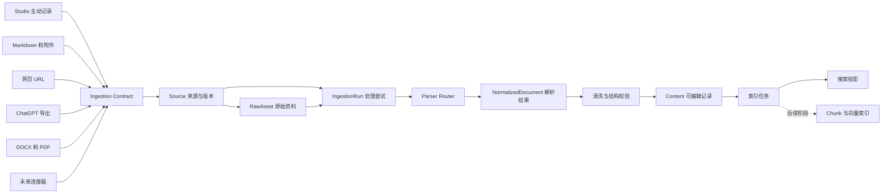

> 历史归档（2026-11-26）：保留原文，不再维护；现行规则见 [主文档](../ARCHITECTURE.md)。原文中的旧路径、阶段和结论仅供回溯。

# 系统架构与技术决策

当前技术选择和内容采集流程统一维护于本文。物理表结构见 [数据库设计](DATABASE-DESIGN.md)。

## 技术选择

| 项目 | 技术方案 |
| --- | --- |
| 后端应用 | FastAPI、Pydantic、pydantic-settings |
| 数据库 | PostgreSQL |
| 数据库访问与迁移 | SQLAlchemy 2.x、psycopg 3、Alembic |
| 部署 | Docker、Docker Compose |
| 工程目录 | frontend/、backend/、deploy/ |

## 后端工程与环境

后端使用 app/core 管理配置、app/db 管理连接和事务，app/modules 按业务领域组织，app/api 管理请求公共依赖及健康检查。参考项目与 API 边界见 [API 契约](API.md)，运行说明见 [数据库开发](../development/DATABASE.md)。

开发与自动化测试共用本机 luma_dev，测试写入回滚；生产使用独立数据库，先在本机正式使用，后续迁到云服务器。APP_ENV 只区分 development、production，不额外建设测试环境。生产连接配置显式注入，不读取开发文件。生产库与生产部署尚未创建。

## 前端命名与工程方案

公开端确定命名为 Site，工程名使用 site，私人工作台沿用 Studio / studio。

前端分为 frontend/studio（React + Vite）和 frontend/site（Next.js），共用 FastAPI 后端和 PostgreSQL。首阶段建设 Studio，Site 在公开发布阶段建设。具体依赖版本待工程初始化时锁定。

## 数据库设计要求

- 正文采用 Tiptap JSON，数据库设计考虑使用 JSONB，具体字段由表结构设计落实。
- 即使首阶段只有一个所有者，也需考虑多标签页或多设备同时保存同一记录。
- 并发保存应检测版本冲突，避免旧内容静默覆盖新内容；版本字段和冲突响应待接口设计确定。
- 正文、元数据及关系的组合修改需明确事务边界。
- 索引围绕列表、搜索、位置与标签查询设计。中文检索方案待验证。

## 待确认

- 生产 PostgreSQL 版本；本地已在 16.14 验证，当前基础使用同步 psycopg 3。
- 连接池及并发参数，依据部署资源和实际负载设置。
- 前端和后端具体版本、附件存储及备份方案。

领域关系见 [核心领域模型](../product/CORE-DOMAIN-MODEL.md)。

表结构设计见 [首阶段数据库设计](DATABASE-DESIGN.md)。

## 采集边界

采用 [统一采集架构](ARCHITECTURE.md)，来源、原始资料、处理版本、规范结果和可编辑记录分别管理。相关表已通过迁移建立，采集执行器尚未实现。

# 内容接收与处理

2026-11-25。采用[调研报告](../product/deep-research-report.md)的采集模式。物理字段和约束维护在[数据库设计](DATABASE-DESIGN.md)，模型与迁移已在本地 luma_dev 验证。

## 1. 管线

首阶段不接 AI。统一契约包含所有者、输入类型、幂等键、来源标识、原始时间、原始载荷引用和权限。各入口共用来源追溯、幂等与保存规则。Studio 的 Tiptap 输入可同步完成规范化与保存，不必等待外部解析器；普通后续编辑直接修改 Content，按版本触发投影更新。

## 2. 对象边界与现有模型映射

| 对象 | 物理模型映射 | 与现有模型的关系 |
| --- | --- | --- |
| Source | sources | 外部来源身份，可独立于笔记存在；原 content_sources 改为内容到来源版本的引用 |
| SourceVersion | source_versions | 保留原始创建/更新时间、校验摘要和资料版本。重抓取或重新导入创建新版本 |
| RawAsset | raw_assets | 指向附件存储文件，保留原始 JSON、文件或网页快照及元数据；attachments 继续承接二进制存储，不重复保存文件 |
| IngestionJob | import_jobs / import_items | 继续承接批次与输入项，输入项关联 source_version_id |
| IngestionRun | ingestion_runs | 每次解析或重试的执行记录，保存解析器名称、版本、配置摘要、阶段、错误和租约 |
| NormalizedDocument | normalized_documents | 某次处理生成的不可变解析结果。与用户编辑正文分开 |
| Knowledge Item | contents / content_bodies | 复用原有记录和 Tiptap JSON 正文，保留 normalized_document_id 的来源引用 |
| IndexJob | index_jobs | 按内容版本记录投影/索引任务，通过事务性任务表可靠投递 |
| Chunk | 后续阶段定义 | 消费内容版本及哈希，不作为首阶段建表前提 |

SourceVersion 的原始资料和 NormalizedDocument 的解析结果不可被用户编辑覆盖。Content 是用户可修改的笔记。相同来源可以再次处理；从同一解析结果生成多份笔记必须为显式用户操作。

## 3. 数据库规格

来源、版本、原始资料、处理尝试、规范结果与索引任务的字段、约束和索引统一维护在 [数据库设计](DATABASE-DESIGN.md)，本文只描述组件职责与处理流程。模型和迁移位于 backend/，配置及验证命令见 [数据库开发](../development/DATABASE.md)。

sources 外部唯一性按平台和输入类型确定，URL 不能一概充当全局唯一键。source_versions 校验摘要用于判断变化；处理版本由解析器版本和配置摘要共同识别。规范内容 schema 与各解析器原生输出的转换规则需要接口契约进一步细化。

## 4. 保存、失败与重跑

- 输入接收成功先形成可追溯的来源和原始资料。上传成功与解析成功分别反馈。
- 解析阶段可产生 success、partial、failed、needs_review 等结果，状态与阶段分别保存。批次状态聚合输入项，不直接等同于处理尝试状态。
- 输入项完成时提交解析结果、内容来源引用与记录，再标记结果。相同幂等请求复用结果；重试创建新的 run，保留原尝试。
- 首次成功可创建 Content。已有笔记的重新解析先产生候选结果，不能静默覆盖用户编辑；确认应用需检查 expected_version。
- 复杂文件可先保留附件并允许查看处理结果。只有需要正文的功能依赖解析完成；失败不丢弃原件。
- 编辑正文、更新 plain_text 与插入 index_jobs 在同一数据库事务提交。plain_text 支撑首阶段直接搜索，后续异步索引失败也可重建。
- 索引 worker 按版本领取任务并校验租约。旧版本结果不可覆盖新版本索引；删除时阻止旧任务重新建立可搜索内容。
- 数据库任务表与一个 worker 作为待确认的初始实现方案。处理器须幂等，外部文件操作通过状态和补偿协调。

## 5. 输入适配与顺序

采用调研顺序作为工程实施基线，替代前文将导入整体后置的拆分。

1. 统一契约与来源/原件/版本/处理记录，Studio 主动记录贯通。
2. Markdown 与图片附件，保留 frontmatter、原路径、时间、附件和 wikilink。
3. URL Capture，先保留链接，抓取成功后留 HTML 快照，清洗并预览再生成内容。
4. ChatGPT 官方导出，完整保留 JSON、角色、顺序、分支和附件，支持分片输入的兼容验证。
5. Docling 的 DOCX/PDF 解析验证，反馈部分成功及结构丢失，OCR 与资源开销单独评估。

AI 对话仍是产品重要来源，优先级顺序体现实现依赖，具体阶段与承诺在路线图评审。解析库版本、维护情况与许可在引入时重新核验。

## 6. 格式与安全

用户正文权威格式仍为 Tiptap JSON。NormalizedDocument 是解析层的版本化契约，解析器原始 JSON 可以保留，不能把 Markdown 展示结果同时当另一份权威用户正文。MDX 采用后续受控组件方案。

网页抓取校验协议、解析后的 IP 与每次重定向，防止访问内网及元数据服务；限制响应大小、超时和递归附件。HTML 清洗后转换，禁止执行导入内容中的脚本。原始资料默认私有，原文保留和用户主动永久删除须兼容，不能把“保留原件”实现成无法删除。

未来 ConnectorAdapter 负责授权、变化枚举、抓取与游标。游标只在数据可靠保存后推进。外部删除记录 tombstone，由用户决定本地内容处理。首阶段暂不建立连接器或向量表。

## 7. 采集流程验收

- 同一输入重试和 worker 中断不重复生成笔记。
- 解析器升级可重新运行，旧原件、旧结果与用户笔记都保留。
- 再次导入新增消息或修改文件能辨认版本差异。
- 部分解析、未知格式、缺失附件明确反馈。
- 用户编辑与重解析确认同时发生时检测冲突。
- 旧索引任务、已删除记录与原件清理符合权限和引用约束。

22 张业务表已迁移至本地 luma_dev，数据库约束与迁移验证结果见 [数据库设计的核验状态](DATABASE-DESIGN.md#核验状态)。以上条目属于后续业务流程验收，不因建表通过而视为完成。
