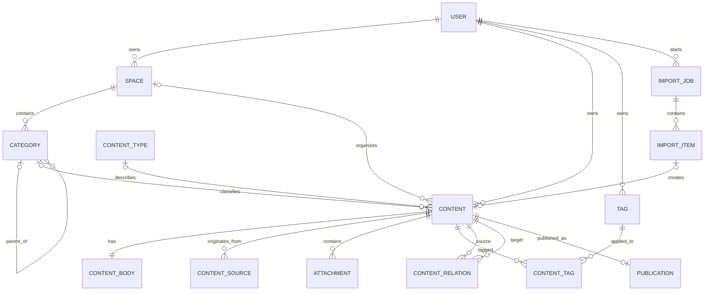
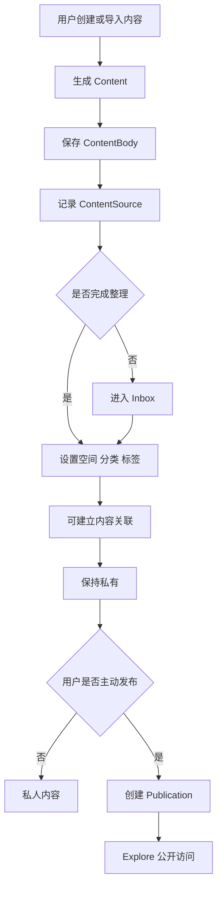

# 灵脑｜核心领域模型

| 文档信息 | 内容 |
|---|---|
| 产品名称 | 灵脑 · Luma |
| 文档名称 | 核心领域模型（Core Domain Model） |
| 文档版本 | V1.0 |
| 文档状态 | 逻辑模型设计基线 |
| 更新日期 | 2026-11-13 |
| 关联文档 | `PRODUCT-STRATEGY.md`、`PRD.md`、`PRODUCT-DECISIONS.md`、`ROADMAP.md` |
| 设计范围 | V1.0 核心业务对象，以及 AI 能力的后续扩展边界 |

> **核心设计原则：以统一内容为基础，以灵活组织为方式，以来源和关系为上下文，以 AI 记忆为后续扩展。**

---

## 1. 文档目的

本文档定义灵脑需要管理的核心业务对象、对象之间的关系、关键字段、数据生命周期和业务约束，为后续数据库 ER 模型、API 契约及研发实现提供统一依据。

本文档描述的是**逻辑领域模型**，不是最终 SQL 建表脚本。

- 本文档回答：灵脑有哪些核心数据对象，它们代表什么，彼此如何关联。
- `DATABASE.md` 负责：将逻辑模型映射为 PostgreSQL 表结构、字段类型、索引、约束和迁移方案。
- `API.md` 负责：定义前后端如何读取、创建、更新和管理这些对象。
- `PRD.md` 负责：定义用户能够执行哪些操作，以及操作应产生什么产品结果。

### 1.1 设计目标

1. 统一承载工作、学习、生活、兴趣、经历和个人思考等不同领域的内容。
2. 允许用户动态建立知识空间和分类，不把固定目录写死。
3. 将内容与组织结构分离，保证内容具有稳定身份。
4. 保留来源、时间和内容之间的关系，为历史找回和 AI 使用提供上下文。
5. 严格区分私人内容与公开内容。
6. 为 RAG、Memory 和 Agent 预留扩展能力，但不提前建设复杂系统。

### 1.2 当前范围

| 范围 | 处理方式 |
|---|---|
| 统一内容 | V1.0 核心对象 |
| 知识空间、分类、标签 | V1.0 核心对象 |
| 内容来源、附件、导入任务 | V1.0 核心对象 |
| 内容关联 | V1.0 核心对象 |
| 内容发布 | V1.0 核心对象 |
| AI 处理记录、检索分块 | 后续 AI 阶段扩展 |
| 个人记忆及其证据 | Personal Memory 阶段扩展 |
| Agent 任务与工具执行记录 | Personal AI 阶段扩展 |
| 多用户协作、团队空间 | 当前不纳入 |

---

## 2. 核心建模原则

### 2.1 统一内容模型，而不是为每种知识建立一套表

灵脑中的知识、资料、经历、想法等，V1.0 统一由 `Content` 承载。

例如：

- 一篇技术文章；
- 一份项目方案；
- 一次问题解决记录；
- 一段个人思考；
- 一份学习资料；
- 一条重要决策记录。

它们可以具有不同的内容类型，但共享标题、正文、来源、空间、分类、标签、关联、时间和权限等基础能力。

**V1.0 不为 Knowledge、Experience、Thought、Decision、Event 等每一种内容分别建立独立主表。**

这样可以避免内容类型增加时不断修改数据库结构，也可以让搜索、编辑、导入和关联使用统一机制。

### 2.2 内容与组织结构分离

内容是独立对象；空间、分类和标签是组织内容的方式。

- 内容可以暂时不属于任何空间或分类。
- 用户可以先记录，再整理。
- 分类移动不改变内容 ID。
- 内容可以通过标签和关联跨越不同分类。
- 分类删除不能无提示地级联删除内容。

### 2.3 类型、分类和标签各司其职

| 概念 | 回答的问题 | 示例 |
|---|---|---|
| 内容类型（Content Type） | 这条内容是什么性质？ | 知识、资料、经历、想法 |
| 知识空间（Space） | 用户希望把它放在哪个大范围？ | 技术、工作、生活 |
| 分类（Category） | 它在这个空间中属于哪个层级？ | 前端开发、项目复盘 |
| 标签（Tag） | 它还具有什么跨分类特征？ | React、待复习、重要 |
| 内容关联（Relation） | 它与另一条内容有什么联系？ | 相关、引用、来源于 |

这些概念不能互相替代。

### 2.4 来源与正文分离

导入的原始文件、网页地址、AI 平台会话等属于来源信息。

内容正文可以被用户持续编辑，但原始来源信息应尽可能保留，避免后续修改覆盖唯一的原始依据。

### 2.5 组织状态与发布状态分离

内容是否整理完成，与内容是否公开是两个不同维度。

- 整理状态：待整理、已整理、已归档。
- 发布状态：未发布、已发布、已撤回。

整理、移动、编辑、添加标签和 AI 处理都不能自动改变公开状态。

### 2.6 原始数据与 AI 派生数据分离

后续 AI 生成的摘要、分类建议、Embedding、检索分块和个人记忆，不应覆盖用户原始内容。

AI 派生数据必须能够识别来源、处理状态和版本，并允许重新生成或纠正。

---

## 3. 核心领域对象总览

### 3.1 V1.0 核心对象

| 对象 | 英文标识 | 作用 | V1.0 |
|---|---|---|---|
| 用户 | User | 内容所有者和权限主体 | 必须 |
| 知识空间 | Space | 用户自定义的大范围组织容器 | 必须 |
| 分类 | Category | 空间内的层级组织结构 | 必须 |
| 内容类型 | ContentType | 标识内容的性质或模板 | 基础支持 |
| 内容 | Content | 灵脑统一管理的核心对象 | 必须 |
| 内容正文 | ContentBody | 存储富文本、Markdown 或 MDX 正文 | 必须 |
| 标签 | Tag | 跨空间、跨分类的轻量标记 | 必须 |
| 内容标签 | ContentTag | 内容与标签的多对多关系 | 必须 |
| 内容关联 | ContentRelation | 连接不同内容 | 必须 |
| 内容来源 | ContentSource | 记录内容从哪里来 | 必须 |
| 附件 | Attachment | 保存图片、文档和原始文件 | 必须 |
| 导入任务 | ImportJob | 管理一次导入操作 | 必须 |
| 导入项目 | ImportItem | 管理批次内的单个导入对象 | 必须 |
| 内容发布 | Publication | 管理公开地址和发布状态 | 必须 |

### 3.2 后续 AI 扩展对象

| 对象 | 英文标识 | 作用 | 规划阶段 |
|---|---|---|---|
| AI 处理任务 | AIProcessingRun | 记录摘要、分类、提取等 AI 处理 | AI 知识助手 |
| 检索分块 | ContentChunk | 将内容切分为检索单元 | RAG |
| 向量记录 | Embedding | 保存分块的向量表示 | RAG |
| 个人记忆 | MemoryItem | 保存经过管理的个人事实、偏好、经历和决策 | Memory |
| 记忆证据 | MemoryEvidence | 记录记忆对应的原始依据 | Memory |
| Agent 任务 | AgentTask | 记录任务计划、执行状态和结果 | Agent |
| 工具调用记录 | ToolExecution | 记录 Agent 调用工具的行为 | Agent |

后续对象是扩展方向，不意味着 V1.0 需要提前创建全部数据表。

---

## 4. 核心对象定义

## 4.1 User｜用户

**定义：** 灵脑中的个人数据所有者，也是身份认证和权限判断的主体。

V1.0 以单个个人所有者为主要使用模式，但业务数据保留 `owner_id`，避免未来扩展时所有内容都需要重构。

| 字段 | 含义 | 说明 |
|---|---|---|
| `id` | 用户 ID | 稳定唯一标识 |
| `email` | 登录邮箱 | 唯一 |
| `password_hash` | 密码摘要 | 不保存明文密码 |
| `display_name` | 展示名称 | 可修改 |
| `avatar_url` | 头像地址 | 可选 |
| `status` | 账户状态 | 如 active、disabled |
| `created_at` | 创建时间 | 系统记录 |
| `updated_at` | 更新时间 | 系统记录 |

**业务规则：**

- V1.0 通过受保护的初始化流程创建所有者。
- 不开放公开注册。
- 所有私人业务数据必须能够归属到所有者。
- 访客不需要创建 User 记录；访客只能访问明确公开的内容。
- 认证、会话和密码安全策略由架构文档定义。

---

## 4.2 Space｜知识空间

**定义：** 用户自定义的较大内容组织范围。

空间用于帮助用户建立自己的知识体系，不代表固定的人生领域。

示例：

- 技术；
- 工作；
- 学习；
- 生活；
- 兴趣；
- 个人思考。

以上仅为示例，不作为系统强制目录。

| 字段 | 含义 | 说明 |
|---|---|---|
| `id` | 空间 ID | 稳定唯一标识 |
| `owner_id` | 所有者 ID | 归属用户 |
| `name` | 空间名称 | 必填 |
| `description` | 空间描述 | 可选 |
| `icon` | 图标标识 | 可选 |
| `sort_order` | 排序值 | 用于导航排序 |
| `created_at` | 创建时间 | 系统记录 |
| `updated_at` | 更新时间 | 系统记录 |
| `deleted_at` | 删除时间 | 软删除策略待技术设计确认 |

**业务规则：**

1. 用户可以动态创建、重命名和调整空间。
2. 内容可以暂时不属于任何空间。
3. 一个内容在 V1.0 中最多归属一个主空间。
4. 跨空间联系通过标签和内容关联实现，不通过复制内容实现。
5. 删除非空空间前，必须先处理其中的分类和内容。
6. 空间名称不能作为内容的唯一标识。

---

## 4.3 Category｜分类

**定义：** 知识空间内部的层级组织节点。

分类支持多级结构，帮助用户建立符合自己习惯的知识目录。

| 字段 | 含义 | 说明 |
|---|---|---|
| `id` | 分类 ID | 稳定唯一标识 |
| `owner_id` | 所有者 ID | 归属用户 |
| `space_id` | 所属空间 ID | 必须归属一个空间 |
| `parent_id` | 父分类 ID | 根分类为空 |
| `name` | 分类名称 | 必填 |
| `description` | 分类描述 | 可选 |
| `sort_order` | 同级排序值 | 用于列表展示 |
| `created_at` | 创建时间 | 系统记录 |
| `updated_at` | 更新时间 | 系统记录 |

**业务规则：**

- 一个分类只能属于一个空间。
- 支持多级分类。
- 父分类必须属于同一个空间。
- 分类不能移动到自身或其后代，防止循环。
- 同一父分类下的名称应避免重复。
- 删除分类前必须迁移内容或明确解除分类关系。
- 分类移动不应改变内容 ID 和内容关联。

**内容归属约束：**

V1.0 建议每条内容最多有一个主空间和一个主分类。

如果内容设置了 `category_id`，该分类必须属于内容的 `space_id`。若内容暂时没有分类，可以只归属空间；也可以暂时不归属空间。

---

## 4.4 ContentType｜内容类型

**定义：** 描述一条内容的性质或默认编辑模板。

内容类型与空间、分类独立。内容类型不能限制内容属于哪个空间，也不能决定内容是否公开。

V1.0 可以提供初始类型：

| 建议标识 | 展示名称 | 说明 |
|---|---|---|
| `knowledge` | 知识 | 技术知识、概念和方法 |
| `resource` | 资料 | 文章、文档、参考资料 |
| `experience` | 经历 | 项目过程、问题解决和实践经验 |
| `thought` | 想法 | 个人观点、灵感和思考 |
| `memory_note` | 记忆记录 | 用户主动记录的重要个人信息 |

以上为初始类型建议，最终初始列表应与 PRD 的待确认事项保持一致。

| 字段 | 含义 | 说明 |
|---|---|---|
| `id` | 类型 ID | 稳定唯一标识 |
| `owner_id` | 所有者 ID | 系统类型可为空或采用系统级归属 |
| `code` | 类型代码 | 稳定标识，不随展示名称变化 |
| `name` | 类型名称 | 展示名称 |
| `description` | 类型说明 | 可选 |
| `is_system` | 是否系统内置 | 区分内置与自定义 |
| `is_active` | 是否启用 | 停用不应破坏历史内容 |
| `sort_order` | 排序值 | 用于选择器 |
| `created_at` | 创建时间 | 系统记录 |
| `updated_at` | 更新时间 | 系统记录 |

**业务规则：**

- 内容类型不能替代空间、分类和标签。
- 类型不应成为保存内容的必填前置条件。
- 类型变化不能导致正文丢失。
- V1.0 是否开放用户新增、重命名和停用类型，仍需产品决策确认。
- 系统应保留稳定的 `code`，避免展示名称调整影响数据兼容。

**重要区分：** `memory_note` 是用户主动创建的一种内容类型；未来 AI 提取的个人记忆属于独立的 `MemoryItem`，二者不能混为一谈。

---

## 4.5 Content｜内容

**定义：** 灵脑最核心的业务对象，承载用户创建或导入的知识、资料、经历、想法和其他个人信息。

内容本身具有稳定身份，不依赖空间、分类或标题存在。

| 字段 | 含义 | 说明 |
|---|---|---|
| `id` | 内容 ID | 稳定唯一标识 |
| `owner_id` | 所有者 ID | 内容所有者 |
| `title` | 标题 | 可编辑 |
| `content_type_id` | 内容类型 ID | 可为空 |
| `space_id` | 主空间 ID | 可为空 |
| `category_id` | 主分类 ID | 可为空 |
| `organization_status` | 整理状态 | inbox、organized、archived |
| `created_at` | 创建时间 | 内容在灵脑中的创建时间 |
| `updated_at` | 更新时间 | 最近一次修改时间 |
| `deleted_at` | 删除时间 | 具体删除与恢复策略由架构确认 |

**建议的 V1.0 内容状态：**

| 状态 | 含义 |
|---|---|
| `inbox` | 已保存，但尚未整理 |
| `organized` | 已完成基本整理 |
| `archived` | 已归档，不再作为日常活跃内容 |

发布状态不放在 `organization_status` 中，而由 `Publication` 独立管理。

**业务规则：**

1. 内容创建后拥有稳定 ID。
2. 标题可以修改，不应影响内容 ID。
3. 内容可以没有空间、分类和标签。
4. 内容可以有多个来源记录。
5. 内容可以有多个附件。
6. 内容可以关联其他内容。
7. 内容默认私有。
8. 内容删除不应导致其他内容的正文被级联删除。
9. 内容类型、空间和分类可以调整，但不应破坏原始来源。
10. 内容正文与内容元数据分开存储。

---

## 4.6 ContentBody｜内容正文

**定义：** 存储 Content 的实际正文及其表示格式。

正文与内容元数据分离，便于支持富文本、Markdown 和受控 MDX。

| 字段 | 含义 | 说明 |
|---|---|---|
| `content_id` | 内容 ID | 与 Content 一对一 |
| `format` | 正文格式 | `tiptap_json`、`markdown`、`mdx` |
| `body_json` | 结构化正文 | Tiptap JSON，适用于富文本 |
| `body_source` | 原始正文源码 | Markdown 或 MDX 文本 |
| `plain_text` | 纯文本投影 | 用于搜索和后续 AI 处理，可重新生成 |
| `updated_at` | 正文更新时间 | 系统记录 |

**存储规则：**

- 每条内容只有一种当前权威正文表示。
- `tiptap_json` 使用 `body_json`。
- `markdown` 和 `mdx` 使用 `body_source`。
- `plain_text` 是派生字段，不是原始正文的替代品。
- 不应同时把多个格式都当成独立权威版本，避免编辑冲突。
- Markdown、Tiptap JSON 和 MDX 之间转换不承诺任意内容无损互转。

**MDX 安全边界：**

- MDX 应采用受控组件白名单。
- 不允许把任意用户输入的 JSX 当作可信代码执行。
- 组件能力、服务端渲染方式和发布端安全策略由 UI 与技术架构文档定义。
- 若 V1.0 暂不提供完整 MDX 可视化编辑，可先保留受控源码存储和渲染能力，具体交付范围由 PRD 确认。

---

## 4.7 Tag｜标签

**定义：** 用于跨空间和分类标记内容的轻量组织方式。

| 字段 | 含义 | 说明 |
|---|---|---|
| `id` | 标签 ID | 稳定唯一标识 |
| `owner_id` | 所有者 ID | 归属用户 |
| `name` | 标签名称 | 必填 |
| `normalized_name` | 规范化名称 | 用于去重 |
| `color` | 展示颜色 | 可选 |
| `created_at` | 创建时间 | 系统记录 |

**业务规则：**

- 同一所有者下，规范化后的标签名称应唯一。
- 一个标签可以关联多条内容。
- 一条内容可以关联多个标签。
- 删除标签不应删除内容。
- 标签不承担层级目录职责。

### ContentTag｜内容标签关系

| 字段 | 含义 |
|---|---|
| `content_id` | 内容 ID |
| `tag_id` | 标签 ID |
| `created_at` | 关联时间 |

`ContentTag` 是多对多关联表，`content_id + tag_id` 应唯一。

---

## 4.8 ContentRelation｜内容关联

**定义：** 建立两条内容之间的联系，使用户能够从一条内容找到另一条内容。

V1.0 优先实现用户主动建立的基础关联，不要求 AI 自动发现关系。

| 字段 | 含义 | 说明 |
|---|---|---|
| `id` | 关联 ID | 稳定唯一标识 |
| `owner_id` | 所有者 ID | 归属用户 |
| `source_content_id` | 起始内容 ID | 关联的一端 |
| `target_content_id` | 目标内容 ID | 关联的另一端 |
| `relation_type` | 关联类型 | V1.0 默认 `related_to` |
| `note` | 关联说明 | 可选 |
| `created_at` | 创建时间 | 系统记录 |

**V1.0 规则：**

- 不允许内容关联自身。
- 两端内容必须属于同一所有者。
- 同一对内容不能重复建立相同类型的关联。
- `related_to` 在产品体验上按双向关联展示。
- 反向引用通过查询关联表获得，不要求额外复制正文。
- 关联可以跨越不同空间和分类。
- 删除内容时应处理关联记录，不能留下无法访问的孤立引用。

**后续扩展：**

未来可以增加 `references`、`derived_from`、`part_of`、`supports` 等有方向的关系，但应先通过实际使用验证，不在 V1.0 预设完整关系本体。

---

## 4.9 ContentSource｜内容来源

**定义：** 记录一条内容从哪里产生或导入，保留原始依据和来源上下文。

一条内容可以有一个或多个来源记录。手动创建也可以记录为 `manual` 来源。

| 字段 | 含义 | 说明 |
|---|---|---|
| `id` | 来源 ID | 稳定唯一标识 |
| `content_id` | 内容 ID | 所属内容 |
| `source_type` | 来源类型 | manual、file_import、web、ai_conversation、other |
| `source_platform` | 来源平台 | 如 ChatGPT、其他平台 |
| `original_url` | 原始 URL | 网页来源可用 |
| `original_title` | 原始标题 | 可选 |
| `original_filename` | 原始文件名 | 文件来源可用 |
| `external_id` | 外部来源 ID | 平台提供时保存 |
| `captured_at` | 来源内容发生或发布时间 | 可选，不能与导入时间混淆 |
| `imported_at` | 导入时间 | 可选 |
| `metadata` | 来源扩展信息 | JSON，需控制敏感信息 |
| `created_at` | 来源记录创建时间 | 系统记录 |

**业务规则：**

- 来源记录不能替代内容正文。
- 用户编辑正文不应覆盖来源记录。
- 无法获取原始 URL 或外部 ID 时允许为空。
- `captured_at`、`imported_at` 和 `created_at` 语义不同。
- 来源元数据默认私有。
- 公开内容不能直接序列化全部来源字段。

---

## 4.10 Attachment｜附件

**定义：** 保存与内容相关联的图片、文档、原始导入文件和其他附件。

| 字段 | 含义 | 说明 |
|---|---|---|
| `id` | 附件 ID | 稳定唯一标识 |
| `owner_id` | 所有者 ID | 归属用户 |
| `content_id` | 内容 ID | 所属内容 |
| `original_filename` | 原始文件名 | 上传时的文件名 |
| `storage_key` | 存储定位键 | 不直接暴露物理路径 |
| `mime_type` | MIME 类型 | 用于类型识别 |
| `size_bytes` | 文件大小 | 字节数 |
| `checksum` | 文件校验值 | 用于完整性和重复识别 |
| `purpose` | 附件用途 | inline、attachment、source_original |
| `publication_included` | 是否纳入公开内容 | 默认 false |
| `created_at` | 创建时间 | 系统记录 |

**业务规则：**

- 附件归属于内容，不直接以公开 URL 作为唯一存储方式。
- 原始导入文件可以作为 `source_original` 保存。
- 附件默认私有。
- 只有父内容已发布，且附件被明确纳入公开展示时，访客才可访问附件。
- 撤回父内容后，公开附件也必须停止匿名访问。
- 删除内容时，附件的物理删除、保留和恢复策略由存储架构定义。
- 文件大小、格式白名单、预览能力和存储位置属于待确认的技术约束。

---

## 4.11 ImportJob｜导入任务

**定义：** 表示用户发起的一次导入批次，用于跟踪文件、网页或 AI 对话数据的处理进度。

| 字段 | 含义 | 说明 |
|---|---|---|
| `id` | 导入任务 ID | 稳定唯一标识 |
| `owner_id` | 所有者 ID | 发起用户 |
| `source_type` | 导入来源类型 | file、web、ai_conversation、other |
| `source_platform` | 来源平台 | 可选 |
| `status` | 任务状态 | queued、processing、completed、partial_failed、failed |
| `total_items` | 总项目数 | 批次内待处理数量 |
| `success_count` | 成功数量 | 统计字段 |
| `failed_count` | 失败数量 | 统计字段 |
| `started_at` | 开始时间 | 可选 |
| `completed_at` | 完成时间 | 可选 |
| `error_summary` | 汇总错误 | 可选 |
| `created_at` | 创建时间 | 系统记录 |

### ImportItem｜导入项目

**定义：** 导入任务中的单个可处理对象。

例如，一个 ChatGPT 导出文件可能包含多个会话；每个会话可以作为一个 ImportItem。

| 字段 | 含义 | 说明 |
|---|---|---|
| `id` | 导入项目 ID | 稳定唯一标识 |
| `import_job_id` | 所属导入任务 | 必填 |
| `external_id` | 原始对象 ID | 有则保存 |
| `source_title` | 来源标题 | 可选 |
| `status` | 项目状态 | pending、processing、succeeded、failed、skipped |
| `content_id` | 生成的内容 ID | 成功后关联 |
| `error_message` | 错误信息 | 失败时记录 |
| `position` | 原始顺序 | 用于恢复顺序 |
| `raw_metadata` | 原始元数据 | 保留必要解析信息 |
| `created_at` | 创建时间 | 系统记录 |

**业务规则：**

- 一个 ImportJob 可以包含多个 ImportItem。
- 一个 ImportItem 最多生成一条主 Content。
- 导入任务成功不代表所有项目都成功，应区分部分成功。
- 导入失败必须有可理解的错误状态。
- 对重复导入应根据来源标识、校验值或内容指纹制定去重策略。
- 导入生成的内容默认进入收集箱并保持私有。
- 原始文件、解析结果和最终内容之间应能够追溯。

---

## 4.12 Publication｜内容发布

**定义：** 管理 Content 在 Explore 中的公开状态和公开访问地址。

发布状态独立于内容整理状态。

| 字段 | 含义 | 说明 |
|---|---|---|
| `id` | 发布记录 ID | 稳定唯一标识 |
| `content_id` | 内容 ID | 一个内容最多一条当前发布记录 |
| `public_slug` | 公开访问标识 | 稳定且唯一 |
| `status` | 发布状态 | published、withdrawn |
| `published_at` | 首次或最近发布确认时间 | 按实现规则定义 |
| `withdrawn_at` | 撤回时间 | 撤回时记录 |
| `updated_at` | 发布记录更新时间 | 系统记录 |

**业务规则：**

- 没有 Publication 记录的内容视为未公开。
- 只有 `status = published` 的内容可以被匿名访问。
- `public_slug` 与内容标题分离，标题修改不应自动改变公开地址。
- 撤回后公开页面、公开搜索和公开关联都不能继续返回正文。
- 公开关联只能展示目标内容同样处于已发布状态的内容。
- 公开接口必须采用白名单字段，不得直接返回 Content、ContentSource 或 Attachment 的全部字段。
- 附件需要额外满足 `publication_included = true` 才能公开。

**待产品确认：** 已发布内容修改后，是立即更新公开页面，还是先形成待发布版本。该规则需要在 PRD 中确认；本模型不擅自确定版本发布机制。

---

## 5. 领域关系与 ER 概览

### 5.1 V1.0 核心关系

### 5.2 关系基数说明

| 关系 | 基数 | 说明 |
|---|---|---|
| User — Space | 1:N | 一个用户拥有多个空间 |
| User — Content | 1:N | 一个用户拥有多条内容 |
| Space — Category | 1:N | 一个空间包含多个分类 |
| Category — Category | 1:N | 分类支持树形层级 |
| Space — Content | 1:N | 一个空间包含多条内容；内容可暂不归属空间 |
| Category — Content | 1:N | 一个分类包含多条内容；内容可暂不归类 |
| ContentType — Content | 1:N | 一种类型可对应多条内容；内容类型可为空 |
| Content — ContentBody | 1:1 | 一条内容有一份当前权威正文 |
| Content — ContentSource | 1:N | 一条内容可有多个来源 |
| Content — Attachment | 1:N | 一条内容可有多个附件 |
| Content — Tag | N:M | 通过 ContentTag 关联 |
| Content — Content | N:M | 通过 ContentRelation 关联 |
| ImportJob — ImportItem | 1:N | 一个导入批次包含多个项目 |
| ImportItem — Content | 0:1 | 单个导入项目最多生成一条内容 |
| Content — Publication | 0:1 | 一条内容最多有一条当前发布记录 |

### 5.3 关键关系约束

1. 所有私人业务对象必须归属于同一所有者。
2. 内容的 `category_id` 不为空时，分类必须属于内容的 `space_id`。
3. 分类的父节点必须属于同一空间。
4. 分类树不得形成循环。
5. 内容关联两端必须属于同一所有者。
6. 内容不能关联自身。
7. 一个内容与一个标签之间只能存在一条关联记录。
8. 公开访问必须通过已发布的 Publication 判断。
9. 公开内容不能间接暴露未发布内容及其元数据。

---

## 6. 内容生命周期

### 6.1 创建与整理

### 6.2 内容整理状态

| 状态 | 进入条件 | 允许操作 |
|---|---|---|
| `inbox` | 快速记录或导入后默认状态 | 编辑、分类、加标签、关联 |
| `organized` | 用户完成基本整理 | 编辑、移动、关联、归档 |
| `archived` | 用户主动归档 | 查看、恢复、删除 |

整理状态变化不影响内容的公开状态。

### 6.3 发布状态

| 状态 | 是否有 Publication | 匿名访问 |
|---|---|---|
| 私有未发布 | 无记录 | 不允许 |
| 已发布 | 有记录且状态为 `published` | 允许访问公开字段 |
| 已撤回 | 有记录且状态为 `withdrawn` | 不允许 |

发布状态和整理状态可以独立变化。例如，一条已整理内容可以保持私有；一条已发布内容也可以继续被整理，但其修改后的公开生效规则待产品确认。

---

## 7. 时间与来源语义

灵脑需要区分不同时间的含义，避免未来记忆和时间线出现混乱。

| 时间字段 | 含义 | 示例 |
|---|---|---|
| `created_at` | 内容在灵脑中创建的时间 | 今天导入一篇旧文章 |
| `updated_at` | 内容最近修改时间 | 今天修改了文章摘要 |
| `captured_at` | 原始内容发生或发布的时间 | 文章原始发布时间、事件发生时间 |
| `imported_at` | 内容进入灵脑的时间 | 今天导入 ChatGPT 对话 |
| `published_at` | 内容对外发布的时间 | 今天公开一篇文章 |

以上时间不能互相替代。

对于无法确定的发生时间，应允许为空，不应把导入时间伪装成事件发生时间。

未来 Memory 应进一步区分：

- **有效时间（valid time）**：某条个人事实或认知在现实中适用的时间范围；
- **记录时间（recorded time）**：系统何时知道或记录这条信息。

---

## 8. 私有数据与公开数据边界

### 8.1 默认规则

- Content 默认私有。
- ContentSource 默认私有。
- Attachment 默认私有。
- ImportJob 和 ImportItem 仅所有者可见。
- AI 派生数据默认遵循原始内容的权限。
- Publication 只有明确发布后才允许匿名访问。

### 8.2 Explore 公开读取

Explore 不应直接读取后台完整对象并隐藏部分字段，而应通过专门的公开查询和响应模型提供数据。

公开响应原则上只包含：

- 公开标题；
- 公开正文或安全渲染结果；
- 公开摘要（如有）；
- 公开时间；
- 允许展示的分类和标签；
- 已公开的关联内容；
- 明确纳入公开范围的附件。

不得暴露：

- 所有者邮箱和内部 ID；
- 私人来源备注；
- 原始导入元数据；
- 未公开内容标题、摘要和 ID；
- 私人附件的存储地址；
- AI 内部处理信息；
- 管理状态和内部错误信息。

### 8.3 权限判断原则

权限判断必须在服务端执行。前端隐藏入口不能替代后端鉴权。

公开查询必须以 `Publication.status = published` 为必要条件，并对关联内容和附件再次执行公开状态校验。

---

## 9. AI 扩展模型

本节定义未来扩展方向，不属于 V1.0 必须建表范围。

### 9.1 AIProcessingRun｜AI 处理任务

用于记录 AI 对内容执行的处理，例如摘要、分类建议、关系建议和记忆提取。

建议字段：

| 字段 | 含义 |
|---|---|
| `id` | 处理任务 ID |
| `owner_id` | 所有者 |
| `content_id` | 处理对象 |
| `task_type` | summarize、classify、extract、relate 等 |
| `model` | 使用的模型标识 |
| `status` | queued、processing、completed、failed |
| `input_hash` | 输入版本或内容指纹 |
| `output_json` | 结构化结果 |
| `error_message` | 错误信息 |
| `created_at` | 创建时间 |
| `completed_at` | 完成时间 |

AI 输出应先作为派生结果保存。需要写回 Content 的内容必须经过明确的用户确认或符合已授权的自动化规则。

### 9.2 ContentChunk｜检索分块

用于将内容切分为 RAG 检索单元。

建议字段：

| 字段 | 含义 |
|---|---|
| `id` | 分块 ID |
| `content_id` | 原始内容 ID |
| `content_version` | 对应内容版本或指纹 |
| `chunk_index` | 分块顺序 |
| `text` | 分块文本 |
| `token_count` | 估算 Token 数 |
| `metadata` | 标题层级、来源位置等 |
| `created_at` | 生成时间 |

分块属于派生数据，不是原始内容。正文更新后，应根据内容版本或指纹判断旧分块是否失效，并重新生成。

### 9.3 Embedding｜向量记录

用于保存分块的向量表示。

建议关联：

- `chunk_id`；
- `embedding_model`；
- `dimensions`；
- `embedding`；
- `created_at`。

pgvector 可以作为候选实现。向量应能根据原始内容和模型版本重新生成，不应成为唯一知识存储。

### 9.4 MemoryItem｜个人记忆

**定义：** AI 或用户从长期积累的信息中识别、确认和管理的个人上下文单元。

Memory 与 Content 不同：

- Content 保存用户原始记录和资料；
- Memory 保存经过整理、提取或确认的个人上下文；
- Memory 应能够回溯到支持它的原始 Content；
- Memory 不应取代原始内容。

建议字段：

| 字段 | 含义 | 说明 |
|---|---|---|
| `id` | 记忆 ID | 稳定唯一标识 |
| `owner_id` | 所有者 ID | 记忆归属 |
| `memory_type` | 记忆类型 | fact、preference、goal、experience、decision 等 |
| `statement` | 记忆内容 | 清晰、可理解的表述 |
| `status` | 记忆状态 | candidate、confirmed、rejected、superseded、expired |
| `provenance` | 形成方式 | user_confirmed、ai_inferred |
| `valid_from` | 有效开始时间 | 可为空 |
| `valid_until` | 有效结束时间 | 可为空 |
| `recorded_at` | 系统记录时间 | 必填 |
| `confirmed_at` | 用户确认时间 | 可为空 |
| `supersedes_id` | 被替代的记忆 ID | 可为空 |
| `created_at` | 创建时间 | 系统记录 |
| `updated_at` | 更新时间 | 系统记录 |

**设计原则：**

- AI 推断与用户确认的记忆必须能够区分。
- 不应把模型推断直接当作用户确认事实。
- 记忆可以被纠正、拒绝、替代或标记失效。
- 重要记忆必须能够回溯到来源。
- 新信息与旧信息冲突时，应保留变化历史，不静默覆盖。

### 9.5 MemoryEvidence｜记忆证据

用于连接 MemoryItem 与支持它的原始内容。

建议字段：

- `id`；
- `memory_id`；
- `content_id`；
- `source_id`（可选）；
- `evidence_excerpt`（可选）；
- `created_at`。

一条记忆可以有多个证据来源；一条原始内容也可以支持多条记忆。

### 9.6 AgentTask 与 ToolExecution｜Agent 执行记录

未来 Agent 执行任务时，应至少能够记录：

- 用户目标；
- 任务计划；
- 执行状态；
- 调用的工具；
- 输入和输出摘要；
- 是否需要用户确认；
- 错误与重试信息；
- 执行时间；
- 可撤销操作的关联记录。

Agent 执行记录应与原始知识内容分离，不能把工具调用日志混成普通笔记。

---

## 10. V1.0 数据约束与一致性要求

以下要求应在 `DATABASE.md` 和开发测试中落实。

### 10.1 标识与归属

- 主业务对象使用稳定 ID，推荐 UUID。
- 所有者归属必须明确。
- 内容 ID 不依赖标题、分类名称或公开 URL。
- 外部来源 ID 不能直接替代灵脑内部 ID。

### 10.2 空间与分类

- 分类必须属于一个空间。
- 分类父节点必须属于同一空间。
- 内容设置分类时，分类必须属于内容所属空间。
- 分类树不能循环。
- 删除分类前必须处理其内容和子分类。

### 10.3 标签与关联

- 标签规范化名称应在同一所有者范围内唯一。
- 内容与标签关系唯一。
- 内容关联不得自指。
- 内容关联两端必须属于同一所有者。
- 删除内容时应清理或标记相关关系。

### 10.4 正文与搜索

- ContentBody 与 Content 一对一。
- 每条内容只有一个权威正文格式。
- `plain_text` 属于可重建的派生文本。
- 搜索索引不能作为正文数据的唯一来源。
- 正文变更后必须更新对应搜索数据。

### 10.5 来源与导入

- 导入批次和单个导入项目状态应可追踪。
- 导入失败不能伪装为成功。
- 原始来源不能被后续编辑覆盖。
- 对重复导入制定可解释的处理策略。
- 原始文件和解析后的正文应能够区分。

### 10.6 发布与权限

- 私有默认。
- 匿名读取必须经过 Publication 状态检查。
- 撤回后公开正文、附件、搜索结果和关联入口均不可继续访问。
- 公开接口使用专门响应模型。
- 不允许仅依赖前端隐藏来实现权限。

---

## 11. 建议的逻辑数据分组

为了便于后续数据库设计和研发拆分，可以将对象分为以下逻辑模块。

| 逻辑模块 | 对象 | 主要职责 |
|---|---|---|
| Identity | User | 身份和所有权 |
| Workspace | Space、Category | 知识空间和层级分类 |
| Content | Content、ContentBody、ContentType | 内容主体和正文 |
| Organization | Tag、ContentTag | 标签组织 |
| Connection | ContentRelation | 内容关联 |
| Provenance | ContentSource、Attachment | 来源和文件 |
| Ingestion | ImportJob、ImportItem | 外部导入 |
| Publishing | Publication | 公开发布 |
| AI Processing（后续） | AIProcessingRun、ContentChunk、Embedding | AI 处理和检索 |
| Memory（后续） | MemoryItem、MemoryEvidence | 个人记忆 |
| Agent（后续） | AgentTask、ToolExecution | 任务与工具执行 |

这些是逻辑边界，不要求每个模块部署成独立服务。V1.0 建议采用清晰分层的单体后端，避免过早微服务化。

---

## 12. V1.0 实现优先级

### P0｜核心数据闭环

- User；
- Space；
- Category；
- ContentType；
- Content；
- ContentBody；
- Tag；
- ContentTag；
- ContentRelation；
- ContentSource；
- Attachment；
- Publication。

### P1｜导入可靠性

- ImportJob；
- ImportItem；
- 文件解析状态；
- 导入错误记录；
- 重复导入识别；
- 原始文件和解析正文关联。

### P2｜近期 AI 准备与验证

- 统一可检索正文；
- 内容权限过滤；
- 内容版本或内容指纹；
- AIProcessingRun 的最小记录方式；
- ContentChunk 与 Embedding 的后续设计。

### P3｜长期记忆与 Agent

- MemoryItem；
- MemoryEvidence；
- AgentTask；
- ToolExecution。

优先级用于安排开发，不代表 P1/P2 的研究不能提前开展。

---

## 13. 当前待确认事项

以下内容来自 PRD 尚未最终确定的事项，数据库设计前需要形成决策。

| 编号 | 待确认问题 | 对模型的影响 |
|---|---|---|
| Q-01 | 内容类型是否允许用户新增、重命名和停用？ | 决定 ContentType 的管理权限和系统类型策略 |
| Q-02 | 已发布内容编辑后立即更新，还是形成待发布版本？ | 决定 Publication 是否需要版本快照 |
| Q-03 | 公开首页精选内容由用户指定，还是按发布时间排序？ | 可能增加公开展示配置 |
| Q-04 | 网页正文首批支持哪些站点和解析方式？ | 影响 ContentSource 与导入处理元数据 |
| Q-05 | 附件大小、格式、存储和预览范围是什么？ | 影响 Attachment 与文件存储设计 |
| Q-06 | 内容删除是否提供回收站和恢复功能？ | 决定软删除、恢复和永久清理策略 |
| Q-07 | 富文本、Markdown、MDX 在 V1.0 的实际编辑范围是什么？ | 决定 ContentBody 的格式转换和渲染实现 |

本模型对这些问题尽量保留扩展空间，但不能代替产品决策。开发前应将最终结论同步到 `PRODUCT-DECISIONS.md`、`PRD.md` 或 `DATABASE.md`。

---

## 14. 与后续数据库设计的映射

下一份 `DATABASE.md` 应基于本领域模型进一步输出：

1. PostgreSQL ER 图；
2. 每张表的完整字段和数据类型；
3. 主键、外键、唯一约束和检查约束；
4. 索引策略；
5. JSONB 使用范围；
6. 软删除和数据恢复策略；
7. 附件存储与访问策略；
8. 全文搜索方案；
9. 后续 pgvector 接入方案；
10. 数据库迁移和初始化策略。

不得在 `DATABASE.md` 中无理由改变本文定义的业务语义。如果物理设计需要调整领域模型，应说明原因并同步修改本文档和 PRD。

---

## 15. 版本记录

| 版本 | 日期 | 变更说明 |
|---|---|---|
| V1.0 | 2026-11-13 | 根据灵脑 PRD V1.3、产品战略和路线图建立核心逻辑领域模型；明确统一内容模型、组织结构、来源、关联、发布和 AI 扩展边界 |

---

**文档结束**
