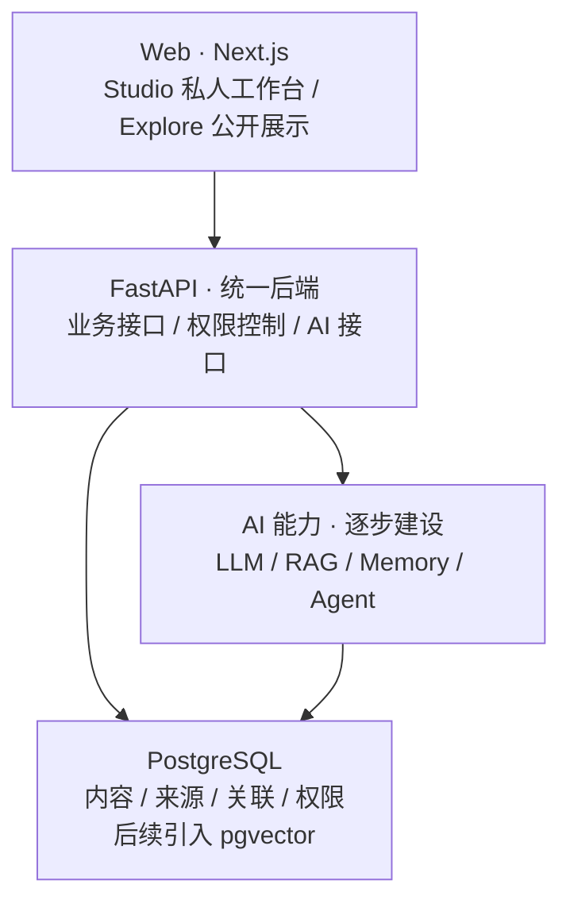

# 灵脑 · Luma
# V1.0 产品需求文档（PRD）

| 文档信息 | 内容 |
|---|---|
| 产品名称 | 灵脑 · Luma |
| 英文名称 | Luma |
| 产品定位 | 个人数字第二大脑 |
| 产品版本 | V1.0 |
| 文档版本 | V1.5.0（修订评审稿） |
| 更新日期 | 2026-11-16 |
| 首要使用者 | 个人所有者 |
| 目标平台 | Web，PC 优先，移动端保持基本可用 |
| 产品体验空间 | 私人 Studio + 公开 Explore |
| 交付方式 | M0 → Alpha → Beta → Release |
| 关联文档 | `PRODUCT-STRATEGY.md`、`PRODUCT-DECISIONS.md`、`ROADMAP.md`、`CORE-DOMAIN-MODEL.md` |

> **产品主张：让知识成为记忆，让记忆产生联系，让联系辅助思考。**

> **文档定位：** 本文档定义灵脑 V1.0 的产品目标、功能范围、用户流程、业务规则和验收标准。它是产品需求基线，不替代 UI 设计、数据库字段设计、API 契约或系统架构文档。

---

## 0. 本次修订说明

**V1.4.2 补充：** 在 V1.4.1 基础上新增 Studio 外观设置（Alpha），明确默认主题、预设切换、偏好保存、内容颜色边界及验收要求；具体色值、字体和间距由设计规范承接。其余既有需求继续有效。

本版本以既有 PRD V1.3 为正文基础，结合最新《产品战略》《产品路线图》和《核心领域模型》进行统一。

| 修订项 | 本次调整 |
|---|---|
| 长期产品方向 | 明确 D：知识管理、个人第二大脑、个人 AI 助手三者融合，不是三个独立产品的拼接 |
| 产品定位 | 明确以个人数字第二大脑为核心定位 |
| V1.0 切入点 | 明确以个人知识管理工作台作为第一阶段入口 |
| 产品空间 | 明确 Studio 优先建设，Explore 在 V1.0 纳入基础发布和阅读闭环 |
| 内容范围 | 明确覆盖工作、学习、生活、兴趣、经历、想法和个人决策，不局限于技术知识 |
| 数据对象 | 与统一内容模型对齐，明确 Content、Space、Category、Tag、ContentRelation、ContentSource、Attachment、ImportJob 和 Publication 的产品职责 |
| 内容类型 | V1.0 采用 Knowledge、Experience、Memory、Thought 四种初始类型 |
| 编辑能力 | 明确 Tiptap、Markdown 与受控 MDX 的不同职责和安全边界 |
| AI 规划 | 明确 AI 是近期核心能力方向；V1.0 不以完整 AI 功能为验收条件，但基础数据稳定后尽早并行验证 LLM、RAG 和评测 |
| 数据保护 | 明确默认私有、回收站、完整备份导出与基础恢复要求 |
| 交付阶段 | 进一步区分 Alpha 基础知识、Beta 知识组织、Release 知识关联及公开发布闭环 |
| 文档边界 | 移除仓库绝对路径和不必要的底层实现细节 |

**版本关系：** V1.4.1 延续 V1.4.0，并替代此前 V1.0.0 评审稿，作为后续产品设计、技术设计和研发任务拆分的需求基线。既有十项产品决策继续有效；本次修订将后续战略讨论转化为 V1.0 的明确边界。

---

## 1. 产品概述

### 1.1 产品定位

灵脑（Luma）是一个面向个人长期使用的**数字第二大脑**。

它帮助个人持续收集、保存、组织、关联和找回在工作、学习、生活、兴趣与思考中产生的信息，包括知识、资料、经验、经历、想法和重要决策。

灵脑不仅保存内容，也关注内容的来源、背景、时间和彼此之间的联系。随着长期积累，过去的知识、经验和思考能够被重新访问、理解和利用。

灵脑的长期方向是将知识管理、个人第二大脑和个人 AI 助手融合为一个持续演进的系统：

- **知识管理是入口：** 先解决信息收集、编辑、组织、搜索和关联问题。
- **个人第二大脑是核心：** 让知识、经历、思考、决策和偏好形成可持续积累、可追溯的个人上下文。
- **个人 AI 助手是长期能力：** 在用户授权范围内理解和调用个人上下文，辅助检索、分析、思考与行动。

三者不是三个独立产品的简单拼接，而是同一套个人数据基础和能力体系的逐步演进。

### 1.2 要解决的核心问题

个人在工作、学习和生活中持续产生大量信息，但这些信息往往分散在聊天记录、文档、网页、文件、笔记工具和个人设备中。

| 核心问题 | 典型表现 | 灵脑的解决方向 |
|---|---|---|
| 信息分散 | 文件、网页、聊天和笔记分布在不同位置 | 统一收集与外部导入 |
| 记录成本高 | 记录前需要决定放在哪里、如何分类 | 快速记录、先收集后整理 |
| 内容难找回 | 过去保存的知识和经历难以定位 | 全文搜索、标签和内容关联 |
| 知识彼此孤立 | 工作、学习、生活和思考之间缺少联系 | 双向链接和关系管理 |
| 经验难以复用 | 过去解决过的问题和作出的决定无法及时调用 | 来源追踪、历史记录和后续 AI 召回 |
| 个人上下文难以延续 | 每次使用 AI 都要重新说明背景 | RAG、Memory 和个性化 AI 助手 |
| 私人内容难以表达 | 希望展示整理后的知识，又不希望私人记录被公开 | Studio 与 Explore 分离、主动发布 |

### 1.3 V1.0 产品目标

V1.0 首先建立可靠、易用、可持续积累的个人知识基础系统：

1. **能记录：** 无需先完成分类即可快速保存知识、资料、经历和想法。
2. **能组织：** 用户可以自定义知识空间、动态分类和标签。
3. **能编辑：** 提供适合日常记录与技术内容的编辑体验。
4. **能导入：** 支持约定范围内的文件、网页资料和 AI 对话记录导入。
5. **能找回：** 支持标题、正文和常用维度检索。
6. **能关联：** 通过双向链接和基础关系类型建立内容联系。
7. **能学习：** 用户可以手动维护适用内容的学习状态。
8. **能表达：** 用户可以主动将指定内容发布到 Explore。
9. **能迁移：** 支持可读导出、完整备份和基础恢复。
10. **能保护：** 私人内容默认私有，发布、导出和数据访问均由用户控制。

### 1.4 V1.0 成功标准

V1.0 至少完成两条相互连接、权限边界清晰的业务闭环：

**私人知识闭环**

快速记录 / 外部导入 → 收集箱 → 分类整理 → 编辑 → 建立关联 → 搜索找回 → 导出与备份。

**公开表达闭环**

Studio 创建内容 → 编辑和预览 → 用户主动发布 → Explore 公开阅读 → 更新或撤回发布。

验收时还应满足：

- 数据在页面刷新、重新登录和正常服务重启后保持完整；
- 内容具有稳定身份，移动分类不破坏已有引用；
- 私人内容不能通过公开页面、搜索、关联、附件或缓存泄露；
- 用户能够导出自己的数据，并从灵脑备份包恢复到空白工作区。

### 1.5 V1.0 不承担的长期承诺

V1.0 不承诺完整实现自动记忆、复杂多 Agent、自主执行或全平台自动采集。上述能力属于灵脑的长期演进方向；AI 知识助手则作为紧随基础数据能力之后的近期阶段，允许提前开展技术验证。

---

## 2. 产品战略与已确认决策

### 2.1 长期产品方向：D——三者融合

| 层次 | 定位 | 作用 |
|---|---|---|
| 知识管理工具 | V1.0 的实际入口 | 记录、导入、编辑、组织、搜索和关联 |
| 个人第二大脑 | 灵脑的核心定位 | 长期积累个人知识、经历、思考和决策，形成个人上下文 |
| 个人 AI 助手 | 长期能力形态 | 基于个人上下文提供检索、分析、辅助思考和任务执行 |

V1.0 先把知识管理基础做可靠；产品设计和数据模型从一开始就围绕个人第二大脑组织；AI 能力在基础链路稳定后尽早进入验证和迭代。

### 2.2 已确认的十项产品决策

| # | 维度 | 已选方案 | V1.0 落地原则 |
|---|---|---|---|
| 01 | 产品形态 | 混合型数字第二大脑 | 先建立可靠的知识管理基础，逐步融合 AI |
| 02 | 知识组织 | 树状目录 + 网状关联 | 分类树与内容关系独立管理 |
| 03 | 内容编辑 | Tiptap 混合编辑器 | 可视化编辑，支持 Markdown 常用语法及导入导出 |
| 04 | 首页形态 | 数字大脑控制台 | Studio 控制台以快速记录、查找和继续处理为主 |
| 05 | 内容录入 | 统一收集箱 + 知识整理 | 先收集、后整理，保留原始来源 |
| 06 | 内容模型 | 统一内容中心 + 记忆类型 | Knowledge / Experience / Memory / Thought |
| 07 | 检索路线 | 分阶段智能检索 | V1.0 关键词/全文检索，后续引入语义检索和 RAG |
| 08 | 知识关联 | 双向链接 + 可选关系类型 | 支持 `[[...]]`、反向引用和基础关系类型 |
| 09 | 学习管理 | 掌握度 + 渐进式复习 | V1.0 仅手动维护学习状态，复习算法后续 |
| 10 | 交付方式 | 分阶段交付 | Alpha 基础知识、Beta 知识组织、Release 知识关联 |

### 2.3 其他已确认的战略约束

| 维度 | 当前决策 |
|---|---|
| 首要用户 | 个人所有者，先以真实自用验证 |
| 内容覆盖范围 | 工作、学习、生活、兴趣、经历、思考和个人决策 |
| V1.0 信息采集 | B：主动记录 + 外部导入 |
| 长期信息采集 | C：尽可能自动化采集，遵守授权和隐私规则 |
| 产品空间 | 私人 Studio + 公开 Explore |
| 建设顺序 | Studio 优先；Explore 在 V1.0 提供基础发布和阅读闭环 |
| AI 定位 | 近期核心能力方向；基础链路稳定后尽早启动 LLM/RAG 验证 |
| 编辑表达 | 富文本、Markdown 和受控 MDX |
| 分类原则 | 用户动态创建，不将工作、学习、生活等固定目录写死 |
| 数据原则 | 来源可追溯、用户可导出、私人内容默认私有 |
| 当前商业化 | 先验证个人长期使用价值，不以商业化为 V1.0 前提 |

### 2.4 产品原则

1. **面向一个完整的人：** 不把工作或技术知识作为唯一中心。
2. **用户定义自己的知识体系：** 空间、分类和标签由用户动态组织。
3. **先收集，再整理：** 不让分类和元数据成为记录的前置门槛。
4. **内容与组织结构分离：** 内容拥有稳定身份，分类变化不破坏内容关系。
5. **来源与时间可追溯：** 区分内容发生时间、记录时间和导入时间。
6. **用户拥有数据：** 支持可读、可迁移的导出和备份。
7. **隐私默认优先：** 保存、整理和 AI 处理都不代表公开。
8. **AI 可解释、可纠正、可控制：** 区分原始内容、用户确认信息和模型推断。
9. **可靠性优先于自动化程度：** 自动采集和 Agent 不能牺牲数据可靠性。
10. **避免功能堆砌：** 新功能必须改善信息沉淀、知识组织、找回或利用。

---

## 3. 产品体验结构

灵脑由两个体验空间和一层逐步建设的智能能力组成。

### 3.1 Studio｜私人创作与管理空间

Studio 是灵脑优先建设的核心工作空间，只有所有者登录后才能访问。

主要职责：

- 快速记录与统一收集；
- 文件、网页和 AI 对话资料导入；
- 知识空间、分类和标签管理；
- 内容创建、编辑、预览和归档；
- 私人搜索和知识关联；
- 学习状态管理；
- 内容发布、撤回和数据导出；
- 后续 AI 助手和个人记忆管理。

Studio 的体验重点是效率、清晰的信息层级和低摩擦操作。它可以借鉴 Notion 等成熟产品的工作台能力，但不复刻其全部功能。

### 3.2 Explore｜公开知识展示空间

Explore 是灵脑面向访客的公开展示与阅读空间，不需要访客登录。

主要职责：

- 展示灵脑品牌和公开知识入口；
- 浏览用户主动发布的内容；
- 阅读具有完整排版的知识文章；
- 浏览公开分类和标签；
- 搜索已发布内容；
- 展示安全的公开内容关联。

Explore 不是 Studio 的简单只读镜像，也不是通用网站搭建器。它应具有独立、完整的阅读体验。

**V1.0 范围：** 提供基础公开首页、公开内容列表、文章详情和基础公开搜索；暂不建设评论、关注、社区和复杂内容运营系统。

### 3.3 AI 能力层｜贯穿产品的智能能力

AI 不是与知识系统割裂的独立聊天网站，而是逐步融入 Studio 的能力层。

产品体验上，AI 可以通过以下方式出现：

- 全局 AI 助手入口；
- 内容编辑页中的摘要、解释和整理建议；
- 搜索场景中的自然语言提问；
- 基于个人知识的问答和来源召回；
- 后续个人记忆管理与 Agent 任务入口。

产品和系统边界：

- AI 的交互入口位于 Studio；
- AI 的模型调用、检索编排和权限过滤由服务端能力承接；
- AI 只能使用当前用户有权访问且已授权用于当前任务的数据；
- AI 生成结果与用户原始内容分离；
- 重要内容的写入、修改、删除和公开需要遵循明确授权规则。

**V1.0 不要求交付完整 AI 助手界面。** 在内容模型、核心 API 和权限链路稳定后，尽早启动 AI 知识助手验证，不等待所有长期功能完成。

### 3.4 两个空间的关系

- Studio 是内容的创建、编辑和管理源头。
- Explore 只展示用户明确发布的内容。
- 保存不等于公开，整理不等于发布。
- AI 总结、分类、关联和记忆提取不自动改变公开状态。
- 撤回发布后，公开页面、搜索、关联和附件都必须停止暴露该内容。
- 两个空间共享内容基础，但使用不同的访问规则和响应数据范围。

---

## 4. 用户角色与访问边界

### 4.1 V1.0 用户角色

| 角色 | 是否登录 | 核心权限 |
|---|---|---|
| 所有者 | 是 | 管理全部个人内容、空间、分类、标签、来源、附件、关联、发布和导出 |
| 访客 | 否 | 浏览公开首页、已发布内容、公开分类和公开搜索结果 |

V1.0 优先支持单个个人所有者，不开放公开注册，不建设团队协作和复杂 RBAC。业务数据保留所有者归属关系，为后续扩展保留空间。

### 4.2 权限基本规则

1. 所有新建内容和导入内容默认私有。
2. 未登录用户不能访问 Studio 和任何私人 API。
3. 所有者只能访问属于自己的私人数据。
4. 访客只能访问明确发布且状态有效的内容。
5. 公开 API 必须使用专门的公开响应字段，不直接返回后台完整数据对象。
6. 私人来源备注、原始导入元数据、学习状态、管理字段和未发布内容不得被间接暴露。
7. 公开关联只能展示目标内容同样处于已发布状态的内容。
8. 公开附件必须由所有者明确纳入发布范围。
9. 撤回发布后，公开缓存、搜索索引、列表、站点地图和关联入口不得继续返回正文。
10. 前端隐藏入口不能替代服务端鉴权。

### 4.3 账户规则

- V1.0 只维护一个所有者账号。
- 首次部署通过受保护的初始化流程创建所有者，不提供公开注册。
- 登录失败使用通用错误提示，不泄露账号是否存在。
- 登录状态在有效期内保持；退出后会话失效。
- 支持修改密码。
- 忘记密码在 V1.0 采用服务器管理员重置方式，不提供公开邮件找回流程。
- 会话、密码哈希、CSRF、限流等具体实现由系统架构文档定义。

---

## 5. 信息组织与内容模型

本章只定义用户可理解的业务概念和行为，不替代 `CORE-DOMAIN-MODEL.md` 或 `DATABASE.md` 的字段设计。

### 5.1 统一内容中心（Content）

灵脑中的知识、资料、经历、想法和个人记录由统一的内容对象承载。

每条内容应具有稳定身份，并可拥有：

- 标题和正文；
- 内容类型；
- 主知识空间和主分类；
- 标签；
- 来源记录；
- 附件；
- 内容关联；
- 整理状态；
- 可选学习状态；
- 独立的发布状态。

内容可以暂时没有空间、分类和标签，尤其是刚创建或刚导入的收集箱内容。

### 5.2 内容类型（Content Type）

V1.0 提供四种初始类型：

| 类型 | 主要用途 | 示例 |
|---|---|---|
| Knowledge｜知识 | 概念、原理、方法、技术知识和参考资料 | React Hooks、数据库索引 |
| Experience｜经历 | 实践过程、项目经验、问题解决和复盘 | 项目故障处理、工作复盘 |
| Memory｜记忆记录 | 用户主动记录的重要个人事实、事件和背景 | 重要经历、个人目标、重要决定 |
| Thought｜想法 | 个人观点、灵感、判断和思考 | 对某个问题的看法、灵感记录 |

**类型边界：**

- 内容类型描述内容性质，不代表它属于哪个人生领域。
- “工作、学习、生活、兴趣”等通过用户自建空间和分类组织。
- 文档、网页和图片等资料可以作为内容正文或来源附件，不额外强制成为第五种内容类型。
- V1.0 使用上述四种初始类型；用户自定义内容类型管理暂不纳入必须范围。
- 用户可以调整内容类型，但不能因类型变化导致正文、来源和关联丢失。
- 用户主动创建的 `Memory` 内容类型，不等同于未来 AI 提取和管理的 `MemoryItem`。

### 5.3 知识空间（Space）

知识空间是用户自定义的较大组织范围，例如技术、工作、学习、生活、兴趣或个人思考。

- 用户可以创建、重命名、排序和管理空间。
- 空间名称和数量不写死。
- 内容可以暂时不归属任何空间。
- V1.0 一条内容最多归属一个主空间。

### 5.4 分类（Category）

分类是空间内部的层级目录：

- 支持多级分类；
- 分类可以创建、重命名和移动；
- 父子分类必须属于同一空间；
- 禁止移动到自身或其后代；
- 内容可以暂时没有分类；
- V1.0 一条内容最多归属一个主分类；
- 分类移动和重命名不改变内容 ID。

### 5.5 标签（Tag）

标签用于跨空间、跨分类的横向标记：

- 一条内容可以有多个标签；
- 一个标签可以关联多条内容；
- 标签不承担树状目录职责；
- 删除标签不删除内容。

### 5.6 内容关联（Content Relation）

内容关联用于连接不同知识、经历和想法：

- 关联基于稳定内容 ID，不依赖标题文本；
- 支持双向链接和反向引用；
- 允许跨空间、跨分类关联；
- V1.0 支持基础关系类型：相关、前置知识、实际应用、对比；
- 普通“相关”关系按双向展示；有方向的关系保留起点和目标；
- 不允许内容关联自身；
- 不要求 V1.0 自动发现关系或提供完整图谱可视化。

### 5.7 内容来源（Content Source）

来源用于记录内容从哪里产生或导入：

- 手动创建；
- 文件导入；
- 网页；
- AI 对话；
- 其他来源。

尽可能保留原始标题、URL、文件名、来源平台、外部标识、发生/发布时间和导入时间。内容正文后续修改不得覆盖原始来源记录。

### 5.8 附件（Attachment）

附件用于保存图片、文档和原始导入文件：

- 附件默认私有；
- 附件与内容关联；
- 原始导入文件与正文解析结果应能够区分；
- 公开内容中的附件必须由所有者明确选择公开；
- 撤回内容发布后，相关公开附件也必须停止匿名访问。

### 5.9 导入任务（Import Job）

一次导入可以包含多个导入项目：

- 每个批次能够查看总数、成功数和失败数；
- 单个项目能够查看处理状态和错误原因；
- 支持部分成功，不把批次失败等同于所有项目失败；
- 尽可能识别重复导入；
- 导入内容默认进入收集箱并保持私有。

### 5.10 内容状态

内容的整理状态、发布状态和学习状态相互独立。

**整理状态**

| 状态 | 含义 |
|---|---|
| Inbox｜待整理 | 已保存但尚未完成组织 |
| Organized｜已整理 | 已完成基本整理 |
| Archived｜已归档 | 不再作为日常活跃内容 |

**发布状态**

| 状态 | 含义 |
|---|---|
| Draft｜私有草稿 | 未公开；没有有效发布记录 |
| Published｜已发布 | 访客可以访问公开字段 |
| Withdrawn｜已撤回 | 曾经发布，但当前不允许公开访问 |

**学习状态**

| 状态 | 含义 |
|---|---|
| To Learn｜待学习 | 尚未开始 |
| Learning｜学习中 | 正在学习 |
| Understood｜已理解 | 已理解主要内容 |
| Applied｜能应用 | 能在实际场景中使用 |

学习状态由用户手动维护，不通过阅读次数或 AI 自动推断掌握度。

### 5.11 删除与回收站

- 用户删除内容时，内容先进入回收站，不立即物理删除。
- 用户可以从回收站恢复内容。
- 用户可以明确执行永久删除；永久删除前必须提示影响。
- 永久删除时应处理内容关联、附件和派生索引，不能留下不可解释的悬空引用。
- V1.0 不设置未经确认的自动清理期限。
- 删除非空空间或分类时，系统默认阻止直接删除；用户应先迁移或处理其中的内容和子分类，不允许无提示级联删除。

---

## 6. V1.0 功能范围与优先级

### 6.1 P0｜V1.0 核心必需

- 单所有者登录和私人权限；
- Studio 基础框架和数字大脑控制台；
- 统一内容创建、查看、编辑、保存和删除；
- Tiptap 基础编辑器；
- 快速记录和基础收集箱；
- 动态知识空间和多级分类；
- 四种初始内容类型；
- 标签；
- 标题与正文搜索；
- 来源记录和附件关联；
- 基础内容关联与反向引用；
- 内容主动发布和撤回；
- Explore 基础公开首页和内容详情；
- 私人/公开数据权限隔离；
- Markdown 导出和完整备份/恢复。

### 6.2 P1｜V1.0 分阶段交付

- DOCX/PDF 文本提取与原文件保留；
- ChatGPT 官方导出数据的首批导入适配；
- 网页 URL 保存及可获取正文提取；
- 导入批次、单项状态和失败原因；
- 组合筛选、分页和搜索结果高亮；
- 关系类型和关系说明；
- 学习中心和掌握状态筛选；
- Explore 公开内容列表、公开搜索和基础 SEO；
- Studio 外观设置：预设底色与强调色切换、即时生效和偏好保存（Alpha）；
- 受控 MDX 源码保存与安全预览；
- 从完整备份包恢复到空白工作区。

P0/P1 均属于 V1.0 范围，区别在于实现顺序，不代表 P1 自动延期到 V1.1。

### 6.3 V1.0 明确不做

- AI 自动写入个人记忆；
- AI 自动修改、删除、发布或整理用户内容；
- 完整 RAG 问答和语义搜索作为 V1.0 发布门槛；
- 多 Agent 协作和复杂自主执行；
- 完整可视化知识图谱；
- 自动间隔复习、AI 出题和考试系统；
- 多用户团队协作和复杂 RBAC；
- 评论、点赞、关注、社区和内容信息流；
- 通用网站搭建器；
- 全平台自动采集和后台定时同步；
- 任意第三方平台一键连接；
- 任意 JSX/MDX 组件执行；
- 完整内容审批、定时发布和多人审核；
- 完整的商业化、订阅和计费系统。

---

## 7. 功能需求

### 7.1 ACC｜账户与身份认证（M0 / Alpha）

**功能要求**

- V1.0 只维护单个所有者账号，不提供公开注册。
- 首次部署通过受保护的初始化命令或等价流程创建所有者。
- 登录页提供账号、密码、提交中状态、密码显隐和错误反馈。
- 登录成功进入 Studio；未登录访问 Studio 时进入登录流程。
- 登录状态在有效期内保持；退出后服务端会话失效。
- 支持修改当前用户密码。
- 忘记密码通过服务器管理员重置，不提供公开邮件找回。

**安全要求**

- 服务端执行认证和资源归属检查；
- 密码使用安全哈希存储；
- 登录失败不泄露账号存在性；
- 登录接口具备基础限流；
- 会话采用安全 Cookie 等方式，具体实现由系统架构定义；
- 敏感配置和密钥不得写入仓库或前端代码。

### 7.2 STU｜Studio 工作台（Alpha）

Studio 首页定位为安静的「个人思想动态档案」，让用户重新进入自己的思想世界。个人思考与经历是主角，快速记录和搜索为辅助；不采用信息密集、不断推送的 Dashboard，不以统计、完成率、待办和大量卡片为中心。

- 最近的思考：长期展示正在延续的已确认脉络及其相关记录、变化和待解问题。V1.0 无足够关联依据时展示真实的最近记录，不用更新时间列表冒充思考脉络。
- 值得回看：V1.0 使用用户人工组织的记录与基础关联；收藏能力是否新增待确认。AI 推荐属于后续阶段，应说明回看理由。
- 记录此刻：保留轻量快速记录入口，不要求先分类、建立主题或填写决策表单。
- 待确认记忆：后续 AI 阶段提供安静、可集中处理的入口，不逐条推送；V1.0 不建设，不用空卡片占位。
- 空库时提供真实引导；空间、导入、备份等由导航承接，首页不重复堆叠全部功能入口。

**验收重点：** 可以方便地记录、搜索和回看；没有数据时不制造内容；未实现的 AI 能力不得展示为真实结果。当前原型尚需按本节重新设计，不代表已完成首页改版。

### 7.3 INB｜快速记录与收集箱（Alpha / Beta）

**Alpha 基础能力**

- 从 Studio 任意主要页面进入快速记录；
- 允许先输入正文，不强制填写空间、分类和标签；
- 保存后生成稳定内容 ID；
- 新记录默认进入 Inbox；
- 保存成功后能够立即重新打开。

**Beta 完整整理能力**

- 收集箱列表、筛选和分页；
- 补充标题、内容类型、空间、分类和标签；
- 将记录整理为正式内容；
- 归档或删除；
- 批量整理可作为 Beta 增强项，未通过验收前不作为基础能力承诺。

**关键规则**

- 整理前后使用同一个 Content ID；
- 重复点击整理不得创建重复内容；
- 整理不触发公开发布；
- 原始来源和必要的导入上下文必须保留。

### 7.4 CNT｜内容创建与编辑（Alpha / Beta）

**基础编辑能力**

- 创建、查看、编辑、保存和删除内容；
- 支持标题、段落、标题层级、粗体、斜体、列表、引用、链接、代码块和基础表格；
- 支持代码语言标记和合理的代码展示；
- 支持常见 Markdown 快捷输入；
- 显示保存中、已保存和保存失败状态；
- 服务端成功响应后才能显示“已保存”；
- 离开页面前发现未保存修改时，应提示用户。

**内容表示格式**

| 格式 | V1.0 定位 | 要求 |
|---|---|---|
| Tiptap JSON | 可视化编辑器的结构化正文 | 作为富文本编辑的主要存储表示 |
| Markdown | 通用文本格式和迁移格式 | 支持导入、导出、源码编辑或预览 |
| MDX | 高级内容表达 | 支持受控源码保存与安全预览；不要求任意组件可视化编辑 |

**MDX 安全边界**

- 只允许受控组件白名单；
- 不允许把任意用户输入的 JSX 当作可信代码执行；
- 不承诺 Tiptap、Markdown 和 MDX 之间任意内容无损双向转换；
- 不支持的节点或组件必须给出明确提示，不得静默丢失内容。

**图片与附件**

- 支持约定范围内的图片和文件上传；
- 上传失败提供明确反馈；
- 附件默认私有；
- 具体大小、格式白名单和预览能力由技术设计确定。

### 7.5 SPC｜知识空间与动态分类（Beta）

- 用户可以创建、重命名、排序和管理知识空间；
- 用户可以创建多级分类、重命名和移动分类；
- 分类父子节点必须属于同一空间；
- 禁止移动到自身或后代；
- 内容可以暂时没有空间和分类；
- V1.0 每条内容最多归属一个主空间和一个主分类；
- 分类移动和重命名不改变内容 ID；
- 删除非空空间或分类时阻止直接删除，先要求迁移或处理子级和内容。

### 7.6 TYP｜内容类型与标签（Beta）

- V1.0 提供 Knowledge、Experience、Memory、Thought 四种初始类型；
- 内容类型可以在编辑时修改；
- V1.0 不提供自定义内容类型管理；
- 标签由用户动态创建；
- 标签可以跨空间和分类使用；
- 一条内容可以关联多个标签；
- 删除标签不删除内容；
- 内容类型、空间、分类和标签不可互相替代。

### 7.7 IMP｜外部资料导入（Beta）

外部导入是 V1.0 的正式能力，采用“主动记录 + 外部导入”，不承诺全平台自动同步。

**文件导入**

| 格式 | V1.0 要求 |
|---|---|
| Markdown | 解析正文和常用结构，保留必要元数据 |
| TXT | 读取文本并允许用户补充标题 |
| DOCX | 提取基础文本和常用结构；无法完整解析时保留原文件并提示 |
| PDF | 提取可读取文本；复杂版式不承诺完全还原，保留原文件 |
| 图片及其他附件 | 作为附件保存；OCR 不作为 V1.0 必须能力 |

**AI 对话导入**

- 首批优先验证 ChatGPT 官方导出格式；
- 上传后识别可导入会话；
- 导入前允许预览并选择会话；
- 尽可能保留会话标题、消息角色、内容和时间；
- 记录来源平台、导入时间和外部标识（可获取时）；
- 不支持的导出格式明确提示，不静默丢弃。

**网页资料保存**

- 用户可以粘贴网页 URL；
- 保存原始 URL、可获取的标题和保存时间；
- 在网页可访问且技术允许时尝试提取正文；
- 无法提取正文时仍允许保存链接并补充个人摘要；
- 不绕过登录、付费墙或网站访问限制。

**导入处理**

- 以 ImportJob 记录一次批次；
- 以 ImportItem 记录单个导入对象；
- 展示排队、处理中、成功、部分失败和失败状态；
- 单个项目显示错误原因；
- 尽可能识别重复导入；
- 导入内容默认进入收集箱并保持私有；
- 文件接收成功不等于正文解析成功，需分别反馈。

### 7.8 SRC｜来源与附件管理（Beta）

- 每条内容可以有多个来源；
- 手动创建、文件导入、网页和 AI 对话来源应可区分；
- 保存原始 URL、原始文件名、来源平台、导入时间和可获取的外部 ID；
- 区分内容创建时间、来源发生时间和导入时间；
- 编辑正文不得覆盖原始来源记录；
- 附件使用内部存储定位信息，不以公开 URL 作为唯一标识；
- 原始文件可以作为来源附件保留；
- 公开附件必须由用户明确选择纳入发布。

### 7.9 SEA｜搜索与筛选（Alpha / Beta）

**Alpha 基础搜索**

- 按标题和正文关键词搜索；
- 搜索结果能够打开对应内容；
- 无结果时展示空状态。

**Beta 完整搜索**

- 支持空间、分类、内容类型、标签和时间筛选；
- 支持组合筛选、分页和排序；
- 显示匹配摘要或高亮片段；
- 移动、归档、删除和恢复后的搜索结果保持一致；
- Studio 搜索包含所有者有权访问的私人内容；
- Explore 搜索只查询已发布内容。

**中文搜索要求**

中文检索质量必须通过真实中文样本验收。具体分词、n-gram 或其他检索实现由 `DATABASE.md` 和 `API.md` 确定，不能将默认英文分词效果视为中文检索已经合格。

### 7.10 REL｜知识关联与反向引用（Release）

- 支持通过 `[[关键词]]` 搜索并选择目标内容；
- 支持从内容详情建立、查看和删除关联；
- 支持反向引用列表；
- 支持基础关系类型：相关、前置知识、实际应用、对比；
- 普通“相关”关系按双向方式展示；
- 有方向的关系必须保留起点和目标；
- 关联两端必须属于同一所有者；
- 不允许内容关联自身；
- 删除内容后不能留下不可解释的悬空关联；
- Explore 只展示两端均已发布的关联，不暴露私人内容标题、摘要或 ID。

V1.0 不要求自动关系发现、复杂关系本体或完整知识图谱可视化。

### 7.11 LRN｜学习状态管理（Release）

- 用户可以为适用内容设置待学习、学习中、已理解、能应用；
- 用户可以修改或清除学习状态；
- 学习中心按状态查看和筛选；
- 学习状态不由阅读次数自动推断；
- V1.0 不实现间隔复习调度、自动出题和考试系统。

### 7.12 PUB｜内容发布与 Explore（Release）

**发布原则**

- 新建和导入内容默认私有；
- 整理、分类、标签、关联和 AI 处理都不会自动发布；
- 只有所有者在 Studio 中主动执行发布，内容才允许匿名访问；
- 发布前展示公开预览和明确的公开提示；
- Memory 类型内容在发布前增加隐私提醒；
- 草稿预览必须经过所有者身份验证。

**发布行为**

1. 内容达到可发布条件：具有标题和可展示正文。
2. 所有者在 Studio 中预览公开效果。
3. 所有者主动确认发布。
4. 系统创建或更新 Publication，并生成稳定公开地址。
5. 已发布内容再次编辑并保存时，V1.0 默认立即更新线上内容；编辑界面应提示该行为。
6. 撤回发布后，内容仍保留在 Studio，但匿名访问失效。
7. 标题修改不自动改变已生成的公开 slug。
8. 公开附件必须单独勾选纳入发布范围。

**Explore 页面**

| 页面 | 路由建议 | 主要功能 |
|---|---|---|
| 公开首页 | `/` | 品牌表达、公开知识入口、最近发布内容 |
| 知识探索 | `/knowledge` | 已发布内容列表、公开分类和标签 |
| 内容详情 | `/knowledge/[slug]` | 正文阅读、代码展示、目录和公开关联 |
| 公开搜索 | `/search` | 只检索已发布内容 |
| 不可用页面 | Next.js not-found | 不存在、未发布或已撤回内容的统一不可用体验 |

V1.0 公开首页默认按最近发布时间展示，不要求手动精选内容管理。公开页面应具备基本响应式布局、可读性和 SEO 信息。

**撤回要求**

撤回后以下位置均不得继续暴露内容：

- 公开详情页；
- 公开列表和搜索结果；
- 公开关联区域；
- 站点地图；
- 公开附件；
- CDN、页面缓存或其他可访问缓存。

对已撤回或未发布内容，匿名访问应返回 404 或等价的不泄露结果。

### 7.13 DAT｜数据导出、备份与恢复（Release）

**Markdown 导出**

- 支持单条或批量内容导出；
- 保留标题和正文；
- 尽可能导出来源、标签、空间和分类等必要元数据；
- 不支持的富文本节点应提示转换限制。

**完整备份**

完整备份包至少包含：

- 内容及正文；
- 内容类型；
- 空间和分类结构；
- 标签及内容标签关系；
- 内容关联；
- 来源记录；
- 附件及必要文件；
- 整理状态、学习状态和发布状态；
- 备份清单、格式版本和生成时间。

**恢复规则**

- V1.0 支持从灵脑完整备份包恢复到空白工作区；
- 恢复前展示备份版本、内容数量和附件数量，并要求用户确认；
- V1.0 不要求将备份合并到已有内容的工作区；
- 恢复后应保留稳定 ID、内容关系和来源；
- 恢复过程失败时不得留下被误认为完整成功的半成品数据；
- 私人备份文件只允许所有者下载。

**数据边界**

Markdown 导出用于内容迁移和阅读；完整备份用于数据恢复。两者不能互相替代。

### 7.14 AI｜AI 能力准备与近期迭代边界

**V1.0 必须具备的数据基础**

- 稳定的 Content ID；
- 可检索的正文文本；
- 来源和必要时间信息；
- 空间、分类、标签和内容关系；
- 用户归属和权限边界；
- 内容更新后可识别派生索引是否过期；
- AI 派生结果与原始正文分离的能力。

**V1.0 不要求**

- Embedding 和向量检索正式上线；
- RAG 问答作为 Release 验收条件；
- AI 自动记忆写入；
- Agent 自主执行；
- 完整 AI 评测平台。

**近期 AI 阶段优先验证**

- LLM 总结、解释、改写和内容整理建议；
- RAG 个人知识问答；
- 回答引用原始内容和来源；
- AI 分类与关联建议，由用户确认后写入；
- 基础评测：检索相关性、回答依据、引用准确性和权限隔离。

AI 技术验证可以在内容模型、核心 API 和权限规则稳定后并行启动，不必等待 V1.0 所有功能全部完成。近期目标窗口约为基础链路稳定后的一个至两个月，属于规划预期，不是固定发布日期承诺。

---

#### AI 产品规则｜本轮讨论确认（2026-11-16）

**价值闭环。** 灵脑既支持分类、搜索以快速复现知识，也支持把人生思考片段串成可追溯的脉络。长期闭环为：自由记录 → 发现联系 → 用户确认 → 有引用的梳理与回顾 → 辅助当下判断和任务 → 留下新的经历、选择与反思。重要决定可轻量补记选择、理由和担忧，不强制改变日常记录习惯。

**来源优先级。** 首批重点为 AI 对话（官方导出导入）与 Studio 日常随记；其次为工作项目文件，之后扩展网页、文章、书籍等外部资料。此为接入优先方向，具体格式、容量和阶段排期待确认，不自动变更既有全部交付承诺。

**对话溯源。** 保留角色、消息顺序、时间及来源；区分用户提问、个人表达、引用、AI 建议、明确认可和后续否定。提问不等于信念，AI 回答不等于用户观点，内容出现在用户消息中也不必然代表认可。示意案例不得写成用户真实经历。

**分级控制。** 支持按来源设置默认权限，并按内容调整：仅保存、允许 AI 理解、允许提取长期记忆、完全排除。理解与记忆权限可分别控制，不能因保存即推定授权；Agent 执行权限另行定义。新导入 AI 对话默认允许理解、提取候选记忆，但候选必须经用户确认后才作为长期个人上下文生效。未经确认的线索不得冒充个人事实。记忆保留证据，允许纠正、拒绝、删除；权限继承冲突、撤权后的衍生数据处理与清除规则待设计，不默认继续使用已撤权内容。

**思考脉络。** 它是持续演变的个人主题，不是分类、标签或文件夹。自由记录为基础，AI 发现为核心，用户确认作为边界，主动创建作为补充。AI 提出主题时展示相关记录和关联理由，经确认才形成正式脉络。后续新记录先进入「可能相关」，由用户决定是否加入；拒绝或忽略不改变原始记录。主题确认不代表认可其中全部观点，允许矛盾、犹豫和被否定的表达共存。

**阅读体验。** 先呈现带原文引用的脉络梳理，再提供完整时间线；引用可返回原文。重要判断和观点差异须有来源，推断与明确表达分开，允许用户纠正，无证据时留白。时间先后不能直接推出因果或成长。

**梳理版本。** 自动发现有意义的变化、生成候选新版并标明变化和证据，不自动覆盖已确认版本；用户接受后切换当前版本并保留历史，保留旧版时不替换。不是每条新记录都触发更新。AI 不改写原始记录。新增材料、观点差异、AI 解读修正应分开呈现，不能把梳理版本变化当成人的认知变化。旧版未覆盖新增材料的提示、历史恢复与人工纠正的继承方式待交互设计。

**Agent 定位。** LLM 负责理解与生成，RAG 提供检索证据，Memory 延续经确认的个人上下文，Agent 规划步骤、调用工具完成任务并将结果沉淀回来。它们是同一体系中的能力，不拆成互不相干的产品；Agent 不只是聊天窗口。整理、个人研究、决策辅助可作为验证方向，具体首个任务待确认。重要写入、发布、删除遵循明确授权，不因记忆权限自动获得执行权。

**交付边界。** V1.0 继续建设记录、导入、分类、检索、来源与人工关联基础，可用人工组织的记录和时间线验证体验；独立脉络对象与人工时间线的具体交付阶段待确认。自动发现主题、候选关联、记忆提取确认、AI 梳理版本管理属于后续 AI 阶段，不作为 V1.0 验收前提。产品规则以本节为准，数据模型和路线图只承接对应职责。

### 7.15 APP｜Studio 外观设置（Alpha）

**入口与默认主题**

- 在“设置 → 外观”中配置，路由建议为 `/studio/settings/appearance`。
- 默认采用已选定的暖白底色与灰紫强调色；具体色值、字体、间距和组件视觉状态由设计规范定义。

**预设配置**

| 配置项 | V1.0 预设 | 影响范围 |
|---|---|---|
| 界面底色 | 暖白（默认）、清白 | Studio 画布、侧栏、界面文字、分隔线等基础搭配 |
| 主题强调色 | 灰紫（默认）、靛蓝、松绿、石墨 | 主按钮、链接、选中状态、输入焦点等交互元素 |

- 底色与强调色可独立选择；所有提供的组合均应保证文字、按钮和状态清晰可辨。
- 选择后即时生效，无需额外保存操作，并保存用户偏好；同一浏览器刷新或重新进入 Studio 后保持选择。
- V1.0 不要求跨浏览器或跨设备同步外观偏好；具体保存方式由技术设计确定。
- 切换统一作用于 Studio 界面，不修改正文内容、用户设置的内容颜色、图片、附件或代码语义。
- Studio 的个人外观偏好与 Explore 公开展示样式独立；切换不改变公开页面样式，也不新增 Explore 主题编辑能力。

**范围边界**

- V1.0 只提供预设，不支持任意色号自定义。
- 深色模式与跟随系统模式留待后续迭代。
- 主题配置不改变布局、内容组织、权限和发布状态。

**验收重点：** 预设组合切换一致、文字清晰、偏好可保存；内容颜色和 Explore 不受影响。

---

## 8. 信息架构与页面清单

### 8.1 Studio｜私人工作空间

| 编号 | 页面 | 路由建议 | 主要职责 | 阶段 |
|---|---|---|---|---|
| ST-01 | 登录 | `/login` | 所有者身份验证 | M0 |
| ST-02 | 数字大脑控制台 | `/studio` | 快速记录、最近内容、收集箱和空间入口 | Alpha |
| ST-03 | 收集箱 | `/studio/inbox` | 查看和整理待处理内容 | Alpha 基础 / Beta 完整 |
| ST-04 | 知识空间 | `/studio/spaces` | 空间列表和管理 | Beta |
| ST-05 | 空间详情 | `/studio/spaces/[spaceId]` | 分类树和内容列表 | Beta |
| ST-06 | 内容编辑与详情 | `/studio/contents/[contentId]` | 编辑正文、来源、附件、标签和关联 | Alpha / Beta / Release |
| ST-07 | 全局搜索 | `/studio/search` | 私人搜索、筛选和结果列表 | Alpha 基础 / Beta 完整 |
| ST-08 | 导入中心 | `/studio/imports` | 文件、网页和 AI 对话导入 | Beta |
| ST-09 | 学习中心 | `/studio/learning` | 学习状态管理和筛选 | Release |
| ST-10 | 回收站 | `/studio/trash` | 恢复和永久删除内容 | Alpha 基础 / Release 完整 |
| ST-11 | 数据管理 | `/studio/settings/data` | Markdown 导出、备份和恢复 | Release |
| ST-12 | 账户设置 | `/studio/settings` | 账户信息和密码管理 | M0 / Alpha |
| ST-13 | 外观设置 | `/studio/settings/appearance` | 预设底色与强调色配置、即时预览和偏好保存 | Alpha |

### 8.2 Explore｜公开展示空间

| 编号 | 页面 | 路由建议 | 主要职责 | 阶段 |
|---|---|---|---|---|
| EX-01 | 公开首页 | `/` | 品牌表达、公开知识入口、最近发布内容 | Release |
| EX-02 | 知识探索 | `/knowledge` | 已发布内容列表和分类浏览 | Release |
| EX-03 | 内容详情 | `/knowledge/[slug]` | 公开文章阅读和安全关联 | Release |
| EX-04 | 公开搜索 | `/search` | 仅检索已发布内容 | Release |
| EX-05 | 不可用页面 | Next.js not-found | 不存在、未发布或已撤回内容 | Release |

### 8.3 AI 交互入口（后续阶段）

| 页面/组件 | 规划职责 | 阶段 |
|---|---|---|
| Studio AI 助手面板 | 基于个人知识进行问答和来源召回 | AI 知识助手 |
| 内容上下文操作 | 总结、解释、分类和关联建议 | AI 知识助手 |
| Memory 管理 | 查看、确认、纠正和删除个人记忆 | Personal Memory |
| Agent 任务面板 | 展示计划、工具调用、执行状态和确认 | Personal AI Assistant |

AI 不需要在 V1.0 先建设一个独立的复杂 AI 首页。

---

## 9. 核心用户流程

### F01｜首次使用与登录

首次部署完成 → 通过受保护流程初始化所有者 → 打开登录页 → 登录成功 → 进入 Studio 控制台。

**关键要求：** 不存在公开注册；未登录不能读取私人内容。

### F02｜快速记录

进入 Studio → 点击快速记录 → 输入正文（标题和分类可稍后补充）→ 保存 → 进入收集箱 → 后续整理。

**关键要求：** 保存成功后立即生成稳定 ID；默认私有；保存失败明确反馈。

### F03｜创建知识体系

进入知识空间 → 创建空间 → 创建多级分类 → 新建或移动内容 → 添加标签 → 从空间和分类中浏览内容。

### F04｜编辑知识

打开内容 → 使用 Tiptap 编辑 → 输入或粘贴内容 → 自动保存/手动保存反馈 → 离开并重新打开 → 内容结构和正文保持完整。

### F05｜导入外部资料

进入导入中心 → 选择文件、网页 URL 或 AI 对话导出包 → 系统识别并展示可导入项目 → 用户确认 → 生成导入任务 → 查看成功/失败结果 → 内容进入收集箱 → 保留来源。

### F06｜建立知识关联

打开内容 A → 使用 `[[` 搜索内容 B → 选择目标 → 选择关系类型（可选）→ 保存 → A 展示关联 → B 展示反向引用 → 删除关联后两端同步更新。

### F07｜搜索并找回

输入关键词 → 搜索标题和正文 → 按空间、类型、标签或时间筛选 → 打开内容 → 清除筛选后恢复结果。

### F08｜发布知识到 Explore

打开内容 → 检查正文和附件 → 预览公开效果 → 阅读公开提醒 → 主动确认发布 → 生成公开地址 → 访客匿名阅读。

### F09｜撤回公开内容

在 Studio 中选择撤回 → 确认操作 → 内容继续保留在私人工作区 → Explore 详情、搜索、列表、关联和公开附件均不再提供访问。

### F10｜删除与恢复

删除内容 → 内容进入回收站 → 可恢复到原有空间/分类（若原位置已不存在则进入收集箱）→ 或明确永久删除 → 关联和附件按规则处理。

### F11｜备份与恢复

进入数据管理 → 生成完整备份 → 下载并校验备份包 → 在空白工作区选择恢复 → 预览备份信息 → 确认恢复 → 校验内容、关系、来源和附件数量。

### F12｜使用 AI 找回知识（近期 AI 阶段）

用户提出问题 → 服务端按用户权限检索个人资料 → 模型根据检索结果组织回答 → 展示来源引用 → 用户打开原始内容核对 → 对错误结果反馈或修正。

---

## 10. 产品规则与异常边界

### 10.1 内容与组织

- 内容具有稳定 ID，标题不是唯一标识。
- 内容类型、空间、分类、标签相互独立。
- V1.0 每条内容最多归属一个主空间和一个主分类。
- 内容可以暂时不属于任何空间或分类。
- 分类移动、重命名不改变内容 ID。
- 内容类型变更不能丢失正文、来源或关联。
- 内容整理状态和发布状态独立。

### 10.2 分类与空间

- 分类必须属于一个空间。
- 父分类必须属于同一个空间。
- 分类树不能形成循环。
- 删除非空分类或空间时默认阻止直接删除。
- 必须先迁移或处理子分类和内容。
- 不允许无提示级联删除。

### 10.3 内容关联

- 关联通过稳定 ID 建立。
- 不能关联自身。
- 关联两端必须属于同一所有者。
- 同一对内容不能重复建立相同类型的关系。
- 普通相关关系按双向展示，有方向的关系保留源和目标。
- 删除内容、移入回收站或撤回发布时，应按访问范围正确处理关联。

### 10.4 编辑与保存

- 保存失败不能显示为已保存。
- 网络异常时应保留本地未提交编辑状态，避免直接丢失。
- 内容正文只有一个当前权威表示；格式转换不承诺任意内容无损。
- 原始导入资料和来源信息不能被编辑后的正文静默覆盖。
- 已发布内容保存后立即更新线上内容，界面应明确提示。

### 10.5 导入与附件

- 文件类型、大小、编码和内容均需验证。
- 不支持的格式应给出明确错误。
- 导入批次允许部分成功。
- 重复导入应给出识别或提示，不应无提示地产生大量重复记录。
- 原始文件和解析正文应能区分。
- 附件默认私有；只有明确纳入发布的附件才能公开。

### 10.6 公开与隐私

- 未发布内容不能通过 URL、ID、搜索、关联或缓存被匿名访问。
- 公开接口仅返回白名单字段。
- 公开关联不能泄露私人内容的标题、摘要或 ID。
- 撤回发布后必须清理公开搜索、列表、站点地图和缓存。
- 公开附件访问必须同时满足父内容已发布和附件已明确公开。
- AI 处理私人内容不会使其自动公开。

### 10.7 删除与恢复

- 普通删除进入回收站。
- 恢复操作应尽可能恢复原空间、分类和关联。
- 原空间或分类不存在时，恢复内容进入收集箱。
- 永久删除必须由用户明确确认。
- 永久删除后应清理关联、附件和可重建的派生数据。
- V1.0 不承诺自动清理期限。

---

## 11. 非功能需求

### 11.1 安全与隐私

- 服务端必须执行身份认证和资源权限检查。
- 私人内容默认私有。
- 公开 API 只能返回已发布内容的白名单字段。
- 草稿预览必须验证所有者身份。
- 文件上传需限制类型和大小，并进行安全校验。
- 编辑器和 MDX 渲染需防范 XSS 与不可信代码执行。
- 认证会话、密码和敏感配置遵循基本 Web 安全规范。
- 日志不得无必要记录密码、密钥和完整私人正文。

### 11.2 可用性与交互

- 快速记录减少必填项和跳转次数。
- 保存、导入、发布、撤回、删除和恢复均提供明确反馈。
- 失败状态应可理解、可恢复。
- Studio 优先保障 PC 完整体验，移动端保证浏览、搜索和快速记录基本可用。
- Explore 兼顾桌面和移动端阅读体验。
- 不以复杂动效或大规模图形展示影响内容阅读和编辑。

### 11.3 数据可靠性与可迁移性

- 内容具有稳定标识。
- 来源信息尽可能保留。
- 删除、撤回、导出、备份和恢复操作有明确反馈。
- 完整备份应包含内容及必要关系和附件。
- 备份格式应有版本标识。
- 不依赖只能在灵脑内部读取的封闭格式保存全部个人知识。

### 11.4 性能与可维护性

- 常用页面、编辑保存和搜索保持可接受响应速度。
- 中文搜索质量通过实际样本验证。
- 公开页面缓存策略不能影响撤回后的隐私正确性。
- 性能阈值根据实际数据规模和部署环境在测试计划中确定。
- 业务规则、权限规则和 AI 能力保持清晰边界。

---

## 12. 技术方向与整体架构

本章只明确灵脑的技术方向和主要层级关系，具体选型、调用流程、数据结构和部署细节由技术架构文档负责。

### 12.1 技术方向

| 层次 | 技术方向 | 阶段 |
|---|---|---|
| Web | Next.js、React、TypeScript | V1.0 |
| 服务端 | Python、FastAPI | V1.0 |
| 数据 | PostgreSQL | V1.0 |
| 内容编辑 | Tiptap、Markdown、受控 MDX | V1.0 |
| AI 智能能力 | LLM、RAG、Memory、Agent | 分阶段接入，近期优先 LLM + RAG |
| AI 数据与质量 | Embedding、pgvector、基础评测 | 随首批 AI 功能逐步建设 |
| 部署 | Docker、Nginx | V1.0 |

### 12.2 整体架构关系

**架构原则：** Studio 和 Explore 通过后端访问内容；AI 复用知识和数据基础，始终遵循用户权限。图示为逻辑关系，不要求 AI 独立部署成服务。AI 评测随首批智能功能同步建设。

### 12.3 文档职责

- **PRD：** 约定功能、用户行为和验收结果。
- **`SYSTEM-ARCHITECTURE.md` / `AI-ARCHITECTURE.md`：** 定义整体技术方案和 AI 实现机制。
- **`DATABASE.md` / `API.md`：** 定义数据结构与接口契约。

---

## 13. 开发里程碑与交付顺序

### M0｜产品与工程基础

**目标：** 让产品需求、工程环境和数据权限基础明确。

主要交付：

- 产品战略、PRD、产品决策和路线图对齐；
- Next.js、FastAPI、PostgreSQL 工程骨架；
- 数据库迁移和本地开发环境；
- 单所有者初始化、登录和基础权限；
- Studio / Explore 路由边界；
- 基础错误处理、日志和测试规范。

**验收门槛：** 新环境能够按开发说明启动；未登录不能访问私人数据；数据归属规则明确。

### Alpha｜基础知识

**目标：** 完成可实际使用的 Studio 基础知识闭环。

主要交付：

- Studio 基础框架和数字大脑控制台；
- 内容创建、查看、编辑、保存和删除；
- Tiptap 基础编辑器；
- 快速记录；
- Studio 外观设置：预设主题切换与偏好保存；
- 基础空间/分类承载能力；
- 标题和正文基础搜索；
- 登录与私人数据隔离。

**验收门槛：** 用户能够创建一条内容、编辑保存、刷新后重新打开，并通过基础搜索找回。

### Beta｜知识组织

**目标：** 让内容能够按用户自己的方式持续积累和整理。

主要交付：

- 完整收集箱；
- 动态知识空间和多级分类；
- 四种内容类型；
- 标签；
- 文件导入（Markdown、TXT、DOCX、PDF）；
- 网页链接保存；
- ChatGPT 导出数据首批适配；
- 来源与附件管理；
- 完整搜索和组合筛选。

**验收门槛：** 用户能够导入外部资料、整理内容、保留来源，并在不同空间和分类中找回内容。

### Release｜知识关联与公开表达

**目标：** 让内容之间形成联系，并完成基础公开展示和数据迁移闭环。

主要交付：

- 双向链接、反向引用和基础关系类型；
- 学习状态；
- 内容预览、主动发布和撤回；
- Explore 公开首页、内容列表和详情；
- 公开搜索和基础 SEO；
- 私人/公开关联隔离；
- Markdown 导出；
- 完整备份导出和恢复；
- 核心流程回归、安全与部署验收。

**验收门槛：** 用户能够记录、整理、导入、关联、搜索、选择性发布、撤回、备份和恢复自己的内容。

### AI 知识助手｜近期启动，不作为 V1.0 阻塞项

**目标：** 让 AI 尽早开始利用个人知识，而不是等到所有长期功能完成后才启动。

启动条件：

- 核心 Content 模型稳定；
- 核心 API 可用；
- 用户权限和公开/私人边界可验证；
- 正文、来源和时间信息可追溯。

首批验证：

- LLM 摘要和解释；
- RAG 个人知识问答；
- 来源引用；
- 分类和关联建议；
- 小规模固定评测集。

该阶段可以与 V1.0 后期开发并行验证，但不能绕过权限和数据保护要求。

---

## 14. 验收标准

以下验收项按 M0、Alpha、Beta、Release 分阶段完成。Release 必须通过全部 V1.0 验收项。

| ID | 阶段 | 验收条件 |
|---|---|---|
| AC-01 | M0 | 新环境能够按开发说明启动前后端，数据库迁移成功，健康检查通过 |
| AC-02 | M0 | 未登录访问 Studio 或私人 API 被拒绝 |
| AC-03 | M0 | 所有私人业务数据具有明确所有者归属 |
| AC-04 | Alpha | 用户能够创建、查看、编辑和删除内容 |
| AC-05 | Alpha | 内容保存成功后刷新页面仍然存在 |
| AC-06 | Alpha | 编辑器支持约定的标题、段落、列表、链接、引用和代码块 |
| AC-07 | Alpha | 保存失败显示失败状态，不误报成功 |
| AC-08 | Alpha | 快速记录无需先填写空间、分类和标签 |
| AC-09 | Alpha | 内容具有稳定 ID，修改标题不改变内容身份 |
| AC-10 | Alpha | Studio 首页可进入快速记录、搜索和最近内容 |
| AC-11 | Beta | 用户能够创建、重命名和管理多个知识空间 |
| AC-12 | Beta | 支持至少三级分类，移动到自身或后代的操作被拒绝 |
| AC-13 | Beta | 删除非空空间或分类时阻止直接删除并提示处理方式 |
| AC-14 | Beta | 四种内容类型可选择、修改和筛选 |
| AC-15 | Beta | 标签可创建、添加、移除和筛选 |
| AC-16 | Beta | 未整理内容进入收集箱，整理前后 Content ID 保持不变 |
| AC-17 | Beta | 支持约定范围的 Markdown/TXT/DOCX/PDF 导入或附件保留，失败有明确提示 |
| AC-18 | Beta | 导入任务能展示批次状态、单项结果和失败原因 |
| AC-19 | Beta | 网页保存至少保留原始 URL；正文提取失败时仍可保存链接 |
| AC-20 | Beta | 首批 ChatGPT 导入基于真实导出样本验证，保留可获取的会话信息 |
| AC-21 | Beta | 内容来源、原始文件和导入时间可追溯 |
| AC-22 | Beta | 搜索能够检索标题和正文，并通过约定中文样本测试 |
| AC-23 | Release | 内容之间能够建立、查看和删除关联，并显示反向引用 |
| AC-24 | Release | 方向性关系保留正确的起点和目标 |
| AC-25 | Release | 学习状态可手动设置、修改和筛选 |
| AC-26 | Release | 新建和导入内容默认私有 |
| AC-27 | Release | 只有所有者主动发布后，访客才能访问内容 |
| AC-28 | Release | 未发布内容无法通过猜测 URL、ID、搜索或关联被匿名读取 |
| AC-29 | Release | 撤回后公开页面、搜索、列表、关联、站点地图和附件均不再暴露内容 |
| AC-30 | Release | 公开关联不泄露未发布内容的标题、摘要或 ID |
| AC-31 | Release | 已发布内容编辑并保存后，公开页面按 V1.0 规则立即更新 |
| AC-32 | Release | MDX 仅允许受控组件，不执行任意不可信 JSX |
| AC-33 | Release | 删除内容进入回收站，能够恢复；永久删除需要明确确认 |
| AC-34 | Release | Markdown 导出包含正文及约定元数据 |
| AC-35 | Release | 完整备份包含内容、组织结构、标签、关联、来源、附件和必要状态 |
| AC-36 | Release | 完整备份能够恢复到空白工作区，并校验恢复结果 |
| AC-37 | Release | 私人备份不能被匿名访问 |
| AC-38 | Release | 关键 API 错误、导入异常和前端异常有清晰反馈 |
| AC-39 | Release | 核心业务流程通过自动化测试 |
| AC-40 | Release | 安全检查覆盖越权、XSS、非法上传、公开数据泄漏和撤回缓存等情形 |
| AC-41 | Release | 完成“记录/导入 → 整理 → 搜索/关联 → 选择性发布 → 撤回 → 备份/恢复”的端到端测试 |
| AC-42 | Alpha | 默认使用暖白底色与灰紫强调色；可独立切换两种底色与四种强调色，且所有预设组合清晰可辨 |
| AC-43 | Alpha | 主题切换即时作用于 Studio 导航、按钮、链接、选中状态及输入焦点；同一浏览器刷新或重新进入后保持选择 |
| AC-44 | Alpha | 主题切换不修改正文及用户内容颜色，不改变 Explore 公开样式、权限和发布状态 |

### 14.1 端到端验收场景

1. 所有者登录 Studio。
2. 创建「技术」空间和「前端」分类。
3. 快速记录一条 React Hooks 想法，不填写分类也能保存。
4. 在收集箱中将其整理为 Knowledge，归属「技术 / 前端」。
5. 导入一份 Markdown 或 ChatGPT 对话记录，保留来源信息。
6. 创建「JavaScript 闭包」知识，并与 Hooks 建立关联。
7. 在闭包内容中查看 Hooks 的反向引用。
8. 将 Hooks 标记为「学习中」，并从学习中心找到它。
9. 使用中文关键词搜索并筛选到该内容。
10. 预览 Hooks 内容并主动发布到 Explore。
11. 访客可以阅读已发布内容，但无法读取未发布的关联内容。
12. 撤回 Hooks 发布，确认公开页面、搜索和关联均不再暴露。
13. 导出完整备份并恢复到空白工作区，验证正文、分类、标签、来源和关联完整。

---

## 15. 待技术设计明确事项

以下事项不改变当前产品方向，应在对应功能开发前由设计或技术文档明确。

| 编号 | 事项 | 需要明确的内容 |
|---|---|---|
| T-01 | 附件策略 | 单文件大小、允许格式、存储位置和预览范围 |
| T-02 | 网页正文提取 | 首批支持的网站类型、失败降级和解析质量 |
| T-03 | ChatGPT 导入 | 以真实官方导出样本确定数据结构和兼容版本 |
| T-04 | MDX 组件 | V1.0 允许的组件白名单和渲染安全策略 |
| T-05 | 中文搜索 | 分词或 n-gram 方案、测试样本和检索效果 |
| T-06 | 备份格式 | 清单结构、版本兼容和附件打包方式 |
| T-07 | 性能指标 | 在实际数据规模和部署环境确定延迟目标 |
| T-08 | 登录安全 | 会话有效期、限流阈值和密码策略的具体参数 |

以下产品行为已在本版本明确，不再交由开发自行决定：

- V1.0 初始内容类型为四种，暂不支持自定义类型管理；
- 已发布内容编辑并保存后立即更新线上内容；
- Explore 首页默认按最近发布时间展示；
- 删除内容进入回收站，永久删除需用户明确确认；
- 删除非空空间或分类默认阻止直接删除；
- V1.0 备份恢复目标为空白工作区，不支持与现有内容合并。

---

## 16. 文档协作与变更规则

- 本 PRD 记录做什么、为什么做、用户如何使用以及如何验收。
- `PRODUCT-STRATEGY.md` 记录核心定位、长期价值和战略边界。
- `PRODUCT-DECISIONS.md` 记录已确认决策、原因和变更记录。
- `ROADMAP.md` 记录阶段顺序、里程碑和进入条件。
- `CORE-DOMAIN-MODEL.md` 记录业务对象、关系和数据语义。
- `UI-DESIGN.md` / `USER-FLOWS.md` 记录页面与交互细节。
- `SYSTEM-ARCHITECTURE.md` / `DATABASE.md` / `API.md` 记录技术实现契约。
- `ACCEPTANCE.md` 记录研发任务和版本验收方法。

如果实现过程发现需求冲突，不得由 Codex 或开发人员静默改变产品规则。应先定位冲突，再通过产品决策记录变更，并同步相关文档。

---

## 17. 版本记录

| 文档版本 | 日期 | 变更说明 |
|---|---|---|
| V1.0.0 | 2026-11-12 | 初始产品需求评审稿 |
| V1.1 | 2026-11-12 | 明确私人后台和公开前台、登录与发布边界 |
| V1.2 | 2026-11-12 | 调整产品定位与隐私规则 |
| V1.3 | 2026-11-13 | 重新梳理为个人数字第二大脑，纳入完整个人信息范围、外部导入和近期 AI 方向 |
| V1.4.0 | 2026-11-13 | 对齐 D 三者融合战略、Studio/Explore 分工、核心领域模型、MDX 边界、分阶段范围、回收站、备份恢复和可执行验收标准 |
| V1.4.1 | 2026-11-16 | 精简第 12 章技术方向，并补充 Studio/Explore、FastAPI、数据库与 AI 能力的逻辑架构图 |
| V1.4.2 | 2026-11-16 | 新增 Studio 外观设置（Alpha）：默认暖白与灰紫、预设切换、偏好保存、页面入口及验收要求 |

---

**V1.0 产品需求文档结束**
