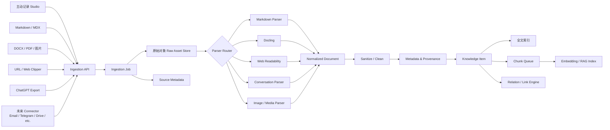

# 灵脑 / Luma：个人数字第二大脑的开源项目与采集架构深度研究

## Executive Summary

**[已核实事实]** 本次研究以 2026 年 11 月 13 日为时间点，重点核验了 Dotstell、AFFiNE、Mimir、Life OS、Blinko、Memos，以及 MDX 方向的 MDMX / MDXEditor。前面讨论中有几项信息需要纠正：Dotstell 目前 GitHub 仅约 **5 Stars**，并不是成熟社区项目；Mimir `mimir-foundation/mimir` 目前也只有约 **5 Stars / 42 commits**，属于非常早期项目；Life OS `karim-coder/life-os` 约 **9 Stars / 41 commits**；而 AFFiNE、Memos、Blinko 分别约有 **74.4k、64.4k、11.2k Stars**，成熟度明显高一个数量级。citeturn279146search0turn475867view0turn963688search3turn803814search9turn504803view3turn504803view2

**[核心判断]** Luma 不适合直接 fork 任一现有项目作为整体底座。你已经确定的技术栈是 **Next.js / React / TypeScript + FastAPI + PostgreSQL + Tiptap + Markdown/MDX**，而现有项目各自只与其中一部分高度重合。最值得采用的是“**组合借鉴而不是整体复用**”：Studio 的交互和信息架构参考 AFFiNE / Memos；Markdown 导入与知识关系参考 Dotstell；采集流水线、RAG 和连接器体系重点参考 Mimir；MDX 的受控组件模型重点研究 MDMX；快速记录和 AI 检索体验参考 Blinko。AFFiNE 的 BlockSuite、Dotstell 和 Blinko 都存在许可证或架构耦合问题，不建议直接把核心代码搬入 Luma。citeturn250766search0turn317605search0turn475867view0turn330274search3turn250766search8

**[核心判断]** 你已经确认的采集策略——**V1.0 = B：主动记录 + 外部导入；长期 = C：尽可能自动化采集**——技术上非常合理，而且不需要等 AI 才能开始。真正重要的不是先支持十几种文件，而是从 V1.0 就建立统一的 `Source → Ingestion Job → Parser → Normalized Document → Knowledge Item → Index` 管道。Mimir 已经证明“所有入口先统一进入采集管线”是可行模式，其 7 阶段流程为 normalize、chunk、extract、embed、link、synthesize、index，且各阶段设计成可重跑；这与 Luma 从 B 平滑演进到 C 的需求高度吻合。citeturn475867view0

**[建议]** V1.0 导入优先级应调整为：**Markdown → 图片/附件 → 网页链接 → ChatGPT 官方导出 JSON → DOCX → PDF**。Markdown、图片和网页剪藏成本较低；ChatGPT 官方导出已经明确包含 `conversations.json` 或分片 conversation JSON，因此可以做稳定的专用 importer；DOCX 和 PDF 则应当视为“文档解析任务”，而不是简单上传功能。OpenAI 官方文档确认个人账户导出 ZIP 中存在聊天记录，且大型导出可能产生编号 JSON 文件，因此 ChatGPT 对话导入完全具有现实可行性。citeturn560563search0turn560563search1

**[建议]** MDX 应该进入 Luma 的能力规划，但不要把“任意 MDX / JSX 执行”作为 V1.0 要求。MDMX 的做法更适合 Luma：只允许注册过的 React 组件、JSON 类型 props，禁止 import/export、任意表达式和原始 HTML，从而获得近似 MDX 的表达能力，同时大幅降低安全风险。MDMX 当前仍是极早期项目，GitHub 页面显示 **0 Stars、84 commits**，因此更适合研究其规范和编辑模型，而不是作为关键生产依赖。citeturn504803view1turn330274search3

## 开源项目核验与比较

### Dotstell

| 项目 | 核验结果 |
|---|---|
| 项目名 | Dotstell |
| 仓库地址 | [dotstell/dotstell](https://github.com/dotstell/dotstell) |
| 最新 commit 日期 | **未核实**；GitHub 当前页面未返回具体日期，仓库有约 **712 commits**。citeturn279146search0 |
| Stars | **5**。citeturn279146search0 |
| 主要功能 | 富文本笔记、Notebook、任务、人物、书签、wikilink/backlink、知识图谱、AI Chat/Writing、语义搜索、MCP、会议转录、语音输入、导入导出。citeturn317605search0 |
| 技术栈 | Next.js、React/TypeScript、Tiptap、Supabase/PostgreSQL、React Flow；仓库还含 Tauri 桌面端。citeturn279146search0 |
| 架构成熟度 | **实验 / 早期**。功能面广，但 Star、Fork、Issue 数和项目规模表明社区仍很小。此为判断。citeturn279146search0 |
| 部署复杂度 | **中**：官方描述为自建 Supabase + Node.js Host。citeturn279146search0 |
| 许可证 | **AGPL-3.0**。网络提供修改版服务时，AGPL 对对应源码公开有额外义务。citeturn362328search0turn131816search0 |
| Markdown / MDX | Markdown：**支持导入/导出**；MDX：**未核实**。citeturn317605search0 |
| MD / DOCX / PDF / 图片导入 | MD：支持；DOCX：未核实；PDF：README 明确 PDF **导出**，未核实 PDF 导入；图片可在富文本中使用，但“批量图片文档导入”未核实。citeturn317605search0 |
| 网页剪藏 | 支持 Smart Bookmark：保存 URL 并抓 title、description、favicon，也支持浏览器书签批量导入；正文级网页剪藏未核实。citeturn317605search0 |
| ChatGPT/对话导入 | ChatGPT 导出专用 importer：**未核实**；会议 transcript `.vtt/.srt/.txt` 支持。citeturn317605search0 |
| 与 Luma 匹配度 | **借鉴设计 + 局部研究，不建议直接复用主体代码** |
| 关键风险 | AGPL；项目年轻；与 Supabase 强绑定；功能范围已很宽，搬代码容易把 Luma 架构拖向其既有模型。 |
| 优先研究建议 | **高**：重点看 Tiptap 笔记、wikilink/backlink、import/export、source metadata、MCP，不建议 fork 整仓库。 |

**[判断]** Dotstell 是本轮研究中**产品概念与 Luma 最接近**的项目之一，但不是当前最成熟的实现。它最有价值的是“笔记 + 人 + 任务 + 书签 + 图谱 + AI”统一实体关系思路，以及 Markdown 导入时保留 notebook、tag、日期和 wikilink 的能力。citeturn317605search0

### AFFiNE

| 项目 | 核验结果 |
|---|---|
| 项目名 | AFFiNE |
| 仓库地址 | [toeverything/AFFiNE](https://github.com/toeverything/AFFiNE) |
| 最新 commit 日期 | GitHub 组织页显示仓库 **Updated Nov 11, 2026**；严格的“最后一个 commit 时间戳”本次抓取未返回，因此按“最近仓库更新”记录。citeturn963688search1 |
| Stars | 约 **74.4k**。citeturn803814search9 |
| 主要功能 | Block 文档、Page / Edgeless 双模式、数据库/集合、双向引用、本地/自托管、协作型知识工作区。citeturn250766search1turn250766search2 |
| 技术栈 | TypeScript 为主；AFFiNE 自有 BlockSuite 编辑技术栈；仓库同时包含 Rust/native、后端等复杂模块。citeturn963688search1turn803814search7 |
| 架构成熟度 | **成熟**：大型代码库、高活跃度、大量 commits/issues/PR。citeturn963688search1 |
| 部署复杂度 | **高**：完整产品远大于单人笔记系统；官方支持 self-host。citeturn250766search3 |
| 许可证 | **需要特别注意：不是一句“纯 MIT”就能概括。** 根 LICENSE 表示大多数代码 MIT，但 `packages/backend` 与 `packages/common/native` 有单独许可；部分 CE/client 代码还涉及 MPL-2.0，Enterprise 部分有专有 EE License。citeturn803814search0turn803814search4turn803814search5 |
| Markdown / MDX | Markdown import/export：支持；MDX：未核实。BlockSuite 有 Markdown adapter。citeturn250766search0 |
| MD / DOCX / PDF / 图片导入 | Markdown：支持；历史官方资料确认 Notion/HTML/Markdown import；PDF 是明确 export；当前 DOCX import 未在本次官方文档中核实。AFFiNE 组织内确有 `docx-parser` 与 `pdf-extract` fork，但这不能等同于产品正式支持。citeturn250766search4turn963688search1 |
| 网页剪藏 | 官方核心文档中未核实原生 web clipper。 |
| ChatGPT/对话导入 | 未核实。 |
| 与 Luma 匹配度 | **主要借鉴设计 / 编辑器架构，少量代码谨慎复用** |
| 关键风险 | 代码库过重；编辑器与 CRDT/BlockSuite 生态耦合；许可证多层；与 Tiptap 路线不同。 |
| 优先研究建议 | **高**：研究 Studio 信息架构、block model、adapter 层，不建议把 BlockSuite 替换 Tiptap。 |

**[重要纠正]** 之前把 AFFiNE 简单描述为“Community Edition MIT”是不完整的。AFFiNE README 的确称 Community Edition 可免费 self-host，并提及 MIT，但仓库 LICENSE 又明确对特定目录和 Enterprise 部分设置了不同许可，BlockSuite 独立仓库则是 MPL-2.0。实际复制文件前必须按目录逐个确认。citeturn803814search0turn803814search4turn803814search6turn803814search7

### Mimir

| 项目 | 核验结果 |
|---|---|
| 项目名 | Mimir |
| 仓库地址 | [mimir-foundation/mimir](https://github.com/mimir-foundation/mimir) |
| 最新 commit 日期 | **未核实**；GitHub 页面可核实约 **42 commits**，但本次抓取未暴露最后 commit 日期。citeturn475867view0 |
| Stars | **5**。citeturn504803view0 |
| 主要功能 | Telegram/Mattermost/Email/Chrome/File Drop/Voice/API 采集；7 阶段处理管线；混合搜索；RAG；图谱；主动 resurfacing；自动 taxonomy；MCP。citeturn317605search1 |
| 技术栈 | Python 3.12+、FastAPI、React 19 + TypeScript + Vite、SQLite/FTS5、ChromaDB、Ollama、APScheduler、Docker Compose。citeturn475867view0 |
| 架构成熟度 | **实验**，但设计完整度较高；代码量和社区仍很早期。citeturn475867view0 |
| 部署复杂度 | **中到高**：Docker Compose；本地 Ollama 默认方案需要额外模型资源，README 写明本地 preset 首次拉取约 5 GB 模型且建议 8 GB+ RAM。citeturn475867view0 |
| 许可证 | **MIT**。citeturn504803view0 |
| Markdown / MDX | Markdown export 明确支持；MDX 未核实。citeturn317605search1 |
| MD / DOCX / PDF / 图片导入 | 提供通用 `/file`、File Drop、Telegram 文件/照片入口；**具体 PDF/DOCX parser 能力未在 mimir-foundation README 中逐项核实**，不得把其他名为 Mimir 的项目能力混为一谈。citeturn317605search1 |
| 网页剪藏 | **支持** URL capture + Chrome extension，Telegram URL 也会 fetch page。citeturn317605search1 |
| ChatGPT/对话导入 | 专用 ChatGPT importer：未核实。 |
| 与 Luma 匹配度 | **架构直接借鉴；部分 Python pipeline 代码可评估复用** |
| 关键风险 | 极早期；SQLite/Chroma 与 Luma PostgreSQL 路线不同；自动 taxonomy/agent 很激进，V1.0 不宜照搬。 |
| 优先研究建议 | **最高**：重点阅读 `capture/processing/search` 三层和幂等重跑逻辑。 |

**[判断]** 如果只选一个项目研究“B 如何进化到 C”，我会选 Mimir。它最值得借鉴的不是 UI，而是**入口与处理分离**：Telegram、Email、网页、文件、语音最终都走同一 capture API 和 processing pipeline。citeturn475867view0turn317605search1

### Life OS

| 项目 | 核验结果 |
|---|---|
| 项目名 | Life OS |
| 仓库地址 | [karim-coder/life-os](https://github.com/karim-coder/life-os) |
| 最新 commit 日期 | **未核实**；GitHub 当前结果显示约 **41 commits**。citeturn963688search3 |
| Stars | **9**。citeturn963688search3 |
| 主要功能 | 17 类人生对象、双向连接、Brain Graph、8 个 life domains、任务/日记/习惯/财务/联系人/书影音、Calendar、Quick Capture、AI Inbox Processing。citeturn279146search4 |
| 技术栈 | Next.js 16、TypeScript、Tailwind、Prisma；README 提供数据库配置说明。citeturn279146search4turn335814search1 |
| 架构成熟度 | **实验** |
| 部署复杂度 | **中**：Docker/Compose 文件存在，也支持 Vercel 类部署。citeturn963688search3 |
| 许可证 | **MIT**。citeturn362328search1turn362328search2 |
| Markdown / MDX | Rich Journal/WYSIWYG 有核实；Markdown/MDX 作为核心内容格式未核实。 |
| MD / DOCX / PDF / 图片导入 | 未核实；README 重点是 JSON backup/restore，而非通用文档 ingestion。citeturn279146search4 |
| 网页剪藏 | 未核实。 |
| ChatGPT/对话导入 | 未核实。 |
| 与 Luma 匹配度 | **仅研究产品模型，不建议直接复用核心架构** |
| 关键风险 | 项目非常早期；功能跨度过大；预设“8 人生领域/17 类型”与 Luma 希望保持动态分类的方向存在冲突。 |
| 优先研究建议 | **中**：研究 Quick Capture、Inbox、跨人生领域关系；不要照搬类型体系。 |

**[判断]** Life OS 最大价值不是代码，而是验证了“第二大脑不应该只覆盖工作”这个产品方向。但它把人生领域和对象类型预设得较重，Luma 更适合保留开放 schema。citeturn279146search4

### Blinko

| 项目 | 核验结果 |
|---|---|
| 项目名 | Blinko |
| 仓库地址 | [blinkospace/blinko](https://github.com/blinkospace/blinko) |
| 最新 commit 日期 | GitHub 组织页显示 **Updated Aug 27, 2026**；本次无法确认这是否恰好等于主分支最后 commit 日期。citeturn330274search0 |
| Stars | 约 **11.2k**。citeturn504803view2 |
| 主要功能 | 快速卡片记录、Markdown、RAG 自然语言检索、AI、self-host、跨平台/Tauri。citeturn250766search8 |
| 技术栈 | TypeScript；仓库 topics 明确 Next.js、React、Postgres；Prisma/server/app 均在 monorepo 中。citeturn504803view2 |
| 架构成熟度 | **中等偏成熟**：2,100+ commits、11k+ Stars，但当前仍有大量 issue/PR。citeturn504803view2 |
| 部署复杂度 | **中**：官方提供 Docker 一键部署。citeturn330274search1 |
| 许可证 | **GPL-3.0**。citeturn504803view2turn131816search1 |
| Markdown / MDX | Markdown：明确支持；MDX：未核实。citeturn250766search8 |
| MD / DOCX / PDF / 图片导入 | Markdown 能力明确；具体通用 importer 支持项在本次官方资料中未充分核实。 |
| 网页剪藏 | 主仓库官方 README 未明确原生 clipper；社区有 Blinko Extension，可提取整页、选区、图片并发回 Blinko，但这是第三方仓库，不能视为核心官方能力。citeturn250766search9 |
| ChatGPT/对话导入 | 未核实。 |
| 与 Luma 匹配度 | **借鉴 UI/RAG，不建议直接复制 GPL 核心代码** |
| 关键风险 | GPL-3.0 对分发衍生作品有 copyleft 义务；整体后端不是 FastAPI；AI/RAG 与业务代码高度集成的可能性需源码审阅。 |
| 优先研究建议 | **高**：研究快速记录、RAG UX、Postgres 数据结构；代码复用前先做许可证审查。 |

### Memos

| 项目 | 核验结果 |
|---|---|
| 项目名 | Memos |
| 仓库地址 | [usememos/memos](https://github.com/usememos/memos) |
| 最新 commit 日期 | 组织页显示 **Updated Nov 11, 2026**；最新版 26.11.0 于 2026-11-01 发布。citeturn330274search6turn330274search7 |
| Stars | 约 **64.4k**。citeturn504803view3 |
| 主要功能 | Markdown memo、时间线、标签、隐私/分享、自托管、附件、API、MCP、Web Clipper。citeturn330274search2turn317605search2 |
| 技术栈 | Go 后端 + React/TypeScript Web；默认自托管可用 SQLite。citeturn504803view3 |
| 架构成熟度 | **成熟**：约 4,945 commits、64k+ Stars、稳定发行和完整文档。citeturn504803view3turn330274search7 |
| 部署复杂度 | **低**：官方单 Docker container 即可启动，也支持 Compose/Kubernetes/binary。citeturn330274search2 |
| 许可证 | **MIT**。citeturn504803view3turn131816search2 |
| Markdown / MDX | Markdown：完整支持；MDX：未核实。citeturn317605search2 |
| MD / DOCX / PDF / 图片导入 | 当前原生 export/import 主要是 **Memos 自己的 Markdown+JSON ZIP 格式**；PDF/DOCX 可作为附件，但附件 ≠ 内容解析。图片可直接粘贴/拖拽/上传。citeturn317605search3turn317605search4 |
| 网页剪藏 | **明确支持官方 Web Clipper**：网页、选区、图片转 Markdown，并保留来源 URL。citeturn250766search11 |
| ChatGPT/对话导入 | 未核实。 |
| 与 Luma 匹配度 | **强烈建议借鉴设计；Web Clipper 可重点研究；主体代码不直接复用** |
| 关键风险 | Go 后端与 Luma FastAPI 不同；产品模型偏 memo/timeline，而不是复杂知识对象；Markdown editor 与 Luma Tiptap/MDX 路线不同。 |
| 优先研究建议 | **最高**：重点研究 Quick Capture、附件权限、Web Clipper、export/import、来源链接。 |

### MDMX / MDXEditor

| 项目 | 核验结果 |
|---|---|
| 项目名 | MDMX；补充参考 MDXEditor |
| 仓库地址 | [kaziridwan/mdmx](https://github.com/kaziridwan/mdmx)；[mdx-editor/editor](https://github.com/mdx-editor/editor) |
| 最新 commit 日期 | MDMX：本次未核实具体最后 commit 日期；84 commits。MDXEditor 组织页显示 **Updated Nov 2, 2026**，最近 release 4.3.4 为 2026-10-27。citeturn504803view1turn330274search5turn335814search28 |
| Stars | MDMX：**0**；MDXEditor：约 **3.7k**。citeturn504803view1turn330274search5 |
| 主要功能 | MDMX：Next.js 内嵌视觉 CMS、ProseMirror、MDX 子集、React 组件 block、源码/视觉双向同步；MDXEditor：React Markdown 富文本编辑并支持 JSX component editing。citeturn330274search3turn330274search4 |
| 技术栈 | React/TypeScript/Next.js；MDMX 使用 ProseMirror；MDXEditor 基于 React/Lexical 生态。citeturn330274search3turn330274search4 |
| 架构成熟度 | MDMX：**实验**；MDXEditor：**中等**。 |
| 部署复杂度 | MDMX：中；MDXEditor 作为组件：低到中。 |
| 许可证 | 两者均 **MIT**。citeturn362328search3turn330274search4 |
| Markdown / MDX | 两者均重点支持；MDMX 是受限 MDX 方言，MDXEditor 支持 Markdown + JSX 扩展。citeturn330274search3turn330274search4 |
| MD / DOCX / PDF / 图片导入 | 重点不是 Office/PDF importer；未核实 DOCX/PDF ingestion。 |
| 网页剪藏 | 未核实。 |
| ChatGPT/对话导入 | 未核实。 |
| 与 Luma 匹配度 | **编辑器/MDX 模型重点研究；不建议整体采用 MDMX；MDXEditor 可做 POC 对比** |
| 关键风险 | Luma 已选 Tiptap，MDMX 是 ProseMirror 但有自己的 schema；MDXEditor 是另一套编辑器体系；强行混合可能带来双编辑状态和 AST 转换复杂度。 |
| 优先研究建议 | **高**：复制“受控组件白名单”思想，不复制整套 CMS。 |

**[建议]** 对 Luma 来说，MDX 更适合作为**一种受控内容表示层/发布层**，而不是第三种完全独立编辑器。即：Tiptap 是主编辑体验；Markdown 是可迁移文本格式；MDX 则针对少量高级页面/文章启用安全组件节点。

## 对 Luma 技术栈的复用评估

Luma 当前目标栈是 **Next.js / React / TypeScript + FastAPI + PostgreSQL + Tiptap + Markdown/MDX**。基于此约束，复用价值可以更明确地拆开：

| 项目 | 代码直接复用 | 架构借鉴 | 编辑器/组件 | 导入导出 | AI/RAG | 结论 |
|---|---:|---:|---:|---:|---:|---|
| Dotstell | 低 | 高 | 高 | 高 | 中高 | **研究源码，不 fork** |
| AFFiNE | 低 | 很高 | 中 | 高 | 中 | **借鉴产品/adapter，不换 BlockSuite** |
| Mimir | 中 | 很高 | 低 | 高 | 很高 | **最值得拆模块研究** |
| Life OS | 低 | 中 | 中 | 低 | 低中 | **产品研究** |
| Blinko | 低 | 高 | 中 | 中 | 高 | **RAG/快速记录参考** |
| Memos | 低 | 很高 | 中 | 高 | 中 | **Capture/Web Clipper 优先参考** |
| MDMX | 中 | 高 | 很高 | 中 | 低 | **MDX schema/serializer 重点参考** |

**代码复用方面，[建议]** 优先只复制或移植 **MIT 许可且边界清晰的小模块**。Mimir 的 FastAPI capture/pipeline 思路与 Luma 后端最接近，但其 SQLite + ChromaDB 应替换成 PostgreSQL，并优先考虑 PostgreSQL 全文检索 + pgvector，以减少个人部署服务数量。Mimir 明确选择 SQLite/Chroma 是为了单用户零配置，而不是因为这套存储是 RAG 的唯一正确方案。citeturn475867view0

**编辑器方面，[建议]** 保持 Tiptap，不要因为 AFFiNE/MDMX 很优秀就更换编辑器。Dotstell 已经证明 Tiptap 可以承载复杂个人知识编辑器；AFFiNE 的 BlockSuite transformer/adapter 思想值得复制，即内部 canonical schema 与 Markdown/HTML 等交换格式解耦。citeturn279146search0turn250766search0

**MDX 方面，[建议]** 为 Luma 定义一个类似 MDMX 的 `LumaMDX` 子集：只允许 `Callout`、`Gallery`、`CodeDemo`、`Mermaid`、`Timeline` 等注册组件；props 必须 JSON-safe；禁止 import/export、函数、任意表达式和未注册 JSX。MDMX 已经用白名单 AST、JSON props、禁用表达式/Raw HTML 的方式验证了这一思路。citeturn330274search3

**Web Clipper 方面，[建议]** 不必复制 Memos 整个扩展。Memos 已经展示了理想产品行为：提取正文/选区/图片 → 转 Markdown → 带 URL、title、description → 用户预览 → 选择 visibility → 保存。底层可以直接组合 Mozilla Readability + Turndown；Readability 输出标题、正文 HTML、纯文本、作者、站点、发布时间等信息，Turndown 负责 HTML → Markdown。Mozilla 官方同时提醒，对不可信 HTML 必须额外做 sanitizer/CSP。citeturn250766search11turn871017search4turn871017search5

## V1.0 外部导入能力的现实性

### 导入能力优先级

| 能力 | 实现难度 | V1.0 建议 | 现成基础 | 核心风险 |
|---|---|---|---|---|
| Markdown | **低** | P0 | remark/markdown parser、Dotstell/AFFiNE 模式 | frontmatter、附件路径、wikilink |
| 图片/附件 | **低** | P0 | S3/本地文件、Tiptap image node | EXIF 隐私、容量、访问权限 |
| 网页链接/剪藏 | **中** | P0/P1 | Readability + Turndown；Memos clipper | 动态页面、版权、SSRF/XSS |
| ChatGPT 对话导入 | **中** | P1 | 官方 `conversations.json` | 数据格式演进、附件、隐私 |
| DOCX | **中** | P1 | Docling / Mammoth | 样式损失、表格、图片 |
| PDF | **中高** | P1 | Docling | reading order、扫描件、OCR、表格 |
| 任意自动连接器 | **高** | V1.x/C | Mimir connector pattern | OAuth、速率限制、增量同步 |

### Markdown

**[已核实事实]** Dotstell 可以从 Obsidian、Notion、Bear、Joplin、Logseq 等来源导入 Markdown，并保留 notebook、tag、日期和 wikilink；AFFiNE 的 adapter 设计也明确支持 Markdown 与内部 block snapshot 之间双向转换。citeturn317605search0turn250766search0

**[建议]** Luma V1.0 Markdown importer 不要只做“读取字符串”。应支持：

`ZIP / .md → frontmatter → body AST → assets → links → normalized document`

至少保留 `source_filename`、`source_path`、`original_created_at`、`original_updated_at`、`import_batch_id`、`checksum`、`original_content`。

### DOCX

**[已核实事实]** Docling 当前官方支持 DOCX，并能输出统一结构、Markdown、HTML、JSON 和 RAG chunks；Mammoth 能将 DOCX 转成相对干净的语义 HTML，支持标题、列表、表格、图片、链接、脚注等，但官方明确提醒复杂 Word 布局无法完美还原，并且 Mammoth 自身不负责 sanitization。citeturn871017search1turn871017search2turn871017search3

**[建议]** 对 Luma，优先用 **Docling 作为统一文档解析层**，Mammoth 作为轻量备选。不要自己手写 `.docx` XML parser。

### PDF

**[已核实事实]** Docling 已明确支持 PDF 的 layout、reading order、table structure、code、formula、image classification，并可直接输出 Markdown 或 chunk JSON，这比单纯 `pypdf.extract_text()` 更适合未来 RAG。citeturn871017search1turn871017search2

**[判断]** PDF 是 V1.0 最容易被低估的功能。文本型 PDF 很简单，扫描 PDF、双栏论文、复杂表格、公式和图片 PDF 会立刻把问题升级成 document understanding。因此产品上应该明确区分：

`上传附件` ≠ `成功解析为知识`

建议状态至少有：`uploaded / parsing / parsed / partial / failed / needs_review`。

### 图片与附件

**[已核实事实]** Memos 对附件处理已经形成非常成熟的参考：图片可 paste/drag/upload，非图片保持 attachment；附件遵循 memo 的访问规则；可保留媒体元数据，但官方特别提醒地理位置、拍摄时间等 metadata 可能泄露隐私。citeturn317605search3

**[建议]** Luma V1.0 图片先做到“安全保存 + 预览 + 元数据记录”。OCR、图像理解和自动标签可以以后进入 C 阶段，不要阻塞第一版。

### 网页链接与 Web Clipper

**[已核实事实]** Memos 官方 Web Clipper 可以把网页、选区、图片转换成 Markdown，并保留 source URL；Mozilla Readability 能提取文章的 title、content、text、excerpt、byline、siteName、language 和 publishedTime；Turndown 可将 HTML 转成 Markdown。citeturn250766search11turn871017search4turn871017search5

**[建议]** V1.0 可以先不开发浏览器扩展，先做：

`粘贴 URL → 服务端抓取 → Readability → sanitizer → Turndown → 预览 → 保存`

随后 C 阶段再增加 Chrome Extension，用相同 API 接口。

服务端抓 URL 必须防 **SSRF**：禁止 localhost、私网 IP、metadata endpoints、非 http/https scheme；限制重定向、响应大小和下载时间。

### ChatGPT 对话导入

**[已核实事实]** OpenAI 官方目前允许符合条件的个人账户导出数据；导出的 ZIP 包含聊天历史，官方迁移说明明确指出文件中存在 `conversations.json`，大型导出可能拆成多个编号 JSON 文件。citeturn560563search0turn560563search1

因此 **ChatGPT 对话导入是 V1.0/B 阶段完全现实的功能**。

**[建议]** 不要把整份 `conversations.json` 当成一篇巨型笔记。应解析为：

`Conversation → Message[] → Attachments[] → Metadata`

然后允许两种导入方式：

`原始归档模式`：完整保留角色、时间、message tree、原始 JSON。

`知识提炼模式`：AI 后处理生成摘要、主题、关键结论、行动项，但原始对话永远保留并可追溯。

隐私上必须默认 **Private**。ChatGPT 导出可能包含大量身份、工作、健康、账号和私人上下文；OpenAI 官方也提醒导出文件包含敏感账户信息，应妥善保护。citeturn560563search0

## 从 B 演进到 C 的采集架构

**[建议]** Luma 最重要的架构决策不是某个 parser，而是建立稳定的 **Ingestion Contract**。



Mimir 的 7 阶段 pipeline 采用“每一阶段可独立重跑”的原则，非常适合 Luma 借鉴；Luma 可以把它简化为 `normalize → enrich → chunk → index`，V1.0 甚至可以先不运行 embedding，但**数据管线接口必须提前存在**。citeturn475867view0

建议核心数据模型至少包含：

```text
Source
- id
- kind              # manual / file / url / chatgpt / connector
- external_id
- external_url
- connector_id
- original_created_at
- original_updated_at
- imported_at
- checksum
- sync_cursor
- privacy_scope

RawAsset
- id
- source_id
- mime_type
- storage_key
- sha256
- size
- metadata

IngestionJob
- id
- source_id
- parser_version
- status
- attempt
- error_code
- error_message

Document
- id
- source_id
- canonical_format
- title
- content
- metadata
- version

Chunk
- id
- document_id
- content
- position
- content_hash
- embedding_version
```

**[建议]** 这套模型能解决从 B 到 C 最大的问题：未来增加 Google Drive、Email、Telegram、浏览器扩展时，新增的只是 `ConnectorAdapter`，而不是再造一套知识保存流程。

连接器建议统一接口：

```text
authenticate()
list_changes(cursor)
fetch_item(external_id)
normalize_metadata()
download_assets()
acknowledge(cursor)
revoke()
```

增量同步必须依赖 `external_id + external_updated_at + checksum`，避免每次同步全量重建。删除则使用 tombstone，不应一发现外部删除就立即物理删除本地知识。

**[建议]** 索引更新也要独立于内容保存：PostgreSQL 事务先保存 canonical document，再投递 `index_job`。修改内容时，只重新生成 content hash 变化的 chunks；删除时按 document_id 清除向量和全文索引。这样未来 AI 模型、embedding 模型升级也可以离线重新索引，不影响原始数据。

对于个人部署，不必一开始上 Kafka/RabbitMQ。FastAPI + PostgreSQL jobs table + 一个 worker 足够；等自动化采集增加后再考虑 Redis/任务队列。

## 许可证风险与合规建议

**[已核实事实]** MIT 是最宽松的一类许可证之一，主要要求保留版权和许可证声明，可以在闭源大型作品中使用；Apache-2.0 同样允许闭源组合，并额外提供明确专利授权与 NOTICE/修改声明要求。citeturn131816search2turn131816search3

**[已核实事实]** GPL-3.0 是强 copyleft：当你分发衍生程序时，需要在 GPL 条件下提供对应源码；AGPL-3.0 更进一步，修改后的程序如果通过网络向用户提供服务，也触发向网络用户提供对应源码的要求。citeturn131816search1turn131816search0

因此对 Luma：

| 许可证 | 私人自托管 | 闭源未来产品 | Luma 建议 |
|---|---|---|---|
| MIT | 通常低风险 | 通常低风险 | **优先复用** |
| Apache-2.0 | 通常低风险 | 通常低风险 | **优先复用，保留 NOTICE/专利条款** |
| MPL-2.0 | 可用 | 文件级 copyleft，需要边界管理 | **可依赖，谨慎修改源文件** |
| GPL-3.0 | 个人本地使用通常问题小 | 分发衍生产品风险高 | **尽量不复制核心代码** |
| AGPL-3.0 | 个人本地使用通常问题小 | 网络服务尤其敏感 | **只研究思想；复制代码前法律确认** |
| 自定义 Enterprise License | 取决于条款 | 高风险 | **默认不复用** |

**[重要建议]** 即使 Luma 目前只是你的个人项目，也不要因为“暂时不商业化”就忽略许可证。如果未来把 Explore 公网部署、开放账户、提供 SaaS 或把代码出售给公司，今天复制进去的 AGPL/GPL 代码会成为历史包袱。

尤其建议：

- Dotstell：**AGPL，默认只阅读/借鉴，不复制源代码**。citeturn362328search0
- Blinko：**GPL，设计和 UX 可以借鉴；代码需谨慎**。citeturn504803view2
- Mimos / Life OS / MDMX / Mimir：MIT，代码边界明确时可以优先考虑复用。citeturn504803view3turn362328search2turn362328search3turn504803view0
- AFFiNE：**按目录逐项确认**，不要把整个仓库默认视为 MIT。citeturn803814search0turn803814search4turn803814search5

本报告不是法律意见。若 Luma 后续闭源商业化、对外提供网络服务、嵌入 GPL/AGPL 代码、链接或修改 MPL 组件，应让熟悉 OSS License 的法律/合规人员确认具体边界。

## 优先级与下一步可执行行动

结合“**B 先落地，C 做长期架构**”这一已确认方向，我建议不要先实现 AI Chat，也不要先造完整 Explore。V1.0 最应该证明的是：**你的真实信息能否低成本进入 Luma，而且进去之后不会丢来源、不会丢结构、未来能被 AI 使用。**

| 优先级 | 可执行行动 | 预估工作量 | 风险 |
|---|---|---:|---|
| **P0** | **先定义统一 Ingestion Domain**：`Source / RawAsset / IngestionJob / Document / Chunk`，PostgreSQL migration + FastAPI API；主动记录也通过同一 domain。 | **2–4 天** | **中**：模型设计错会影响后续所有 importer |
| **P0** | **完成 Markdown + 图片附件 importer**：frontmatter、wikilink、asset path、checksum、导入预览、失败报告、rollback。重点参考 Dotstell/AFFiNE/Memos，而不直接复制 AGPL 代码。citeturn317605search0turn250766search0turn317605search4 | **4–7 天** | **低–中** |
| **P0** | **实现 URL Capture MVP**：Readability + sanitizer + Turndown；保存原 URL、标题、作者、站点、抓取时间、原始 HTML snapshot；暂不开发浏览器扩展。citeturn871017search4turn871017search5 | **3–5 天** | **中**：SSRF、XSS、动态网页 |
| **P1** | **实现 ChatGPT Export importer**：支持 `conversations.json`/分片 JSON；conversation/message/attachment 原样归档，再生成可搜索 Markdown view。citeturn560563search1 | **3–6 天** | **中**：格式演进与隐私 |
| **P1** | **接入 Docling 做 DOCX/PDF 统一解析 POC**：原文件永久保存；Docling JSON 作为 canonical parse result；Markdown 用于展示；chunks 为未来 RAG 准备。citeturn871017search1turn871017search2 | **5–10 天** | **中高**：PDF 复杂布局、资源占用 |

如果这五件事完成，Luma 就已经拥有一个非常关键、而且大多数“Notion 克隆”并没有认真解决的底层能力：**任何知识无论来自你亲自输入、文件、网页还是 AI 对话，都先成为有来源、有原件、有版本、可重新解析、可重新索引的个人数字资产。**

从那个节点开始，C 不再意味着“重写系统做自动同步”，而只是逐渐增加 Telegram、Email、Browser Extension、Cloud Drive 等 Connector；RAG 也不再需要重新设计数据入口，而只是消费已经规范化的 Document/Chunk。这是目前我认为对灵脑最值得坚持的技术边界。